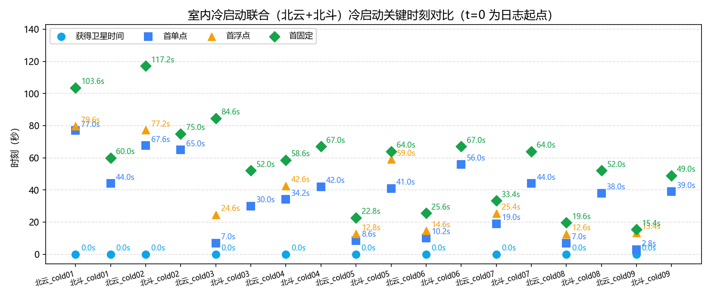
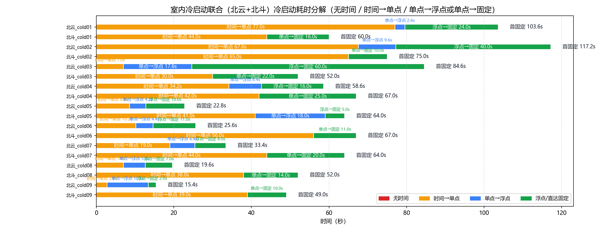

# 室内冷启动联合分析（北云 UG016 + 北斗 UM980）

- 数据源：`北云_cold01`、`北斗_cold01`、`北云_cold02`、`北斗_cold02`、`北云_cold03`、`北斗_cold03`、`北云_cold04`、`北斗_cold04`、`北云_cold05`、`北斗_cold05`、`北云_cold06`、`北斗_cold06`、`北云_cold07`、`北斗_cold07`、`北云_cold08`、`北斗_cold08`、`北云_cold09`、`北斗_cold09`（定位流来源见下表）
- 口径依据：北云科技《UG016 数据通信接口协议》（文本转录：`by_manual\UG016.md`）
- 分析维度：时标状态 / 解算状态 / 定位类型 / 卫星数；本报告不含 INS

## 一、数据完整性与报文构成

| 文件 | 时长 | 定位报文 | 实测周期 | 时标分布(条) | 定位类型分布(条) | 间断/重定标 |
|---|---|---|---|---|---|---|
| `北云_cold01` | 117.0s | BESTGNSSPOSA 586条；0.2s/5.0Hz | `{'COARSE': 454, 'FINESTEERING': 132}` | `{'NONE': 385, 'SINGLE': 16, 'NARROW_FLOAT': 120, 'NARROW_INT': 60, 'PSRDIFF': 5}` | 0 / 0 |
| `北斗_cold01` | 101.0s | BESTNAVA 102条；1.0s/1.0Hz | `{'FINE': 102}` | `{'NONE': 44, 'SINGLE': 11, 'PSRDIFF': 5, 'NARROW_INT': 42}` | 0 / 1 |
| `北云_cold02` | 166.4s | BESTGNSSPOSA 833条；0.2s/5.0Hz | `{'COARSE': 407, 'FINESTEERING': 426}` | `{'NONE': 338, 'SINGLE': 48, 'NARROW_FLOAT': 200, 'NARROW_INT': 239, 'PSRDIFF': 8}` | 0 / 0 |
| `北斗_cold02` | 194.0s | BESTNAVA 195条；1.0s/1.0Hz | `{'FINE': 195}` | `{'NONE': 65, 'SINGLE': 10, 'NARROW_INT': 120}` | 0 / 0 |
| `北云_cold03` | 139.6s | BESTGNSSPOSA 699条；0.2s/5.0Hz | `{'COARSE': 104, 'FINESTEERING': 595}` | `{'NONE': 35, 'SINGLE': 88, 'NARROW_FLOAT': 300, 'NARROW_INT': 268, 'PSRDIFF': 8}` | 0 / 0 |
| `北斗_cold03` | 167.0s | BESTNAVA 168条；1.0s/1.0Hz | `{'FINE': 168}` | `{'NONE': 30, 'SINGLE': 17, 'PSRDIFF': 5, 'NARROW_INT': 116}` | 0 / 0 |
| `北云_cold04` | 195.6s | BESTGNSSPOSA 979条；0.2s/5.0Hz | `{'COARSE': 239, 'FINESTEERING': 740}` | `{'NONE': 171, 'SINGLE': 42, 'NARROW_FLOAT': 80, 'NARROW_INT': 678, 'PSRDIFF': 8}` | 0 / 0 |
| `北斗_cold04` | 224.0s | BESTNAVA 225条；1.0s/1.0Hz | `{'FINE': 225}` | `{'NONE': 42, 'SINGLE': 10, 'PSRDIFF': 15, 'NARROW_INT': 158}` | 0 / 0 |
| `北云_cold05` | 106.6s | BESTGNSSPOSA 534条；0.2s/5.0Hz | `{'COARSE': 200, 'FINESTEERING': 334}` | `{'NONE': 43, 'SINGLE': 21, 'NARROW_FLOAT': 50, 'NARROW_INT': 412, 'PSRDIFF': 8}` | 0 / 0 |
| `北斗_cold05` | 144.0s | BESTNAVA 145条；1.0s/1.0Hz | `{'FINE': 145}` | `{'NONE': 41, 'SINGLE': 6, 'PSRDIFF': 12, 'NARROW_FLOAT': 5, 'NARROW_INT': 81}` | 0 / 0 |
| `北云_cold06` | 158.6s | BESTGNSSPOSA 794条；0.2s/5.0Hz | `{'COARSE': 139, 'FINESTEERING': 655}` | `{'NONE': 51, 'SINGLE': 22, 'NARROW_FLOAT': 55, 'NARROW_INT': 658, 'PSRDIFF': 8}` | 0 / 0 |
| `北斗_cold06` | 203.0s | BESTNAVA 204条；1.0s/1.0Hz | `{'FINE': 204}` | `{'NONE': 56, 'SINGLE': 3, 'PSRDIFF': 8, 'NARROW_INT': 137}` | 0 / 0 |
| `北云_cold07` | 174.4s | BESTGNSSPOSA 873条；0.2s/5.0Hz | `{'COARSE': 193, 'FINESTEERING': 680}` | `{'NONE': 95, 'SINGLE': 32, 'NARROW_FLOAT': 40, 'NARROW_INT': 699, 'PSRDIFF': 7}` | 0 / 0 |
| `北斗_cold07` | 201.0s | BESTNAVA 202条；1.0s/1.0Hz | `{'FINE': 202}` | `{'NONE': 44, 'SINGLE': 5, 'PSRDIFF': 15, 'NARROW_INT': 138}` | 0 / 0 |
| `北云_cold08` | 145.2s | BESTGNSSPOSA 727条；0.2s/5.0Hz | `{'COARSE': 94, 'FINESTEERING': 633}` | `{'NONE': 35, 'SINGLE': 28, 'NARROW_FLOAT': 35, 'NARROW_INT': 622, 'PSRDIFF': 7}` | 0 / 0 |
| `北斗_cold08` | 181.0s | BESTNAVA 182条；1.0s/1.0Hz | `{'FINE': 182}` | `{'NONE': 38, 'SINGLE': 9, 'PSRDIFF': 5, 'NARROW_INT': 130}` | 0 / 0 |
| `北云_cold09` | 175.0s | BESTGNSSPOSA 876条；0.2s/5.0Hz | `{'COARSE': 108, 'FINESTEERING': 768}` | `{'NONE': 14, 'SINGLE': 53, 'NARROW_FLOAT': 10, 'NARROW_INT': 799}` | 0 / 0 |
| `北斗_cold09` | 216.0s | BESTNAVA 217条；1.0s/1.0Hz | `{'FINE': 217}` | `{'NONE': 39, 'SINGLE': 8, 'PSRDIFF': 2, 'NARROW_INT': 168}` | 0 / 0 |

> 口径（UG016）：报文按行做 CRC 校验（`#` 开头为 32 位 CRC，`$` 开头为 NMEA 异或）；`$KSXT` 为自定义 8 位 CRC32 私有报文，按 NMEA 异或校验判失败属正常、非故障。卫星维度口径：#SVs=跟踪卫星数、#solnSVs=参与解算卫星数、#solnMultiSVs=参与解算的多频卫星数。

### 报文完整性与周期（按报头时间戳逐帧判定）

| 文件 | 帧数 | 实测周期 | 标称频率 | CRC失败行 | 真实间断 | 周重定标 |
|---|---|---|---|---|---|---|
| `北云_cold01` | 586 | 0.2s | 5.0Hz | 0 | 0 | 0 |
| `北斗_cold01` | 102 | 1.0s | 1.0Hz | 0 | 0 | 1 |
| `北云_cold02` | 833 | 0.2s | 5.0Hz | 0 | 0 | 0 |
| `北斗_cold02` | 195 | 1.0s | 1.0Hz | 0 | 0 | 0 |
| `北云_cold03` | 699 | 0.2s | 5.0Hz | 0 | 0 | 0 |
| `北斗_cold03` | 168 | 1.0s | 1.0Hz | 0 | 0 | 0 |
| `北云_cold04` | 979 | 0.2s | 5.0Hz | 0 | 0 | 0 |
| `北斗_cold04` | 225 | 1.0s | 1.0Hz | 0 | 0 | 0 |
| `北云_cold05` | 534 | 0.2s | 5.0Hz | 0 | 0 | 0 |
| `北斗_cold05` | 145 | 1.0s | 1.0Hz | 0 | 0 | 0 |
| `北云_cold06` | 794 | 0.2s | 5.0Hz | 0 | 0 | 0 |
| `北斗_cold06` | 204 | 1.0s | 1.0Hz | 0 | 0 | 0 |
| `北云_cold07` | 873 | 0.2s | 5.0Hz | 0 | 0 | 0 |
| `北斗_cold07` | 202 | 1.0s | 1.0Hz | 0 | 0 | 0 |
| `北云_cold08` | 727 | 0.2s | 5.0Hz | 0 | 0 | 0 |
| `北斗_cold08` | 182 | 1.0s | 1.0Hz | 0 | 0 | 0 |
| `北云_cold09` | 876 | 0.2s | 5.0Hz | 0 | 0 | 0 |
| `北斗_cold09` | 217 | 1.0s | 1.0Hz | 0 | 0 | 0 |

> 实测周期 = 全部相邻帧报头时间差的中位数（不假设）；真实间断 = 相邻帧时间差 > 2.5×实测周期（保留在时间轴中）；周重定标 = 相邻帧时间差 > 3600s（按时间连续处理）。

## 二、四个关键时刻（秒）

| 文件 | 获得卫星时间(脱离UNKNOWN) | COARSE→FINE | 差分改正可用 | 首单点 | 首浮点 | 首固定 | 无解/单点/浮点/固定 占比% | 跟踪星 min/均值/max |
|---|---|---|---|---|---|---|---|---|
| `北云_cold01` | **0.0s** | 0.0s → 90.8s | 78.6s | 77.0s | 79.6s | **103.6s** | 65.7/3.6/20.5/10.2 | 0/21.5/35 |
| `北斗_cold01` | **0.0s** | — → 0.0s | 54.0s | 44.0s | — | **60.0s** | 43.1/15.7/0/41.2 | 2/23.4/37 |
| `北云_cold02` | **0.0s** | 0.0s → 81.4s | 69.2s | 67.6s | 77.2s | **117.2s** | 40.6/6.7/24.0/28.7 | 0/23.3/34 |
| `北斗_cold02` | **—** | — → — | 75.0s | 65.0s | — | **75.0s** | 33.3/5.1/0/61.5 | 0/21.6/37 |
| `北云_cold03` | **0.0s** | 0.0s → 20.8s | 17.4s | 7.0s | 24.6s | **84.6s** | 5.0/13.7/42.9/38.3 | 0/27.5/35 |
| `北斗_cold03` | **—** | — → — | 47.0s | 30.0s | — | **52.0s** | 17.9/13.1/0/69.0 | 0/24.1/38 |
| `北云_cold04` | **0.0s** | 0.0s → 47.8s | 41.6s | 34.2s | 42.6s | **58.6s** | 17.5/5.1/8.2/69.3 | 0/26.1/34 |
| `北斗_cold04` | **—** | — → — | 52.0s | 42.0s | — | **67.0s** | 18.7/11.1/0/70.2 | 0/25.4/39 |
| `北云_cold05` | **0.0s** | 0.0s → 40.0s | 10.0s | 8.6s | 12.8s | **22.8s** | 8.1/5.4/9.4/77.2 | 0/26.2/35 |
| `北斗_cold05` | **—** | — → — | 47.0s | 41.0s | 59.0s | **64.0s** | 28.3/12.4/3.4/55.9 | 0/20.6/36 |
| `北云_cold06` | **0.0s** | 0.0s → 27.8s | 11.6s | 10.2s | 14.6s | **25.6s** | 6.4/3.8/6.9/82.9 | 0/26.7/33 |
| `北斗_cold06` | **—** | — → — | 59.0s | 56.0s | — | **67.0s** | 27.5/5.4/0/67.2 | 0/22.5/36 |
| `北云_cold07` | **0.0s** | 0.0s → 38.6s | 20.4s | 19.0s | 25.4s | **33.4s** | 10.9/4.5/4.6/80.1 | 0/25.8/32 |
| `北斗_cold07` | **—** | — → — | 48.0s | 44.0s | — | **64.0s** | 21.8/9.9/0/68.3 | 0/24.3/37 |
| `北云_cold08` | **0.0s** | 0.0s → 18.8s | 10.6s | 7.0s | 12.6s | **19.6s** | 4.8/4.8/4.8/85.6 | 0/27.6/33 |
| `北斗_cold08` | **—** | — → — | 47.0s | 38.0s | — | **52.0s** | 20.9/7.7/0/71.4 | 0/24.4/37 |
| `北云_cold09` | **0.0s** | 0.0s → 21.6s | 12.0s | 2.8s | 13.4s | **15.4s** | 1.6/6.1/1.1/91.2 | 0/30.4/35 |
| `北斗_cold09` | **—** | — → — | 47.0s | 39.0s | — | **49.0s** | 18.0/4.6/0/77.4 | 0/27.0/39 |

## 三、冷启动耗时分解

### 表1：四阶段严格分解

| 文件 | 无时间 | 时间→单点 | 单点→浮点 | 浮点→固定 | 首固定 | 差分数据可用 |
|---|---|---|---|---|---|---|
| `北云_cold01` | 0.0s | 77.0s | 2.6s | 24.0s | **103.6s** | 78.6s |
| `北斗_cold01` | 0.0s | 44.0s | — | — | **60.0s** | 54.0s |
| `北云_cold02` | 0.0s | 67.6s | 9.6s | 40.0s | **117.2s** | 69.2s |
| `北斗_cold02` | — | 65.0s | — | — | **75.0s** | 75.0s |
| `北云_cold03` | 0.0s | 7.0s | 17.6s | 60.0s | **84.6s** | 17.4s |
| `北斗_cold03` | — | 30.0s | — | — | **52.0s** | 47.0s |
| `北云_cold04` | 0.0s | 34.2s | 8.4s | 16.0s | **58.6s** | 41.6s |
| `北斗_cold04` | — | 42.0s | — | — | **67.0s** | 52.0s |
| `北云_cold05` | 0.0s | 8.6s | 4.2s | 10.0s | **22.8s** | 10.0s |
| `北斗_cold05` | — | 41.0s | 18.0s | 5.0s | **64.0s** | 47.0s |
| `北云_cold06` | 0.0s | 10.2s | 4.4s | 11.0s | **25.6s** | 11.6s |
| `北斗_cold06` | — | 56.0s | — | — | **67.0s** | 59.0s |
| `北云_cold07` | 0.0s | 19.0s | 6.4s | 8.0s | **33.4s** | 20.4s |
| `北斗_cold07` | — | 44.0s | — | — | **64.0s** | 48.0s |
| `北云_cold08` | 0.0s | 7.0s | 5.6s | 7.0s | **19.6s** | 10.6s |
| `北斗_cold08` | — | 38.0s | — | — | **52.0s** | 47.0s |
| `北云_cold09` | 0.0s | 2.8s | 10.6s | 2.0s | **15.4s** | 12.0s |
| `北斗_cold09` | — | 39.0s | — | — | **49.0s** | 47.0s |

### 表2：图示使用的路径汇总（支持无浮点直达固定）

| 文件 | 无时间 | 时间→单点 | 单点→浮点 | 浮点→固定 | 单点→固定 | 合计到首固定 |
|---|---|---|---|---|---|---|
| `北云_cold01` | 0.0s | 77.0s | 2.6s | 24.0s | — | 103.6s |
| `北斗_cold01` | 0.0s | 44.0s | — | — | 16.0s | 60.0s |
| `北云_cold02` | 0.0s | 67.6s | 9.6s | 40.0s | — | 117.19999999999999s |
| `北斗_cold02` | — | 65.0s | — | — | 10.0s | 75.0s |
| `北云_cold03` | 0.0s | 7.0s | 17.6s | 60.0s | — | 84.6s |
| `北斗_cold03` | — | 30.0s | — | — | 22.0s | 52.0s |
| `北云_cold04` | 0.0s | 34.2s | 8.4s | 16.0s | — | 58.6s |
| `北斗_cold04` | — | 42.0s | — | — | 25.0s | 67.0s |
| `北云_cold05` | 0.0s | 8.6s | 4.2s | 10.0s | — | 22.8s |
| `北斗_cold05` | — | 41.0s | 18.0s | 5.0s | — | 64.0s |
| `北云_cold06` | 0.0s | 10.2s | 4.4s | 11.0s | — | 25.6s |
| `北斗_cold06` | — | 56.0s | — | — | 11.0s | 67.0s |
| `北云_cold07` | 0.0s | 19.0s | 6.4s | 8.0s | — | 33.4s |
| `北斗_cold07` | — | 44.0s | — | — | 20.0s | 64.0s |
| `北云_cold08` | 0.0s | 7.0s | 5.6s | 7.0s | — | 19.6s |
| `北斗_cold08` | — | 38.0s | — | — | 14.0s | 52.0s |
| `北云_cold09` | 0.0s | 2.8s | 10.6s | 2.0s | — | 15.399999999999999s |
| `北斗_cold09` | — | 39.0s | — | — | 10.0s | 49.0s |

## 四、定位类型分段统计

### `北云_cold01`

| 定位类型段 | 起–止(s) | 时长(s) | 条数 | 跟踪星 | 解算星 | 多频解算 |
|---|---|---|---|---|---|---|
| NONE | 0.0–76.8 | 77.0 | 385 | 16.9 | 0 | 0 |
| SINGLE | 77.0–79.4 | 2.6 | 13 | 26.9 | 10.1 | 10.1 |
| NARROW_FLOAT | 79.6–103.4 | 24.0 | 120 | 29.2 | 14.2 | 14.2 |
| NARROW_INT | 103.6–115.4 | 12.0 | 60 | 32.7 | 18.1 | 18.1 |
| PSRDIFF | 115.6–116.4 | 1.0 | 5 | 34 | 15.8 | 15.8 |
| SINGLE | 116.6–117.0 | 0.6 | 3 | 27.7 | 9.3 | 9.3 |

### `北斗_cold01`

| 定位类型段 | 起–止(s) | 时长(s) | 条数 | 跟踪星 | 解算星 | 多频解算 |
|---|---|---|---|---|---|---|
| NONE | 0.0–43.0 | 44.0 | 44 | 15.3 | 0 | — |
| SINGLE | 44.0–53.0 | 10.0 | 10 | 23.8 | 9.5 | — |
| PSRDIFF | 54.0–56.0 | 3.0 | 3 | 27 | 10.3 | — |
| SINGLE | 57.0–57.0 | 1.0 | 1 | 26 | 10 | — |
| PSRDIFF | 58.0–59.0 | 2.0 | 2 | 25.5 | 14 | — |
| NARROW_INT | 60.0–101.0 | 42.0 | 42 | 31.4 | 23.1 | — |

### `北云_cold02`

| 定位类型段 | 起–止(s) | 时长(s) | 条数 | 跟踪星 | 解算星 | 多频解算 |
|---|---|---|---|---|---|---|
| NONE | 0.0–67.4 | 67.6 | 338 | 12.3 | 0 | 0 |
| SINGLE | 67.6–77.0 | 9.6 | 48 | 24.2 | 9.9 | 9.9 |
| NARROW_FLOAT | 77.2–117.0 | 40.0 | 200 | 29.9 | 15.1 | 15.1 |
| NARROW_INT | 117.2–164.8 | 47.8 | 239 | 32.9 | 24.9 | 24.9 |
| PSRDIFF | 165.0–166.4 | 1.6 | 8 | 30.1 | 25.8 | 25.8 |

### `北斗_cold02`

| 定位类型段 | 起–止(s) | 时长(s) | 条数 | 跟踪星 | 解算星 | 多频解算 |
|---|---|---|---|---|---|---|
| NONE | 0.0–64.0 | 65.0 | 65 | 4.2 | 0 | — |
| SINGLE | 65.0–74.0 | 10.0 | 10 | 15.8 | 11.2 | — |
| NARROW_INT | 75.0–194.0 | 120.0 | 120 | 31.5 | 26.6 | — |

### `北云_cold03`

| 定位类型段 | 起–止(s) | 时长(s) | 条数 | 跟踪星 | 解算星 | 多频解算 |
|---|---|---|---|---|---|---|
| NONE | 0.0–6.8 | 7.0 | 35 | 10.9 | 0 | 0 |
| SINGLE | 7.0–24.4 | 17.6 | 88 | 16.7 | 10.1 | 10.1 |
| NARROW_FLOAT | 24.6–84.4 | 60.0 | 300 | 26.5 | 15.3 | 15.3 |
| NARROW_INT | 84.6–138.0 | 53.6 | 268 | 34.4 | 28.1 | 28.1 |
| PSRDIFF | 138.2–139.6 | 1.6 | 8 | 30.5 | 24.9 | 24.9 |

### `北斗_cold03`

| 定位类型段 | 起–止(s) | 时长(s) | 条数 | 跟踪星 | 解算星 | 多频解算 |
|---|---|---|---|---|---|---|
| NONE | 0.0–29.0 | 30.0 | 30 | 1.7 | 0 | — |
| SINGLE | 30.0–46.0 | 17.0 | 17 | 12.6 | 8.4 | — |
| PSRDIFF | 47.0–51.0 | 5.0 | 5 | 16.6 | 14.2 | — |
| NARROW_INT | 52.0–167.0 | 116.0 | 116 | 32.0 | 27.7 | — |

### `北云_cold04`

| 定位类型段 | 起–止(s) | 时长(s) | 条数 | 跟踪星 | 解算星 | 多频解算 |
|---|---|---|---|---|---|---|
| NONE | 0.0–34.0 | 34.2 | 171 | 10.7 | 0 | 0 |
| SINGLE | 34.2–42.4 | 8.4 | 42 | 19.8 | 10.9 | 10.9 |
| NARROW_FLOAT | 42.6–58.4 | 16.0 | 80 | 22.9 | 13.1 | 13.1 |
| NARROW_INT | 58.6–194.0 | 135.6 | 678 | 30.7 | 23.2 | 23.2 |
| PSRDIFF | 194.2–195.6 | 1.6 | 8 | 28.1 | 22.9 | 22.9 |

### `北斗_cold04`

| 定位类型段 | 起–止(s) | 时长(s) | 条数 | 跟踪星 | 解算星 | 多频解算 |
|---|---|---|---|---|---|---|
| NONE | 0.0–41.0 | 42.0 | 42 | 1.7 | 0 | — |
| SINGLE | 42.0–51.0 | 10.0 | 10 | 11 | 8.3 | — |
| PSRDIFF | 52.0–66.0 | 15.0 | 15 | 17.1 | 13.3 | — |
| NARROW_INT | 67.0–224.0 | 158.0 | 158 | 33.4 | 28.0 | — |

### `北云_cold05`

| 定位类型段 | 起–止(s) | 时长(s) | 条数 | 跟踪星 | 解算星 | 多频解算 |
|---|---|---|---|---|---|---|
| NONE | 0.0–8.4 | 8.6 | 43 | 8.0 | 0 | 0 |
| SINGLE | 8.6–12.6 | 4.2 | 21 | 14.7 | 11.7 | 11.7 |
| NARROW_FLOAT | 12.8–22.6 | 10.0 | 50 | 19.2 | 17.6 | 17.6 |
| NARROW_INT | 22.8–105.0 | 82.4 | 412 | 29.5 | 23.6 | 23.6 |
| PSRDIFF | 105.2–106.6 | 1.6 | 8 | 28.9 | 21.4 | 21.4 |

### `北斗_cold05`

| 定位类型段 | 起–止(s) | 时长(s) | 条数 | 跟踪星 | 解算星 | 多频解算 |
|---|---|---|---|---|---|---|
| NONE | 0.0–40.0 | 41.0 | 41 | 2.8 | 0 | — |
| SINGLE | 41.0–46.0 | 6.0 | 6 | 14 | 10.7 | — |
| PSRDIFF | 47.0–58.0 | 12.0 | 12 | 15.2 | 9.6 | — |
| NARROW_FLOAT | 59.0–63.0 | 5.0 | 5 | 18.8 | 15.8 | — |
| NARROW_INT | 64.0–144.0 | 81.0 | 81 | 31.0 | 25.7 | — |

### `北云_cold06`

| 定位类型段 | 起–止(s) | 时长(s) | 条数 | 跟踪星 | 解算星 | 多频解算 |
|---|---|---|---|---|---|---|
| NONE | 0.0–10.0 | 10.2 | 51 | 6.6 | 0 | 0 |
| SINGLE | 10.2–14.4 | 4.4 | 22 | 14.7 | 12.2 | 12.2 |
| NARROW_FLOAT | 14.6–25.4 | 11.0 | 55 | 19 | 18 | 18 |
| NARROW_INT | 25.6–157.0 | 131.6 | 658 | 29.4 | 26.2 | 26.2 |
| PSRDIFF | 157.2–158.6 | 1.6 | 8 | 27.2 | 24.9 | 24.9 |

### `北斗_cold06`

| 定位类型段 | 起–止(s) | 时长(s) | 条数 | 跟踪星 | 解算星 | 多频解算 |
|---|---|---|---|---|---|---|
| NONE | 0.0–55.0 | 56.0 | 56 | 2.4 | 0 | — |
| SINGLE | 56.0–58.0 | 3.0 | 3 | 10.7 | 6 | — |
| PSRDIFF | 59.0–66.0 | 8.0 | 8 | 15.1 | 10.4 | — |
| NARROW_INT | 67.0–203.0 | 137.0 | 137 | 31.5 | 27.1 | — |

### `北云_cold07`

| 定位类型段 | 起–止(s) | 时长(s) | 条数 | 跟踪星 | 解算星 | 多频解算 |
|---|---|---|---|---|---|---|
| NONE | 0.0–18.8 | 19.0 | 95 | 5.1 | 0 | 0 |
| SINGLE | 19.0–25.2 | 6.4 | 32 | 18.6 | 14.1 | 14.1 |
| NARROW_FLOAT | 25.4–33.2 | 8.0 | 40 | 22 | 21 | 21 |
| NARROW_INT | 33.4–173.0 | 139.8 | 699 | 29.2 | 27.7 | 27.7 |
| PSRDIFF | 173.2–174.4 | 1.4 | 7 | 27 | 23.9 | 23.9 |

### `北斗_cold07`

| 定位类型段 | 起–止(s) | 时长(s) | 条数 | 跟踪星 | 解算星 | 多频解算 |
|---|---|---|---|---|---|---|
| NONE | 0.0–43.0 | 44.0 | 44 | 2.8 | 0 | — |
| SINGLE | 44.0–47.0 | 4.0 | 4 | 9.2 | 7 | — |
| PSRDIFF | 48.0–53.0 | 6.0 | 6 | 10.7 | 6.5 | — |
| SINGLE | 54.0–54.0 | 1.0 | 1 | 16 | 8 | — |
| PSRDIFF | 55.0–63.0 | 9.0 | 9 | 18.6 | 13.4 | — |
| NARROW_INT | 64.0–201.0 | 138.0 | 138 | 32.7 | 28.6 | — |

### `北云_cold08`

| 定位类型段 | 起–止(s) | 时长(s) | 条数 | 跟踪星 | 解算星 | 多频解算 |
|---|---|---|---|---|---|---|
| NONE | 0.0–6.8 | 7.0 | 35 | 9.1 | 0 | 0 |
| SINGLE | 7.0–12.4 | 5.6 | 28 | 16.4 | 13.2 | 13.2 |
| NARROW_FLOAT | 12.6–19.4 | 7.0 | 35 | 20.2 | 18.2 | 18.2 |
| NARROW_INT | 19.6–143.8 | 124.4 | 622 | 29.5 | 27.6 | 27.6 |
| PSRDIFF | 144.0–145.2 | 1.4 | 7 | 27.7 | 25.9 | 25.9 |

### `北斗_cold08`

| 定位类型段 | 起–止(s) | 时长(s) | 条数 | 跟踪星 | 解算星 | 多频解算 |
|---|---|---|---|---|---|---|
| NONE | 0.0–37.0 | 38.0 | 38 | 1.2 | 0 | — |
| SINGLE | 38.0–46.0 | 9.0 | 9 | 12.6 | 8.7 | — |
| PSRDIFF | 47.0–51.0 | 5.0 | 5 | 16.2 | 13 | — |
| NARROW_INT | 52.0–181.0 | 130.0 | 130 | 32.3 | 28.4 | — |

### `北云_cold09`

| 定位类型段 | 起–止(s) | 时长(s) | 条数 | 跟踪星 | 解算星 | 多频解算 |
|---|---|---|---|---|---|---|
| NONE | 0.0–2.6 | 2.8 | 14 | 9.4 | 0 | 0 |
| SINGLE | 2.8–13.2 | 10.6 | 53 | 18.1 | 15.8 | 15.8 |
| NARROW_FLOAT | 13.4–15.2 | 2.0 | 10 | 20.6 | 19 | 19 |
| NARROW_INT | 15.4–175.0 | 159.8 | 799 | 31.8 | 29.2 | 29.2 |

### `北斗_cold09`

| 定位类型段 | 起–止(s) | 时长(s) | 条数 | 跟踪星 | 解算星 | 多频解算 |
|---|---|---|---|---|---|---|
| NONE | 0.0–38.0 | 39.0 | 39 | 2.2 | 0 | — |
| SINGLE | 39.0–46.0 | 8.0 | 8 | 13.5 | 9.9 | — |
| PSRDIFF | 47.0–48.0 | 2.0 | 2 | 15 | 14.5 | — |
| NARROW_INT | 49.0–216.0 | 168.0 | 168 | 33.6 | 29.6 | — |

## 附录：口径与手册条款对应

| 报告字段 | 数据来源 | 手册条款 | 说明 |
|---|---|---|---|
| 获得卫星时间 | BESTGNSSPOSA 报头 Time Status 首次脱离 UNKNOWN | 报头字段 6 | UNKNOWN 表明尚未计算出准确的 GPS 时间 |
| COARSE→FINE | Time Status 首次 COARSE / FINESTEERING | 报头字段 6 | UNKNOWN / COARSE / FINESTEERING 三态 |
| 首单点 / 首浮点 / 首固定 | 位置类型 Pos Type 首次 SINGLE / NARROW_FLOAT / NARROW_INT | 表 4-2 | SINGLE=16 单点解；NARROW_FLOAT=34 窄带浮点解；NARROW_INT=50 窄带固定解 |
| 差分改正可用 | Stn ID 非空且 != "0" | 4.2.2 字段 12 | 差分站台 ID 号；单点定位时 ID 为 0；基站 ID 随数据动态变化 |
| 无解段解算状态 | Sol Type = INSUFFICIENT_OBS / VARIANCE | 表 4-1 | 观测量不足 / 方差超过限值；SOL_COMPUTED=完全解算；COLD_START=冷启动尚未完全解算 |
| 跟踪星 / 解算星 / 多频解算 | #SVs / #solnSVs / #solnMultiSVs | 4.2.2 字段 15/16/18 | 跟踪卫星数 / 解算卫星数 / 多频解算卫星数 |

> 时间轴为录制经过时间（t=0 为各日志首条记录）；若出现冷启动 GPS 周重定标（相邻两条报头时间差 >3600s），按时间连续处理（间隔按标称周期计）。
> 说明：“获得卫星时间”为“—”表示该产品该次启动时标未丢失（如北斗 UM980 断电后由内部电池保持 GPS 时间），不参与对比；“多频解算”为“—”表示该产品报文无 #solnMultiSVs 字段（如北斗 BESTNAV 表 7-70）。