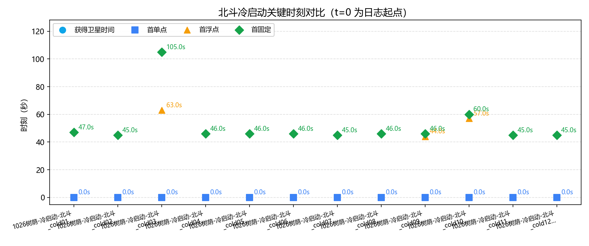
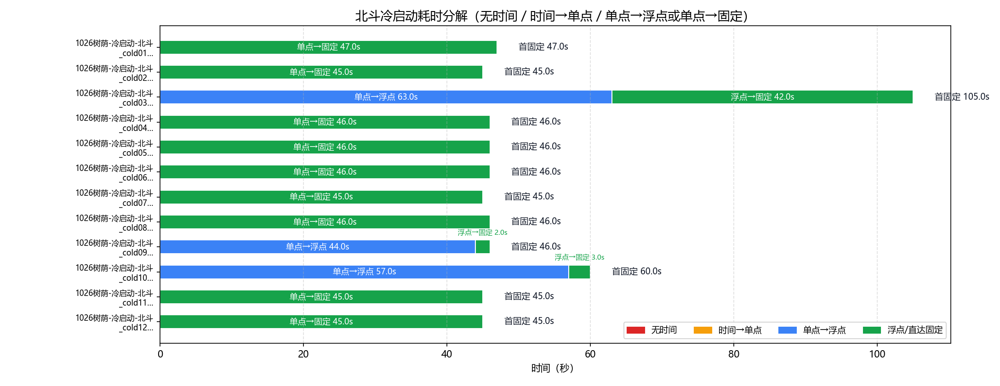
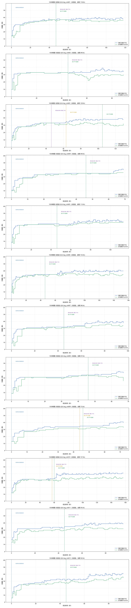

# 北斗（UM980）GNSS 冷启动策略分析

- 数据源：`1026树荫-冷启动-北斗.log_cold01`、`1026树荫-冷启动-北斗.log_cold02`、`1026树荫-冷启动-北斗.log_cold03`、`1026树荫-冷启动-北斗.log_cold04`、`1026树荫-冷启动-北斗.log_cold05`、`1026树荫-冷启动-北斗.log_cold06`、`1026树荫-冷启动-北斗.log_cold07`、`1026树荫-冷启动-北斗.log_cold08`、`1026树荫-冷启动-北斗.log_cold09`、`1026树荫-冷启动-北斗.log_cold10`、`1026树荫-冷启动-北斗.log_cold11`、`1026树荫-冷启动-北斗.log_cold12`（混合二进制+ASCII 日志，#BESTNAVA）
- 口径依据：和芯星通《N4 Products Commands and Logs Reference Book R1.15》（`beidou_manual\Unicore Reference Commands Manual For N4 High Precision Products_V2_CH_R1.15.pdf`）
- 分析维度：时标状态 / 解算状态 / 定位类型 / 卫星数；本报告不含 INS（UM980 无 IMU）

## 一、数据完整性与报文构成

| 文件 | 时长 | 定位报文 | 实测周期 | 时标分布(条) | 定位类型分布(条) | 间断/重定标 |
|---|---|---|---|---|---|---|
| `1026树荫-冷启动-北斗.log_cold01` | 118.0s | BESTNAVA 119条；1.0s/1.0Hz | `{'FINE': 119}` | `{'SINGLE': 47, 'NARROW_INT': 72}` | 0 / 0 |
| `1026树荫-冷启动-北斗.log_cold02` | 89.0s | BESTNAVA 90条；1.0s/1.0Hz | `{'FINE': 90}` | `{'SINGLE': 45, 'NARROW_INT': 45}` | 0 / 0 |
| `1026树荫-冷启动-北斗.log_cold03` | 129.0s | BESTNAVA 130条；1.0s/1.0Hz | `{'FINE': 130}` | `{'SINGLE': 46, 'PSRDIFF': 17, 'NARROW_FLOAT': 42, 'NARROW_INT': 25}` | 0 / 0 |
| `1026树荫-冷启动-北斗.log_cold04` | 69.0s | BESTNAVA 70条；1.0s/1.0Hz | `{'FINE': 70}` | `{'SINGLE': 46, 'NARROW_INT': 24}` | 0 / 0 |
| `1026树荫-冷启动-北斗.log_cold05` | 113.0s | BESTNAVA 114条；1.0s/1.0Hz | `{'FINE': 114}` | `{'SINGLE': 46, 'NARROW_INT': 68}` | 0 / 0 |
| `1026树荫-冷启动-北斗.log_cold06` | 153.0s | BESTNAVA 154条；1.0s/1.0Hz | `{'FINE': 154}` | `{'SINGLE': 46, 'WIDE_INT': 1, 'NARROW_INT': 107}` | 0 / 0 |
| `1026树荫-冷启动-北斗.log_cold07` | 96.0s | BESTNAVA 96条；1.0s/1.0Hz | `{'FINE': 96}` | `{'SINGLE': 45, 'WIDE_INT': 1, 'NARROW_INT': 50}` | 0 / 0 |
| `1026树荫-冷启动-北斗.log_cold08` | 67.0s | BESTNAVA 68条；1.0s/1.0Hz | `{'FINE': 68}` | `{'SINGLE': 46, 'NARROW_INT': 22}` | 0 / 0 |
| `1026树荫-冷启动-北斗.log_cold09` | 72.0s | BESTNAVA 73条；1.0s/1.0Hz | `{'FINE': 73}` | `{'SINGLE': 44, 'NARROW_FLOAT': 2, 'NARROW_INT': 27}` | 0 / 0 |
| `1026树荫-冷启动-北斗.log_cold10` | 157.0s | BESTNAVA 158条；1.0s/1.0Hz | `{'FINE': 158}` | `{'SINGLE': 57, 'NARROW_FLOAT': 3, 'NARROW_INT': 98}` | 0 / 0 |
| `1026树荫-冷启动-北斗.log_cold11` | 95.0s | BESTNAVA 96条；1.0s/1.0Hz | `{'FINE': 96}` | `{'SINGLE': 45, 'NARROW_INT': 51}` | 0 / 0 |
| `1026树荫-冷启动-北斗.log_cold12` | 92.0s | BESTNAVA 93条；1.0s/1.0Hz | `{'FINE': 93}` | `{'SINGLE': 45, 'WIDE_INT': 1, 'NARROW_INT': 47}` | 0 / 0 |

> 口径（N4 手册）：报文按行做 32 位 CRC 校验（`#` 开头为 32 位 CRC，`$` 开头为 NMEA 异或）；报头结构见表 7-51，BESTNAV 数据结构见表 7-70。卫星维度口径：#SVs=跟踪卫星数、#solnSVs=解算卫星数；表 7-70 无 #solnMultiSVs（字段 17-19 为 Reserved），多频解算维度不适用，输出“—”，不解析保留字段。

### 报文完整性与周期（按报头时间戳逐帧判定）

| 文件 | 帧数 | 实测周期 | 标称频率 | CRC失败行 | 真实间断 | 周重定标 |
|---|---|---|---|---|---|---|
| `1026树荫-冷启动-北斗.log_cold01` | 119 | 1.0s | 1.0Hz | 1 | 0 | 0 |
| `1026树荫-冷启动-北斗.log_cold02` | 90 | 1.0s | 1.0Hz | 1 | 0 | 0 |
| `1026树荫-冷启动-北斗.log_cold03` | 130 | 1.0s | 1.0Hz | 1 | 0 | 0 |
| `1026树荫-冷启动-北斗.log_cold04` | 70 | 1.0s | 1.0Hz | 1 | 0 | 0 |
| `1026树荫-冷启动-北斗.log_cold05` | 114 | 1.0s | 1.0Hz | 1 | 0 | 0 |
| `1026树荫-冷启动-北斗.log_cold06` | 154 | 1.0s | 1.0Hz | 1 | 0 | 0 |
| `1026树荫-冷启动-北斗.log_cold07` | 96 | 1.0s | 1.0Hz | 1 | 0 | 0 |
| `1026树荫-冷启动-北斗.log_cold08` | 68 | 1.0s | 1.0Hz | 1 | 0 | 0 |
| `1026树荫-冷启动-北斗.log_cold09` | 73 | 1.0s | 1.0Hz | 1 | 0 | 0 |
| `1026树荫-冷启动-北斗.log_cold10` | 158 | 1.0s | 1.0Hz | 1 | 0 | 0 |
| `1026树荫-冷启动-北斗.log_cold11` | 96 | 1.0s | 1.0Hz | 1 | 0 | 0 |
| `1026树荫-冷启动-北斗.log_cold12` | 93 | 1.0s | 1.0Hz | 1 | 0 | 0 |

> 实测周期 = 全部相邻帧报头时间差的中位数（不假设）；真实间断 = 相邻帧时间差 > 2.5×实测周期（保留在时间轴中）；周重定标 = 相邻帧时间差 > 3600s（按时间连续处理）。

## 二、四个关键时刻（秒）

| 文件 | 获得卫星时间(脱离UNKNOWN) | 时标进入 FINE | 差分改正可用 | 首单点 | 首浮点 | 首固定 | 无解/单点/浮点/固定 占比% | 跟踪星 min/均值/max |
|---|---|---|---|---|---|---|---|---|
| `1026树荫-冷启动-北斗.log_cold01` | **—** | — | 47.0s | 0.0s | — | **47.0s** | 0/39.5/0/60.5 | 15/36.2/40 |
| `1026树荫-冷启动-北斗.log_cold02` | **—** | — | 45.0s | 0.0s | — | **45.0s** | 0/50.0/0/50.0 | 10/33.2/39 |
| `1026树荫-冷启动-北斗.log_cold03` | **—** | — | 46.0s | 0.0s | 63.0s | **105.0s** | 0/48.5/32.3/19.2 | 9/34.0/39 |
| `1026树荫-冷启动-北斗.log_cold04` | **—** | — | 46.0s | 0.0s | — | **46.0s** | 0/65.7/0/34.3 | 11/33.3/41 |
| `1026树荫-冷启动-北斗.log_cold05` | **—** | — | 46.0s | 0.0s | — | **46.0s** | 0/40.4/0/59.6 | 9/35.8/41 |
| `1026树荫-冷启动-北斗.log_cold06` | **—** | — | 46.0s | 0.0s | — | **46.0s** | 0/29.9/0/70.1 | 10/36.7/41 |
| `1026树荫-冷启动-北斗.log_cold07` | **—** | — | 45.0s | 0.0s | — | **45.0s** | 0/46.9/0/53.1 | 9/33.5/41 |
| `1026树荫-冷启动-北斗.log_cold08` | **—** | — | 46.0s | 0.0s | — | **46.0s** | 0/67.6/0/32.4 | 9/32.2/39 |
| `1026树荫-冷启动-北斗.log_cold09` | **—** | — | 44.0s | 0.0s | 44.0s | **46.0s** | 0/60.3/2.7/37.0 | 13/33.2/41 |
| `1026树荫-冷启动-北斗.log_cold10` | **—** | — | 57.0s | 0.0s | 57.0s | **60.0s** | 0/36.1/1.9/62.0 | 12/36.0/42 |
| `1026树荫-冷启动-北斗.log_cold11` | **—** | — | 45.0s | 0.0s | — | **45.0s** | 0/46.9/0/53.1 | 17/35/40 |
| `1026树荫-冷启动-北斗.log_cold12` | **—** | — | 45.0s | 0.0s | — | **45.0s** | 0/48.4/0/51.6 | 6/32.4/41 |

> “—”规则：若该次启动段首已持有效时标（断电后 GPS 时间由 UM980 内部电池保持，Time Status 未丢失），“获得卫星时间 / 时标进入 FINE”输出“—”，不参与对比。N4 时标状态仅 UNKNOWN / FINE 两态（表 7-51）。

## 三、冷启动耗时分解

### 表1：四阶段严格分解

| 文件 | 无时间 | 时间→单点 | 单点→浮点 | 浮点→固定 | 首固定 | 差分数据可用 |
|---|---|---|---|---|---|---|
| `1026树荫-冷启动-北斗.log_cold01` | — | 0.0s | — | — | **47.0s** | 47.0s |
| `1026树荫-冷启动-北斗.log_cold02` | — | 0.0s | — | — | **45.0s** | 45.0s |
| `1026树荫-冷启动-北斗.log_cold03` | — | 0.0s | 63.0s | 42.0s | **105.0s** | 46.0s |
| `1026树荫-冷启动-北斗.log_cold04` | — | 0.0s | — | — | **46.0s** | 46.0s |
| `1026树荫-冷启动-北斗.log_cold05` | — | 0.0s | — | — | **46.0s** | 46.0s |
| `1026树荫-冷启动-北斗.log_cold06` | — | 0.0s | — | — | **46.0s** | 46.0s |
| `1026树荫-冷启动-北斗.log_cold07` | — | 0.0s | — | — | **45.0s** | 45.0s |
| `1026树荫-冷启动-北斗.log_cold08` | — | 0.0s | — | — | **46.0s** | 46.0s |
| `1026树荫-冷启动-北斗.log_cold09` | — | 0.0s | 44.0s | 2.0s | **46.0s** | 44.0s |
| `1026树荫-冷启动-北斗.log_cold10` | — | 0.0s | 57.0s | 3.0s | **60.0s** | 57.0s |
| `1026树荫-冷启动-北斗.log_cold11` | — | 0.0s | — | — | **45.0s** | 45.0s |
| `1026树荫-冷启动-北斗.log_cold12` | — | 0.0s | — | — | **45.0s** | 45.0s |

### 表2：图示使用的路径汇总（支持无浮点直达固定）

| 文件 | 无时间 | 时间→单点 | 单点→浮点 | 浮点→固定 | 单点→固定 | 合计到首固定 |
|---|---|---|---|---|---|---|
| `1026树荫-冷启动-北斗.log_cold01` | — | 0.0s | — | — | 47.0s | 47.0s |
| `1026树荫-冷启动-北斗.log_cold02` | — | 0.0s | — | — | 45.0s | 45.0s |
| `1026树荫-冷启动-北斗.log_cold03` | — | 0.0s | 63.0s | 42.0s | — | 105.0s |
| `1026树荫-冷启动-北斗.log_cold04` | — | 0.0s | — | — | 46.0s | 46.0s |
| `1026树荫-冷启动-北斗.log_cold05` | — | 0.0s | — | — | 46.0s | 46.0s |
| `1026树荫-冷启动-北斗.log_cold06` | — | 0.0s | — | — | 46.0s | 46.0s |
| `1026树荫-冷启动-北斗.log_cold07` | — | 0.0s | — | — | 45.0s | 45.0s |
| `1026树荫-冷启动-北斗.log_cold08` | — | 0.0s | — | — | 46.0s | 46.0s |
| `1026树荫-冷启动-北斗.log_cold09` | — | 0.0s | 44.0s | 2.0s | — | 46.0s |
| `1026树荫-冷启动-北斗.log_cold10` | — | 0.0s | 57.0s | 3.0s | — | 60.0s |
| `1026树荫-冷启动-北斗.log_cold11` | — | 0.0s | — | — | 45.0s | 45.0s |
| `1026树荫-冷启动-北斗.log_cold12` | — | 0.0s | — | — | 45.0s | 45.0s |

## 四、北斗-北云配对审计

| 北云段 | 北云首帧时间 | 北斗候选段 | 北斗首帧时间 | 时间差(s) | 匹配类型 |
|---:|---:|---:|---:|---:|---|
| 1 | 1477019401.2 | 2 | 1477019388.0 | -13.2 | normal |
| 2 | 1477019552.4 | 3 | 1477019548.0 | -4.4 | normal |
| 3 | 1477019705.6 | 4 | 1477019692.0 | -13.6 | normal |
| 4 | 1477019922.4 | 5 | 1477019912.0 | -10.4 | normal |
| 5 | 1477020049.6 | 6 | 1477020043.0 | -6.6 | normal |
| 6 | 1477020379.6 | 8 | 1477020364.0 | -15.6 | normal |
| 7 | 1477020607.4 | 9 | 1477020600.0 | -7.4 | normal |
| 8 | 1477020777.6 | 10 | 1477020771.0 | -6.6 | normal |
| 9 | 1477020906.4 | 11 | 1477020895.0 | -11.4 | normal |
| 10 | 1477021046.6 | 12 | 1477021035.0 | -11.6 | normal |
| 11 | 1477021238.8 | 13 | 1477021234.0 | -4.8 | normal |
| 12 | 1477021386.6 | 14 | 1477021381.0 | -5.6 | normal |

> 北云 cold 段为主切割/编号基准；±30s 为普通匹配，±90s 为扩展匹配；北云时间重置段使用段内首个有效 GPS 时间或后续段有效时间做工程重建。边界仍取北斗 BESTNAVA 自身首末帧。卫星数骤降阈值（下降≥10颗或首帧≤上一段末尾70%）为工程判据，不是厂商协议常数。

## 五、定位类型分段统计

### `1026树荫-冷启动-北斗.log_cold01`

| 定位类型段 | 起–止(s) | 时长(s) | 条数 | 跟踪星 | 解算星 | 多频解算 |
|---|---|---|---|---|---|---|
| SINGLE | 0.0–46.0 | 47.0 | 47 | 33.3 | 30.6 | — |
| NARROW_INT | 47.0–118.0 | 72.0 | 72 | 38.0 | 35.6 | — |

### `1026树荫-冷启动-北斗.log_cold02`

| 定位类型段 | 起–止(s) | 时长(s) | 条数 | 跟踪星 | 解算星 | 多频解算 |
|---|---|---|---|---|---|---|
| SINGLE | 0.0–44.0 | 45.0 | 45 | 31.8 | 30.3 | — |
| NARROW_INT | 45.0–89.0 | 45.0 | 45 | 34.6 | 29.1 | — |

### `1026树荫-冷启动-北斗.log_cold03`

| 定位类型段 | 起–止(s) | 时长(s) | 条数 | 跟踪星 | 解算星 | 多频解算 |
|---|---|---|---|---|---|---|
| SINGLE | 0.0–45.0 | 46.0 | 46 | 29.2 | 27.5 | — |
| PSRDIFF | 46.0–62.0 | 17.0 | 17 | 33.1 | 31.5 | — |
| NARROW_FLOAT | 63.0–104.0 | 42.0 | 42 | 37.0 | 32.0 | — |
| NARROW_INT | 105.0–129.0 | 25.0 | 25 | 38.2 | 30.5 | — |

### `1026树荫-冷启动-北斗.log_cold04`

| 定位类型段 | 起–止(s) | 时长(s) | 条数 | 跟踪星 | 解算星 | 多频解算 |
|---|---|---|---|---|---|---|
| SINGLE | 0.0–45.0 | 46.0 | 46 | 31.7 | 29.6 | — |
| NARROW_INT | 46.0–69.0 | 24.0 | 24 | 36.3 | 34.8 | — |

### `1026树荫-冷启动-北斗.log_cold05`

| 定位类型段 | 起–止(s) | 时长(s) | 条数 | 跟踪星 | 解算星 | 多频解算 |
|---|---|---|---|---|---|---|
| SINGLE | 0.0–45.0 | 46.0 | 46 | 33.1 | 30.5 | — |
| NARROW_INT | 46.0–113.0 | 68.0 | 68 | 37.6 | 35.4 | — |

### `1026树荫-冷启动-北斗.log_cold06`

| 定位类型段 | 起–止(s) | 时长(s) | 条数 | 跟踪星 | 解算星 | 多频解算 |
|---|---|---|---|---|---|---|
| SINGLE | 0.0–45.0 | 46.0 | 46 | 32.3 | 30.0 | — |
| WIDE_INT | 46.0–46.0 | 1.0 | 1 | 35 | 33 | — |
| NARROW_INT | 47.0–153.0 | 107.0 | 107 | 38.5 | 34.8 | — |

### `1026树荫-冷启动-北斗.log_cold07`

| 定位类型段 | 起–止(s) | 时长(s) | 条数 | 跟踪星 | 解算星 | 多频解算 |
|---|---|---|---|---|---|---|
| SINGLE | 0.0–44.0 | 45.0 | 45 | 29.9 | 26.9 | — |
| WIDE_INT | 45.0–45.0 | 1.0 | 1 | 32 | 31 | — |
| NARROW_INT | 46.0–96.0 | 50.0 | 50 | 36.8 | 33.3 | — |

### `1026树荫-冷启动-北斗.log_cold08`

| 定位类型段 | 起–止(s) | 时长(s) | 条数 | 跟踪星 | 解算星 | 多频解算 |
|---|---|---|---|---|---|---|
| SINGLE | 0.0–45.0 | 46.0 | 46 | 30.7 | 28.9 | — |
| NARROW_INT | 46.0–67.0 | 22.0 | 22 | 35.5 | 32.0 | — |

### `1026树荫-冷启动-北斗.log_cold09`

| 定位类型段 | 起–止(s) | 时长(s) | 条数 | 跟踪星 | 解算星 | 多频解算 |
|---|---|---|---|---|---|---|
| SINGLE | 0.0–43.0 | 44.0 | 44 | 30.8 | 27.3 | — |
| NARROW_FLOAT | 44.0–45.0 | 2.0 | 2 | 35 | 31 | — |
| NARROW_INT | 46.0–72.0 | 27.0 | 27 | 36.9 | 32.5 | — |

### `1026树荫-冷启动-北斗.log_cold10`

| 定位类型段 | 起–止(s) | 时长(s) | 条数 | 跟踪星 | 解算星 | 多频解算 |
|---|---|---|---|---|---|---|
| SINGLE | 0.0–56.0 | 57.0 | 57 | 30.2 | 28.5 | — |
| NARROW_FLOAT | 57.0–59.0 | 3.0 | 3 | 33 | 30.7 | — |
| NARROW_INT | 60.0–157.0 | 98.0 | 98 | 39.5 | 33.2 | — |

### `1026树荫-冷启动-北斗.log_cold11`

| 定位类型段 | 起–止(s) | 时长(s) | 条数 | 跟踪星 | 解算星 | 多频解算 |
|---|---|---|---|---|---|---|
| SINGLE | 0.0–44.0 | 45.0 | 45 | 31.9 | 27.5 | — |
| NARROW_INT | 45.0–95.0 | 51.0 | 51 | 37.8 | 32.1 | — |

### `1026树荫-冷启动-北斗.log_cold12`

| 定位类型段 | 起–止(s) | 时长(s) | 条数 | 跟踪星 | 解算星 | 多频解算 |
|---|---|---|---|---|---|---|
| SINGLE | 0.0–44.0 | 45.0 | 45 | 27.8 | 24.1 | — |
| WIDE_INT | 45.0–45.0 | 1.0 | 1 | 32 | 28 | — |
| NARROW_INT | 46.0–92.0 | 47.0 | 47 | 36.8 | 31.1 | — |

## 附录：口径与手册条款对应

| 报告字段 | 数据来源 | 手册条款 | 说明 |
|---|---|---|---|
| 获得卫星时间 | #BESTNAVA 报头 Time Status 首次脱离 UNKNOWN | 表 7-51 字段 5 | UNKNOWN 表明接收机尚未计算出准确的 GPS 时间；仅 UNKNOWN / FINE 两态；时标未丢失的段输出“—” |
| 时标进入 FINE | Time Status 首次 FINE | 表 7-51 字段 5 | 与“获得卫星时间”同刻（无 COARSE 态）；时标未丢失的段输出“—” |
| 首单点 / 首浮点 / 首固定 | 定位类型 Pos Type 首次 SINGLE 系 / NARROW_FLOAT 系 / NARROW_INT 系 | 表 0-5 | SINGLE=16 单点；PSRDIFF=17 伪距差分；NARROW_FLOAT=34 窄巷浮点解；NARROW_INT=50 窄巷固定解 |
| 差分改正可用 | Stn ID 非空且 != "0" | 表 7-70 字段 12 | 基站 ID，缺省值 0（实测如 "1793"）；单点定位时为 0 |
| 无解段解算状态 | Sol Status = INSUFFICIENT_OBS / NO_CONVERGENCE / COV_TRACE / VARIANCE | 表 0-6 | 观测数据不足 / 无法收敛 / 协方差迹超限 / 方差超限；SOL_COMPUTED=已解出 |
| 跟踪星 / 解算星 | #SVs / #solnSVs | 表 7-70 字段 15/16 | 跟踪卫星数 / 解算卫星数 |
| 多频解算 | 不适用（输出“—”） | 表 7-70 字段 17-19 | BESTNAV 无 #solnMultiSVs，17-19 为 Reserved，不解析保留字段 |
| 冷启动段判定 | 无基站 + 定位类型 NONE/单点类 + 差分/固定尾段 + 卫星数骤降 | 表 0-5/0-6/7-70 | UM980 可保持 FINE 时标并很快输出 SINGLE，因此 SOL_COMPUTED 不作为排除条件。卫星数骤降为工程判据；同步北云日志另提供主切割/编号基准 |

> 时间轴为录制经过时间（t=0 为各日志首条记录）；若出现冷启动 GPS 周重定标（相邻两条报头时间差 >3600s），按时间连续处理（间隔按标称周期计）。