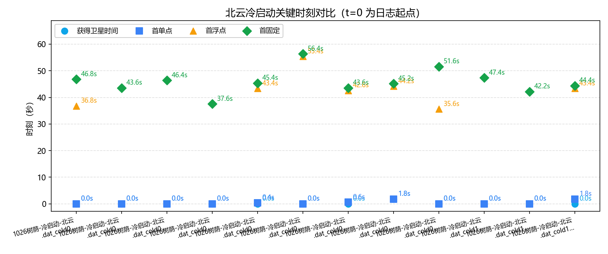
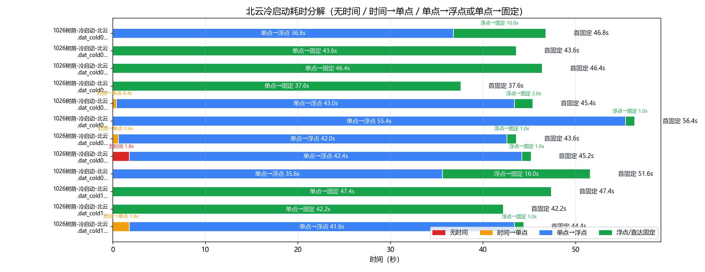
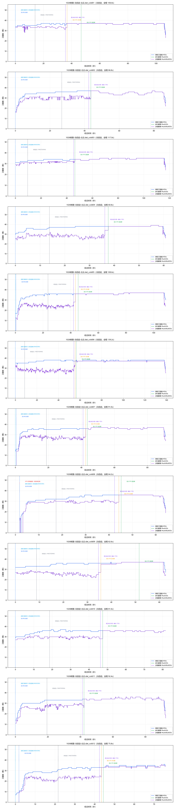

# 北云（UG016）GNSS 冷启动策略分析

- 数据源：`1026树荫-冷启动-北云.dat_cold01`、`1026树荫-冷启动-北云.dat_cold02`、`1026树荫-冷启动-北云.dat_cold03`、`1026树荫-冷启动-北云.dat_cold04`、`1026树荫-冷启动-北云.dat_cold05`、`1026树荫-冷启动-北云.dat_cold06`、`1026树荫-冷启动-北云.dat_cold07`、`1026树荫-冷启动-北云.dat_cold08`、`1026树荫-冷启动-北云.dat_cold09`、`1026树荫-冷启动-北云.dat_cold10`、`1026树荫-冷启动-北云.dat_cold11`、`1026树荫-冷启动-北云.dat_cold12`（定位流来源见下表）
- 口径依据：北云科技《UG016 数据通信接口协议》（文本转录：`by_manual\UG016.md`）
- 分析维度：时标状态 / 解算状态 / 定位类型 / 卫星数；本报告不含 INS

## 一、数据完整性与报文构成

| 文件 | 时长 | 定位报文 | 实测周期 | 时标分布(条) | 定位类型分布(条) | 间断/重定标 |
|---|---|---|---|---|---|---|
| `1026树荫-冷启动-北云.dat_cold01` | 106.8s | BESTGNSSPOSA 535条；0.2s/5.0Hz | `{'COARSE': 70, 'FINESTEERING': 465}` | `{'SINGLE': 184, 'NARROW_FLOAT': 50, 'NARROW_INT': 295, 'PSRDIFF': 6}` | 0 / 0 |
| `1026树荫-冷启动-北云.dat_cold02` | 86.8s | BESTGNSSPOSA 435条；0.2s/5.0Hz | `{'COARSE': 134, 'FINESTEERING': 301}` | `{'SINGLE': 218, 'NARROW_INT': 210, 'PSRDIFF': 7}` | 0 / 0 |
| `1026树荫-冷启动-北云.dat_cold03` | 117.0s | BESTGNSSPOSA 586条；0.2s/5.0Hz | `{'COARSE': 48, 'FINESTEERING': 538}` | `{'SINGLE': 232, 'NARROW_INT': 347, 'PSRDIFF': 7}` | 0 / 0 |
| `1026树荫-冷启动-北云.dat_cold04` | 60.8s | BESTGNSSPOSA 305条；0.2s/5.0Hz | `{'COARSE': 69, 'FINESTEERING': 236}` | `{'SINGLE': 188, 'NARROW_INT': 110, 'PSRDIFF': 7}` | 0 / 0 |
| `1026树荫-冷启动-北云.dat_cold05` | 108.6s | BESTGNSSPOSA 544条；0.2s/5.0Hz | `{'COARSE': 118, 'FINESTEERING': 426}` | `{'NONE': 2, 'SINGLE': 215, 'NARROW_FLOAT': 10, 'NARROW_INT': 310, 'PSRDIFF': 7}` | 0 / 0 |
| `1026树荫-冷启动-北云.dat_cold06` | 139.2s | BESTGNSSPOSA 697条；0.2s/5.0Hz | `{'COARSE': 43, 'FINESTEERING': 654}` | `{'SINGLE': 277, 'NARROW_FLOAT': 5, 'NARROW_INT': 408, 'PSRDIFF': 7}` | 0 / 0 |
| `1026树荫-冷启动-北云.dat_cold07` | 91.0s | BESTGNSSPOSA 456条；0.2s/5.0Hz | `{'COARSE': 94, 'FINESTEERING': 362}` | `{'NONE': 3, 'SINGLE': 210, 'NARROW_FLOAT': 5, 'NARROW_INT': 231, 'PSRDIFF': 7}` | 0 / 0 |
| `1026树荫-冷启动-北云.dat_cold08` | 64.2s | BESTGNSSPOSA 322条；0.2s/5.0Hz | `{'UNKNOWN': 9, 'COARSE': 78, 'FINESTEERING': 235}` | `{'NONE': 14, 'SINGLE': 207, 'NARROW_FLOAT': 5, 'NARROW_INT': 89, 'PSRDIFF': 7}` | 0 / 1 |
| `1026树荫-冷启动-北云.dat_cold09` | 62.6s | BESTGNSSPOSA 314条；0.2s/5.0Hz | `{'COARSE': 44, 'FINESTEERING': 270}` | `{'SINGLE': 178, 'NARROW_FLOAT': 80, 'NARROW_INT': 50, 'PSRDIFF': 6}` | 0 / 0 |
| `1026树荫-冷启动-北云.dat_cold10` | 81.6s | BESTGNSSPOSA 409条；0.2s/5.0Hz | `{'COARSE': 93, 'FINESTEERING': 316}` | `{'SINGLE': 237, 'NARROW_INT': 172}` | 0 / 0 |
| `1026树荫-冷启动-北云.dat_cold11` | 92.4s | BESTGNSSPOSA 463条；0.2s/5.0Hz | `{'COARSE': 97, 'FINESTEERING': 366}` | `{'SINGLE': 211, 'NARROW_INT': 245, 'PSRDIFF': 7}` | 0 / 0 |
| `1026树荫-冷启动-北云.dat_cold12` | 75.8s | BESTGNSSPOSA 380条；0.2s/5.0Hz | `{'COARSE': 108, 'FINESTEERING': 272}` | `{'NONE': 9, 'SINGLE': 208, 'NARROW_FLOAT': 5, 'NARROW_INT': 158}` | 0 / 0 |

> 口径（UG016）：报文按行做 CRC 校验（`#` 开头为 32 位 CRC，`$` 开头为 NMEA 异或）；`$KSXT` 为自定义 8 位 CRC32 私有报文，按 NMEA 异或校验判失败属正常、非故障。卫星维度口径：#SVs=跟踪卫星数、#solnSVs=参与解算卫星数、#solnMultiSVs=参与解算的多频卫星数。

### 报文完整性与周期（按报头时间戳逐帧判定）

| 文件 | 帧数 | 实测周期 | 标称频率 | CRC失败行 | 真实间断 | 周重定标 |
|---|---|---|---|---|---|---|
| `1026树荫-冷启动-北云.dat_cold01` | 535 | 0.2s | 5.0Hz | 0 | 0 | 0 |
| `1026树荫-冷启动-北云.dat_cold02` | 435 | 0.2s | 5.0Hz | 0 | 0 | 0 |
| `1026树荫-冷启动-北云.dat_cold03` | 586 | 0.2s | 5.0Hz | 0 | 0 | 0 |
| `1026树荫-冷启动-北云.dat_cold04` | 305 | 0.2s | 5.0Hz | 0 | 0 | 0 |
| `1026树荫-冷启动-北云.dat_cold05` | 544 | 0.2s | 5.0Hz | 0 | 0 | 0 |
| `1026树荫-冷启动-北云.dat_cold06` | 697 | 0.2s | 5.0Hz | 0 | 0 | 0 |
| `1026树荫-冷启动-北云.dat_cold07` | 456 | 0.2s | 5.0Hz | 0 | 0 | 0 |
| `1026树荫-冷启动-北云.dat_cold08` | 322 | 0.2s | 5.0Hz | 0 | 0 | 1 |
| `1026树荫-冷启动-北云.dat_cold09` | 314 | 0.2s | 5.0Hz | 0 | 0 | 0 |
| `1026树荫-冷启动-北云.dat_cold10` | 409 | 0.2s | 5.0Hz | 0 | 0 | 0 |
| `1026树荫-冷启动-北云.dat_cold11` | 463 | 0.2s | 5.0Hz | 0 | 0 | 0 |
| `1026树荫-冷启动-北云.dat_cold12` | 380 | 0.2s | 5.0Hz | 0 | 0 | 0 |

> 实测周期 = 全部相邻帧报头时间差的中位数（不假设）；真实间断 = 相邻帧时间差 > 2.5×实测周期（保留在时间轴中）；周重定标 = 相邻帧时间差 > 3600s（按时间连续处理）。

## 二、四个关键时刻（秒）

| 文件 | 获得卫星时间(脱离UNKNOWN) | COARSE→FINE | 差分改正可用 | 首单点 | 首浮点 | 首固定 | 无解/单点/浮点/固定 占比% | 跟踪星 min/均值/max |
|---|---|---|---|---|---|---|---|---|
| `1026树荫-冷启动-北云.dat_cold01` | **0.0s** | 0.0s → 14.0s | 35.6s | 0.0s | 36.8s | **46.8s** | 0/35.5/9.3/55.1 | 26/36.4/37 |
| `1026树荫-冷启动-北云.dat_cold02` | **0.0s** | 0.0s → 26.8s | 42.4s | 0.0s | — | **43.6s** | 0/51.7/0/48.3 | 17/34.6/37 |
| `1026树荫-冷启动-北云.dat_cold03` | **0.0s** | 0.0s → 9.6s | 45.4s | 0.0s | — | **46.4s** | 0/40.8/0/59.2 | 27/33.9/35 |
| `1026树荫-冷启动-北云.dat_cold04` | **0.0s** | 0.0s → 13.8s | 36.2s | 0.0s | — | **37.6s** | 0/63.9/0/36.1 | 28/36.9/39 |
| `1026树荫-冷启动-北云.dat_cold05` | **0.0s** | 0.0s → 23.6s | 42.0s | 0.4s | 43.4s | **45.4s** | 0.4/40.8/1.8/57.0 | 17/35.3/37 |
| `1026树荫-冷启动-北云.dat_cold06` | **0.0s** | 0.0s → 8.6s | 54.2s | 0.0s | 55.4s | **56.4s** | 0/40.7/0.7/58.5 | 28/37.3/38 |
| `1026树荫-冷启动-北云.dat_cold07` | **0.0s** | 0.0s → 18.8s | 41.0s | 0.6s | 42.6s | **43.6s** | 0.7/47.6/1.1/50.7 | 14/35.2/37 |
| `1026树荫-冷启动-北云.dat_cold08` | **1.8s** | 1.8s → 17.4s | 42.4s | 1.8s | 44.2s | **45.2s** | 4.3/66.5/1.6/27.6 | 0/32.3/36 |
| `1026树荫-冷启动-北云.dat_cold09` | **0.0s** | 0.0s → 8.8s | 34.6s | 0.0s | 35.6s | **51.6s** | 0/58.6/25.5/15.9 | 27/35.4/37 |
| `1026树荫-冷启动-北云.dat_cold10` | **0.0s** | 0.0s → 18.6s | 46.2s | 0.0s | — | **47.4s** | 0/57.9/0/42.1 | 29/35.1/37 |
| `1026树荫-冷启动-北云.dat_cold11` | **0.0s** | 0.0s → 19.4s | 41.2s | 0.0s | — | **42.2s** | 0/47.1/0/52.9 | 14/32.7/36 |
| `1026树荫-冷启动-北云.dat_cold12` | **0.0s** | 0.0s → 21.6s | 42.4s | 1.8s | 43.4s | **44.4s** | 2.4/54.7/1.3/41.6 | 7/31.1/36 |

## 三、冷启动耗时分解

### 表1：四阶段严格分解

| 文件 | 无时间 | 时间→单点 | 单点→浮点 | 浮点→固定 | 首固定 | 差分数据可用 |
|---|---|---|---|---|---|---|
| `1026树荫-冷启动-北云.dat_cold01` | 0.0s | 0.0s | 36.8s | 10.0s | **46.8s** | 35.6s |
| `1026树荫-冷启动-北云.dat_cold02` | 0.0s | 0.0s | — | — | **43.6s** | 42.4s |
| `1026树荫-冷启动-北云.dat_cold03` | 0.0s | 0.0s | — | — | **46.4s** | 45.4s |
| `1026树荫-冷启动-北云.dat_cold04` | 0.0s | 0.0s | — | — | **37.6s** | 36.2s |
| `1026树荫-冷启动-北云.dat_cold05` | 0.0s | 0.4s | 43.0s | 2.0s | **45.4s** | 42.0s |
| `1026树荫-冷启动-北云.dat_cold06` | 0.0s | 0.0s | 55.4s | 1.0s | **56.4s** | 54.2s |
| `1026树荫-冷启动-北云.dat_cold07` | 0.0s | 0.6s | 42.0s | 1.0s | **43.6s** | 41.0s |
| `1026树荫-冷启动-北云.dat_cold08` | 1.8s | 0.0s | 42.4s | 1.0s | **45.2s** | 42.4s |
| `1026树荫-冷启动-北云.dat_cold09` | 0.0s | 0.0s | 35.6s | 16.0s | **51.6s** | 34.6s |
| `1026树荫-冷启动-北云.dat_cold10` | 0.0s | 0.0s | — | — | **47.4s** | 46.2s |
| `1026树荫-冷启动-北云.dat_cold11` | 0.0s | 0.0s | — | — | **42.2s** | 41.2s |
| `1026树荫-冷启动-北云.dat_cold12` | 0.0s | 1.8s | 41.6s | 1.0s | **44.4s** | 42.4s |

### 表2：图示使用的路径汇总（支持无浮点直达固定）

| 文件 | 无时间 | 时间→单点 | 单点→浮点 | 浮点→固定 | 单点→固定 | 合计到首固定 |
|---|---|---|---|---|---|---|
| `1026树荫-冷启动-北云.dat_cold01` | 0.0s | 0.0s | 36.8s | 10.0s | — | 46.8s |
| `1026树荫-冷启动-北云.dat_cold02` | 0.0s | 0.0s | — | — | 43.6s | 43.6s |
| `1026树荫-冷启动-北云.dat_cold03` | 0.0s | 0.0s | — | — | 46.4s | 46.4s |
| `1026树荫-冷启动-北云.dat_cold04` | 0.0s | 0.0s | — | — | 37.6s | 37.6s |
| `1026树荫-冷启动-北云.dat_cold05` | 0.0s | 0.4s | 43.0s | 2.0s | — | 45.4s |
| `1026树荫-冷启动-北云.dat_cold06` | 0.0s | 0.0s | 55.4s | 1.0s | — | 56.4s |
| `1026树荫-冷启动-北云.dat_cold07` | 0.0s | 0.6s | 42.0s | 1.0s | — | 43.6s |
| `1026树荫-冷启动-北云.dat_cold08` | 1.8s | 0.0s | 42.4s | 1.0s | — | 45.199999999999996s |
| `1026树荫-冷启动-北云.dat_cold09` | 0.0s | 0.0s | 35.6s | 16.0s | — | 51.6s |
| `1026树荫-冷启动-北云.dat_cold10` | 0.0s | 0.0s | — | — | 47.4s | 47.4s |
| `1026树荫-冷启动-北云.dat_cold11` | 0.0s | 0.0s | — | — | 42.2s | 42.2s |
| `1026树荫-冷启动-北云.dat_cold12` | 0.0s | 1.8s | 41.6s | 1.0s | — | 44.4s |

## 四、定位类型分段统计

### `1026树荫-冷启动-北云.dat_cold01`

| 定位类型段 | 起–止(s) | 时长(s) | 条数 | 跟踪星 | 解算星 | 多频解算 |
|---|---|---|---|---|---|---|
| SINGLE | 0.0–36.6 | 36.8 | 184 | 35.9 | 33.2 | 33.2 |
| NARROW_FLOAT | 36.8–46.6 | 10.0 | 50 | 36.9 | 36.9 | 36.9 |
| NARROW_INT | 46.8–105.6 | 59.0 | 295 | 36.8 | 36.8 | 36.8 |
| PSRDIFF | 105.8–106.8 | 1.2 | 6 | 31.2 | 28.7 | 28.7 |

### `1026树荫-冷启动-北云.dat_cold02`

| 定位类型段 | 起–止(s) | 时长(s) | 条数 | 跟踪星 | 解算星 | 多频解算 |
|---|---|---|---|---|---|---|
| SINGLE | 0.0–43.4 | 43.6 | 218 | 34.5 | 29.4 | 29.4 |
| NARROW_INT | 43.6–85.4 | 42.0 | 210 | 34.9 | 34.9 | 34.9 |
| PSRDIFF | 85.6–86.8 | 1.4 | 7 | 30.3 | 27 | 27 |

### `1026树荫-冷启动-北云.dat_cold03`

| 定位类型段 | 起–止(s) | 时长(s) | 条数 | 跟踪星 | 解算星 | 多频解算 |
|---|---|---|---|---|---|---|
| SINGLE | 0.0–46.2 | 46.4 | 232 | 33.1 | 31.1 | 31.1 |
| NARROW_INT | 46.4–115.6 | 69.4 | 347 | 34.5 | 34.5 | 34.5 |
| PSRDIFF | 115.8–117.0 | 1.4 | 7 | 30.4 | 28.3 | 28.3 |

### `1026树荫-冷启动-北云.dat_cold04`

| 定位类型段 | 起–止(s) | 时长(s) | 条数 | 跟踪星 | 解算星 | 多频解算 |
|---|---|---|---|---|---|---|
| SINGLE | 0.0–37.4 | 37.6 | 188 | 36.4 | 28.1 | 28.1 |
| NARROW_INT | 37.6–59.4 | 22.0 | 110 | 38.1 | 38.1 | 38.1 |
| PSRDIFF | 59.6–60.8 | 1.4 | 7 | 32 | 29.6 | 29.6 |

### `1026树荫-冷启动-北云.dat_cold05`

| 定位类型段 | 起–止(s) | 时长(s) | 条数 | 跟踪星 | 解算星 | 多频解算 |
|---|---|---|---|---|---|---|
| NONE | 0.0–0.2 | 0.4 | 2 | 17 | 0 | 0 |
| SINGLE | 0.4–43.2 | 43.0 | 215 | 33.9 | 23.9 | 23.9 |
| NARROW_FLOAT | 43.4–45.2 | 2.0 | 10 | 36 | 36 | 36 |
| NARROW_INT | 45.4–107.2 | 62.0 | 310 | 36.4 | 36.4 | 36.4 |
| PSRDIFF | 107.4–108.6 | 1.4 | 7 | 33.1 | 26 | 26 |

### `1026树荫-冷启动-北云.dat_cold06`

| 定位类型段 | 起–止(s) | 时长(s) | 条数 | 跟踪星 | 解算星 | 多频解算 |
|---|---|---|---|---|---|---|
| SINGLE | 0.0–55.2 | 55.4 | 277 | 36.8 | 27.8 | 27.8 |
| NARROW_FLOAT | 55.4–56.2 | 1.0 | 5 | 37.2 | 37 | 37 |
| NARROW_INT | 56.4–137.8 | 81.6 | 408 | 37.7 | 37.0 | 37.0 |
| PSRDIFF | 138.0–139.2 | 1.4 | 7 | 32.3 | 30.4 | 30.4 |

### `1026树荫-冷启动-北云.dat_cold07`

| 定位类型段 | 起–止(s) | 时长(s) | 条数 | 跟踪星 | 解算星 | 多频解算 |
|---|---|---|---|---|---|---|
| NONE | 0.0–0.4 | 0.6 | 3 | 15 | 0 | 0 |
| SINGLE | 0.6–42.4 | 42.0 | 210 | 34.3 | 26.7 | 26.7 |
| NARROW_FLOAT | 42.6–43.4 | 1.0 | 5 | 36 | 36 | 36 |
| NARROW_INT | 43.6–89.6 | 46.2 | 231 | 36.5 | 36.5 | 36.5 |
| PSRDIFF | 89.8–91.0 | 1.4 | 7 | 31.6 | 27.4 | 27.4 |

### `1026树荫-冷启动-北云.dat_cold08`

| 定位类型段 | 起–止(s) | 时长(s) | 条数 | 跟踪星 | 解算星 | 多频解算 |
|---|---|---|---|---|---|---|
| NONE | 0.0–1.6 | 1.8 | 9 | 0 | 0 | 0 |
| SINGLE | 1.8–2.0 | 0.4 | 2 | 14 | 13 | 13 |
| NONE | 2.2–3.0 | 1.0 | 5 | 13.8 | 0 | 0 |
| SINGLE | 3.2–44.0 | 41.0 | 205 | 33.0 | 29.1 | 29.1 |
| NARROW_FLOAT | 44.2–45.0 | 1.0 | 5 | 36 | 36 | 36 |
| NARROW_INT | 45.2–62.8 | 17.8 | 89 | 35.7 | 35.7 | 35.7 |
| PSRDIFF | 63.0–64.2 | 1.4 | 7 | 28.3 | 26.1 | 26.1 |

### `1026树荫-冷启动-北云.dat_cold09`

| 定位类型段 | 起–止(s) | 时长(s) | 条数 | 跟踪星 | 解算星 | 多频解算 |
|---|---|---|---|---|---|---|
| SINGLE | 0.0–35.4 | 35.6 | 178 | 34.5 | 25.8 | 25.8 |
| NARROW_FLOAT | 35.6–51.4 | 16.0 | 80 | 36.5 | 36.1 | 36.1 |
| NARROW_INT | 51.6–61.4 | 10.0 | 50 | 37 | 37 | 37 |
| PSRDIFF | 61.6–62.6 | 1.2 | 6 | 32.5 | 25.7 | 25.7 |

### `1026树荫-冷启动-北云.dat_cold10`

| 定位类型段 | 起–止(s) | 时长(s) | 条数 | 跟踪星 | 解算星 | 多频解算 |
|---|---|---|---|---|---|---|
| SINGLE | 0.0–47.2 | 47.4 | 237 | 34.7 | 29.3 | 29.3 |
| NARROW_INT | 47.4–81.6 | 34.4 | 172 | 35.5 | 35.5 | 35.5 |

### `1026树荫-冷启动-北云.dat_cold11`

| 定位类型段 | 起–止(s) | 时长(s) | 条数 | 跟踪星 | 解算星 | 多频解算 |
|---|---|---|---|---|---|---|
| SINGLE | 0.0–42.0 | 42.2 | 211 | 31.0 | 26.0 | 26.0 |
| NARROW_INT | 42.2–91.0 | 49.0 | 245 | 34.3 | 34.3 | 34.3 |
| PSRDIFF | 91.2–92.4 | 1.4 | 7 | 26.9 | 22.9 | 22.9 |

### `1026树荫-冷启动-北云.dat_cold12`

| 定位类型段 | 起–止(s) | 时长(s) | 条数 | 跟踪星 | 解算星 | 多频解算 |
|---|---|---|---|---|---|---|
| NONE | 0.0–1.6 | 1.8 | 9 | 8.3 | 0 | 0 |
| SINGLE | 1.8–43.2 | 41.6 | 208 | 29.5 | 22.1 | 22.1 |
| NARROW_FLOAT | 43.4–44.2 | 1.0 | 5 | 33 | 33 | 33 |
| NARROW_INT | 44.4–75.8 | 31.6 | 158 | 34.4 | 33.6 | 33.6 |

## 附录：口径与手册条款对应

| 报告字段 | 数据来源 | 手册条款 | 说明 |
|---|---|---|---|
| 获得卫星时间 | BESTGNSSPOSA 报头 Time Status 首次脱离 UNKNOWN | 报头字段 6 | UNKNOWN 表明尚未计算出准确的 GPS 时间 |
| COARSE→FINE | Time Status 首次 COARSE / FINESTEERING | 报头字段 6 | UNKNOWN / COARSE / FINESTEERING 三态 |
| 首单点 / 首浮点 / 首固定 | 位置类型 Pos Type 首次 SINGLE / NARROW_FLOAT / NARROW_INT | 表 4-2 | SINGLE=16 单点解；NARROW_FLOAT=34 窄带浮点解；NARROW_INT=50 窄带固定解 |
| 差分改正可用 | Stn ID 非空且 != "0" | 4.2.2 字段 12 | 差分站台 ID 号；单点定位时 ID 为 0；基站 ID 随数据动态变化 |
| 无解段解算状态 | Sol Type = INSUFFICIENT_OBS / VARIANCE | 表 4-1 | 观测量不足 / 方差超过限值；SOL_COMPUTED=完全解算；COLD_START=冷启动尚未完全解算 |
| 跟踪星 / 解算星 / 多频解算 | #SVs / #solnSVs / #solnMultiSVs | 4.2.2 字段 15/16/18 | 跟踪卫星数 / 解算卫星数 / 多频解算卫星数 |

> 时间轴为录制经过时间（t=0 为各日志首条记录）；若出现冷启动 GPS 周重定标（相邻两条报头时间差 >3600s），按时间连续处理（间隔按标称周期计）。