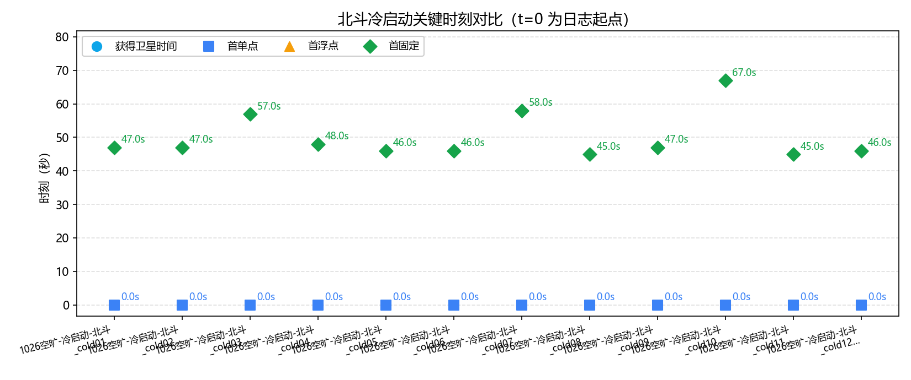
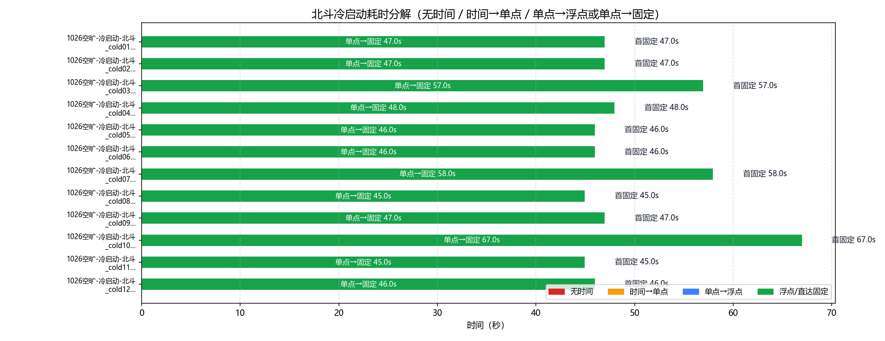
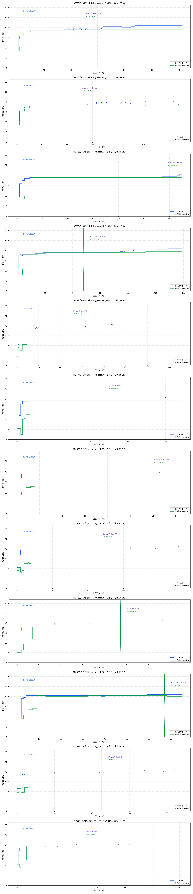

# 北斗（UM980）GNSS 冷启动策略分析

- 数据源：`1026空旷-冷启动-北斗.log_cold01`、`1026空旷-冷启动-北斗.log_cold02`、`1026空旷-冷启动-北斗.log_cold03`、`1026空旷-冷启动-北斗.log_cold04`、`1026空旷-冷启动-北斗.log_cold05`、`1026空旷-冷启动-北斗.log_cold06`、`1026空旷-冷启动-北斗.log_cold07`、`1026空旷-冷启动-北斗.log_cold08`、`1026空旷-冷启动-北斗.log_cold09`、`1026空旷-冷启动-北斗.log_cold10`、`1026空旷-冷启动-北斗.log_cold11`、`1026空旷-冷启动-北斗.log_cold12`（混合二进制+ASCII 日志，#BESTNAVA）
- 口径依据：和芯星通《N4 Products Commands and Logs Reference Book R1.15》（`beidou_manual\Unicore Reference Commands Manual For N4 High Precision Products_V2_CH_R1.15.pdf`）
- 分析维度：时标状态 / 解算状态 / 定位类型 / 卫星数；本报告不含 INS（UM980 无 IMU）

## 一、数据完整性与报文构成

| 文件 | 时长 | 定位报文 | 实测周期 | 时标分布(条) | 定位类型分布(条) | 间断/重定标 |
|---|---|---|---|---|---|---|
| `1026空旷-冷启动-北斗.log_cold01` | 123.0s | BESTNAVA 124条；1.0s/1.0Hz | `{'FINE': 124}` | `{'SINGLE': 47, 'NARROW_INT': 77}` | 0 / 0 |
| `1026空旷-冷启动-北斗.log_cold02` | 131.0s | BESTNAVA 132条；1.0s/1.0Hz | `{'FINE': 132}` | `{'SINGLE': 47, 'NARROW_INT': 85}` | 0 / 0 |
| `1026空旷-冷启动-北斗.log_cold03` | 65.0s | BESTNAVA 66条；1.0s/1.0Hz | `{'FINE': 66}` | `{'SINGLE': 57, 'WIDE_INT': 1, 'NARROW_INT': 8}` | 0 / 0 |
| `1026空旷-冷启动-北斗.log_cold04` | 119.0s | BESTNAVA 120条；1.0s/1.0Hz | `{'FINE': 120}` | `{'SINGLE': 48, 'NARROW_INT': 72}` | 0 / 0 |
| `1026空旷-冷启动-北斗.log_cold05` | 152.0s | BESTNAVA 152条；1.0s/1.0Hz | `{'FINE': 152}` | `{'SINGLE': 46, 'NARROW_INT': 106}` | 0 / 0 |
| `1026空旷-冷启动-北斗.log_cold06` | 89.0s | BESTNAVA 90条；1.0s/1.0Hz | `{'FINE': 90}` | `{'SINGLE': 46, 'NARROW_INT': 44}` | 0 / 0 |
| `1026空旷-冷启动-北斗.log_cold07` | 73.0s | BESTNAVA 74条；1.0s/1.0Hz | `{'FINE': 74}` | `{'SINGLE': 58, 'NARROW_INT': 16}` | 0 / 0 |
| `1026空旷-冷启动-北斗.log_cold08` | 93.0s | BESTNAVA 94条；1.0s/1.0Hz | `{'FINE': 94}` | `{'SINGLE': 45, 'NARROW_INT': 49}` | 0 / 0 |
| `1026空旷-冷启动-北斗.log_cold09` | 75.0s | BESTNAVA 76条；1.0s/1.0Hz | `{'FINE': 76}` | `{'SINGLE': 47, 'NARROW_INT': 29}` | 0 / 0 |
| `1026空旷-冷启动-北斗.log_cold10` | 75.0s | BESTNAVA 76条；1.0s/1.0Hz | `{'FINE': 76}` | `{'SINGLE': 67, 'NARROW_INT': 9}` | 0 / 0 |
| `1026空旷-冷启动-北斗.log_cold11` | 88.0s | BESTNAVA 89条；1.0s/1.0Hz | `{'FINE': 89}` | `{'SINGLE': 45, 'NARROW_INT': 44}` | 0 / 0 |
| `1026空旷-冷启动-北斗.log_cold12` | 122.0s | BESTNAVA 123条；1.0s/1.0Hz | `{'FINE': 123}` | `{'SINGLE': 46, 'NARROW_INT': 77}` | 0 / 0 |

> 口径（N4 手册）：报文按行做 32 位 CRC 校验（`#` 开头为 32 位 CRC，`$` 开头为 NMEA 异或）；报头结构见表 7-51，BESTNAV 数据结构见表 7-70。卫星维度口径：#SVs=跟踪卫星数、#solnSVs=解算卫星数；表 7-70 无 #solnMultiSVs（字段 17-19 为 Reserved），多频解算维度不适用，输出“—”，不解析保留字段。

### 报文完整性与周期（按报头时间戳逐帧判定）

| 文件 | 帧数 | 实测周期 | 标称频率 | CRC失败行 | 真实间断 | 周重定标 |
|---|---|---|---|---|---|---|
| `1026空旷-冷启动-北斗.log_cold01` | 124 | 1.0s | 1.0Hz | 2 | 0 | 0 |
| `1026空旷-冷启动-北斗.log_cold02` | 132 | 1.0s | 1.0Hz | 2 | 0 | 0 |
| `1026空旷-冷启动-北斗.log_cold03` | 66 | 1.0s | 1.0Hz | 2 | 0 | 0 |
| `1026空旷-冷启动-北斗.log_cold04` | 120 | 1.0s | 1.0Hz | 2 | 0 | 0 |
| `1026空旷-冷启动-北斗.log_cold05` | 152 | 1.0s | 1.0Hz | 2 | 0 | 0 |
| `1026空旷-冷启动-北斗.log_cold06` | 90 | 1.0s | 1.0Hz | 2 | 0 | 0 |
| `1026空旷-冷启动-北斗.log_cold07` | 74 | 1.0s | 1.0Hz | 2 | 0 | 0 |
| `1026空旷-冷启动-北斗.log_cold08` | 94 | 1.0s | 1.0Hz | 2 | 0 | 0 |
| `1026空旷-冷启动-北斗.log_cold09` | 76 | 1.0s | 1.0Hz | 2 | 0 | 0 |
| `1026空旷-冷启动-北斗.log_cold10` | 76 | 1.0s | 1.0Hz | 2 | 0 | 0 |
| `1026空旷-冷启动-北斗.log_cold11` | 89 | 1.0s | 1.0Hz | 2 | 0 | 0 |
| `1026空旷-冷启动-北斗.log_cold12` | 123 | 1.0s | 1.0Hz | 2 | 0 | 0 |

> 实测周期 = 全部相邻帧报头时间差的中位数（不假设）；真实间断 = 相邻帧时间差 > 2.5×实测周期（保留在时间轴中）；周重定标 = 相邻帧时间差 > 3600s（按时间连续处理）。

## 二、四个关键时刻（秒）

| 文件 | 获得卫星时间(脱离UNKNOWN) | 时标进入 FINE | 差分改正可用 | 首单点 | 首浮点 | 首固定 | 无解/单点/浮点/固定 占比% | 跟踪星 min/均值/max |
|---|---|---|---|---|---|---|---|---|
| `1026空旷-冷启动-北斗.log_cold01` | **—** | — | 47.0s | 0.0s | — | **47.0s** | 0/37.9/0/62.1 | 21/39.1/42 |
| `1026空旷-冷启动-北斗.log_cold02` | **—** | — | 47.0s | 0.0s | — | **47.0s** | 0/35.6/0/64.4 | 8/37.7/42 |
| `1026空旷-冷启动-北斗.log_cold03` | **—** | — | 57.0s | 0.0s | — | **57.0s** | 0/86.4/0/13.6 | 19/37.7/41 |
| `1026空旷-冷启动-北斗.log_cold04` | **—** | — | 48.0s | 0.0s | — | **48.0s** | 0/40.0/0/60.0 | 21/38.6/42 |
| `1026空旷-冷启动-北斗.log_cold05` | **—** | — | 46.0s | 0.0s | — | **46.0s** | 0/30.3/0/69.7 | 9/39.9/43 |
| `1026空旷-冷启动-北斗.log_cold06` | **—** | — | 46.0s | 0.0s | — | **46.0s** | 0/51.1/0/48.9 | 11/39.6/42 |
| `1026空旷-冷启动-北斗.log_cold07` | **—** | — | 58.0s | 0.0s | — | **58.0s** | 0/78.4/0/21.6 | 21/38.8/40 |
| `1026空旷-冷启动-北斗.log_cold08` | **—** | — | 45.0s | 0.0s | — | **45.0s** | 0/47.9/0/52.1 | 21/40.0/43 |
| `1026空旷-冷启动-北斗.log_cold09` | **—** | — | 47.0s | 0.0s | — | **47.0s** | 0/61.8/0/38.2 | 10/39.4/43 |
| `1026空旷-冷启动-北斗.log_cold10` | **—** | — | 67.0s | 0.0s | — | **67.0s** | 0/88.2/0/11.8 | 9/40.5/42 |
| `1026空旷-冷启动-北斗.log_cold11` | **—** | — | 45.0s | 0.0s | — | **45.0s** | 0/50.6/0/49.4 | 23/40.0/43 |
| `1026空旷-冷启动-北斗.log_cold12` | **—** | — | 46.0s | 0.0s | — | **46.0s** | 0/37.4/0/62.6 | 21/40.7/42 |

> “—”规则：若该次启动段首已持有效时标（断电后 GPS 时间由 UM980 内部电池保持，Time Status 未丢失），“获得卫星时间 / 时标进入 FINE”输出“—”，不参与对比。N4 时标状态仅 UNKNOWN / FINE 两态（表 7-51）。

## 三、冷启动耗时分解

### 表1：四阶段严格分解

| 文件 | 无时间 | 时间→单点 | 单点→浮点 | 浮点→固定 | 首固定 | 差分数据可用 |
|---|---|---|---|---|---|---|
| `1026空旷-冷启动-北斗.log_cold01` | — | 0.0s | — | — | **47.0s** | 47.0s |
| `1026空旷-冷启动-北斗.log_cold02` | — | 0.0s | — | — | **47.0s** | 47.0s |
| `1026空旷-冷启动-北斗.log_cold03` | — | 0.0s | — | — | **57.0s** | 57.0s |
| `1026空旷-冷启动-北斗.log_cold04` | — | 0.0s | — | — | **48.0s** | 48.0s |
| `1026空旷-冷启动-北斗.log_cold05` | — | 0.0s | — | — | **46.0s** | 46.0s |
| `1026空旷-冷启动-北斗.log_cold06` | — | 0.0s | — | — | **46.0s** | 46.0s |
| `1026空旷-冷启动-北斗.log_cold07` | — | 0.0s | — | — | **58.0s** | 58.0s |
| `1026空旷-冷启动-北斗.log_cold08` | — | 0.0s | — | — | **45.0s** | 45.0s |
| `1026空旷-冷启动-北斗.log_cold09` | — | 0.0s | — | — | **47.0s** | 47.0s |
| `1026空旷-冷启动-北斗.log_cold10` | — | 0.0s | — | — | **67.0s** | 67.0s |
| `1026空旷-冷启动-北斗.log_cold11` | — | 0.0s | — | — | **45.0s** | 45.0s |
| `1026空旷-冷启动-北斗.log_cold12` | — | 0.0s | — | — | **46.0s** | 46.0s |

### 表2：图示使用的路径汇总（支持无浮点直达固定）

| 文件 | 无时间 | 时间→单点 | 单点→浮点 | 浮点→固定 | 单点→固定 | 合计到首固定 |
|---|---|---|---|---|---|---|
| `1026空旷-冷启动-北斗.log_cold01` | — | 0.0s | — | — | 47.0s | 47.0s |
| `1026空旷-冷启动-北斗.log_cold02` | — | 0.0s | — | — | 47.0s | 47.0s |
| `1026空旷-冷启动-北斗.log_cold03` | — | 0.0s | — | — | 57.0s | 57.0s |
| `1026空旷-冷启动-北斗.log_cold04` | — | 0.0s | — | — | 48.0s | 48.0s |
| `1026空旷-冷启动-北斗.log_cold05` | — | 0.0s | — | — | 46.0s | 46.0s |
| `1026空旷-冷启动-北斗.log_cold06` | — | 0.0s | — | — | 46.0s | 46.0s |
| `1026空旷-冷启动-北斗.log_cold07` | — | 0.0s | — | — | 58.0s | 58.0s |
| `1026空旷-冷启动-北斗.log_cold08` | — | 0.0s | — | — | 45.0s | 45.0s |
| `1026空旷-冷启动-北斗.log_cold09` | — | 0.0s | — | — | 47.0s | 47.0s |
| `1026空旷-冷启动-北斗.log_cold10` | — | 0.0s | — | — | 67.0s | 67.0s |
| `1026空旷-冷启动-北斗.log_cold11` | — | 0.0s | — | — | 45.0s | 45.0s |
| `1026空旷-冷启动-北斗.log_cold12` | — | 0.0s | — | — | 46.0s | 46.0s |

## 四、北斗-北云配对审计

| 北云段 | 北云首帧时间 | 北斗候选段 | 北斗首帧时间 | 时间差(s) | 匹配类型 |
|---:|---:|---:|---:|---:|---|
| 1 | 1477017009.4 | 2 | 1477016991.0 | -18.4 | normal |
| 2 | 1477017171.8 | 3 | 1477017161.0 | -10.8 | normal |
| 3 | 1477017439.2 | 4 | 1477017429.0 | -10.2 | normal |
| 4 | 1477017540.2 | 5 | 1477017529.0 | -11.2 | normal |
| 5 | 1477017694.0 | 6 | 1477017684.0 | -10.0 | normal |
| 6 | 1477017915.8 | 7 | 1477017908.0 | -7.8 | normal |
| 7 | 1477018087.8 | 9 | 1477018075.0 | -12.8 | normal |
| 8 | 1477018193.8 | 10 | 1477018183.0 | -10.8 | normal |
| 9 | 1477018355.0 | 11 | 1477018346.0 | -9.0 | normal |
| 10 | 1477018478.6 | 12 | 1477018464.0 | -14.6 | normal |
| 11 | 1477018585.0 | 13 | 1477018575.0 | -10.0 | normal |
| 12 | 1477018775.4 | 14 | 1477018772.0 | -3.4 | normal |

> 北云 cold 段为主切割/编号基准；±30s 为普通匹配，±90s 为扩展匹配；北云时间重置段使用段内首个有效 GPS 时间或后续段有效时间做工程重建。边界仍取北斗 BESTNAVA 自身首末帧。卫星数骤降阈值（下降≥10颗或首帧≤上一段末尾70%）为工程判据，不是厂商协议常数。

## 五、定位类型分段统计

### `1026空旷-冷启动-北斗.log_cold01`

| 定位类型段 | 起–止(s) | 时长(s) | 条数 | 跟踪星 | 解算星 | 多频解算 |
|---|---|---|---|---|---|---|
| SINGLE | 0.0–46.0 | 47.0 | 47 | 36.3 | 34.6 | — |
| NARROW_INT | 47.0–123.0 | 77.0 | 77 | 40.8 | 37.9 | — |

### `1026空旷-冷启动-北斗.log_cold02`

| 定位类型段 | 起–止(s) | 时长(s) | 条数 | 跟踪星 | 解算星 | 多频解算 |
|---|---|---|---|---|---|---|
| SINGLE | 0.0–46.0 | 47.0 | 47 | 34.8 | 33.7 | — |
| NARROW_INT | 47.0–131.0 | 85.0 | 85 | 39.3 | 36.6 | — |

### `1026空旷-冷启动-北斗.log_cold03`

| 定位类型段 | 起–止(s) | 时长(s) | 条数 | 跟踪星 | 解算星 | 多频解算 |
|---|---|---|---|---|---|---|
| SINGLE | 0.0–56.0 | 57.0 | 57 | 37.5 | 36.2 | — |
| WIDE_INT | 57.0–57.0 | 1.0 | 1 | 39 | 38 | — |
| NARROW_INT | 58.0–65.0 | 8.0 | 8 | 39.5 | 38 | — |

### `1026空旷-冷启动-北斗.log_cold04`

| 定位类型段 | 起–止(s) | 时长(s) | 条数 | 跟踪星 | 解算星 | 多频解算 |
|---|---|---|---|---|---|---|
| SINGLE | 0.0–47.0 | 48.0 | 48 | 36.9 | 34.5 | — |
| NARROW_INT | 48.0–119.0 | 72.0 | 72 | 39.7 | 38.4 | — |

### `1026空旷-冷启动-北斗.log_cold05`

| 定位类型段 | 起–止(s) | 时长(s) | 条数 | 跟踪星 | 解算星 | 多频解算 |
|---|---|---|---|---|---|---|
| SINGLE | 0.0–45.0 | 46.0 | 46 | 36.7 | 33.9 | — |
| NARROW_INT | 46.0–152.0 | 106.0 | 106 | 41.2 | 39 | — |

### `1026空旷-冷启动-北斗.log_cold06`

| 定位类型段 | 起–止(s) | 时长(s) | 条数 | 跟踪星 | 解算星 | 多频解算 |
|---|---|---|---|---|---|---|
| SINGLE | 0.0–45.0 | 46.0 | 46 | 38.2 | 35.6 | — |
| NARROW_INT | 46.0–89.0 | 44.0 | 44 | 41.1 | 39 | — |

### `1026空旷-冷启动-北斗.log_cold07`

| 定位类型段 | 起–止(s) | 时长(s) | 条数 | 跟踪星 | 解算星 | 多频解算 |
|---|---|---|---|---|---|---|
| SINGLE | 0.0–57.0 | 58.0 | 58 | 38.6 | 36.7 | — |
| NARROW_INT | 58.0–73.0 | 16.0 | 16 | 39.7 | 39 | — |

### `1026空旷-冷启动-北斗.log_cold08`

| 定位类型段 | 起–止(s) | 时长(s) | 条数 | 跟踪星 | 解算星 | 多频解算 |
|---|---|---|---|---|---|---|
| SINGLE | 0.0–44.0 | 45.0 | 45 | 38.5 | 35.9 | — |
| NARROW_INT | 45.0–93.0 | 49.0 | 49 | 41.3 | 40.6 | — |

### `1026空旷-冷启动-北斗.log_cold09`

| 定位类型段 | 起–止(s) | 时长(s) | 条数 | 跟踪星 | 解算星 | 多频解算 |
|---|---|---|---|---|---|---|
| SINGLE | 0.0–46.0 | 47.0 | 47 | 38.4 | 35.7 | — |
| NARROW_INT | 47.0–75.0 | 29.0 | 29 | 41.1 | 40.6 | — |

### `1026空旷-冷启动-北斗.log_cold10`

| 定位类型段 | 起–止(s) | 时长(s) | 条数 | 跟踪星 | 解算星 | 多频解算 |
|---|---|---|---|---|---|---|
| SINGLE | 0.0–66.0 | 67.0 | 67 | 40.3 | 38.1 | — |
| NARROW_INT | 67.0–75.0 | 9.0 | 9 | 42 | 40.1 | — |

### `1026空旷-冷启动-北斗.log_cold11`

| 定位类型段 | 起–止(s) | 时长(s) | 条数 | 跟踪星 | 解算星 | 多频解算 |
|---|---|---|---|---|---|---|
| SINGLE | 0.0–44.0 | 45.0 | 45 | 38.9 | 36.7 | — |
| NARROW_INT | 45.0–88.0 | 44.0 | 44 | 41.2 | 39.7 | — |

### `1026空旷-冷启动-北斗.log_cold12`

| 定位类型段 | 起–止(s) | 时长(s) | 条数 | 跟踪星 | 解算星 | 多频解算 |
|---|---|---|---|---|---|---|
| SINGLE | 0.0–45.0 | 46.0 | 46 | 39.1 | 36.7 | — |
| NARROW_INT | 46.0–122.0 | 77.0 | 77 | 41.7 | 40.3 | — |

## 附录：口径与手册条款对应

| 报告字段 | 数据来源 | 手册条款 | 说明 |
|---|---|---|---|
| 获得卫星时间 | #BESTNAVA 报头 Time Status 首次脱离 UNKNOWN | 表 7-51 字段 5 | UNKNOWN 表明接收机尚未计算出准确的 GPS 时间；仅 UNKNOWN / FINE 两态；时标未丢失的段输出“—” |
| 时标进入 FINE | Time Status 首次 FINE | 表 7-51 字段 5 | 与“获得卫星时间”同刻（无 COARSE 态）；时标未丢失的段输出“—” |
| 首单点 / 首浮点 / 首固定 | 定位类型 Pos Type 首次 SINGLE 系 / NARROW_FLOAT 系 / NARROW_INT 系 | 表 0-5 | SINGLE=16 单点；PSRDIFF=17 伪距差分；NARROW_FLOAT=34 窄巷浮点解；NARROW_INT=50 窄巷固定解 |
| 差分改正可用 | Stn ID 非空且 != "0" | 表 7-70 字段 12 | 基站 ID，缺省值 0（实测如 "1793"）；单点定位时为 0 |
| 无解段解算状态 | Sol Status = INSUFFICIENT_OBS / NO_CONVERGENCE / COV_TRACE / VARIANCE | 表 0-6 | 观测数据不足 / 无法收敛 / 协方差迹超限 / 方差超限；SOL_COMPUTED=已解出 |
| 跟踪星 / 解算星 | #SVs / #solnSVs | 表 7-70 字段 15/16 | 跟踪卫星数 / 解算卫星数 |
| 多频解算 | 不适用（输出“—”） | 表 7-70 字段 17-19 | BESTNAV 无 #solnMultiSVs，17-19 为 Reserved，不解析保留字段 |
| 冷启动段判定 | 无基站 + 定位类型 NONE/单点类 + 差分/固定尾段 + 卫星数骤降 | 表 0-5/0-6/7-70 | UM980 可保持 FINE 时标并很快输出 SINGLE，因此 SOL_COMPUTED 不作为排除条件。卫星数骤降为工程判据；同步北云日志另提供主切割/编号基准 |

> 时间轴为录制经过时间（t=0 为各日志首条记录）；若出现冷启动 GPS 周重定标（相邻两条报头时间差 >3600s），按时间连续处理（间隔按标称周期计）。