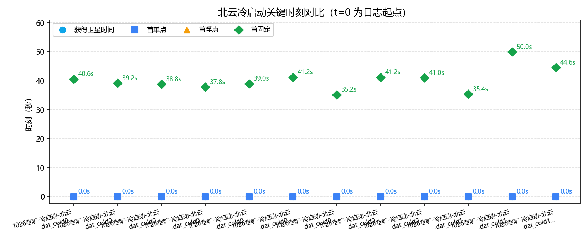
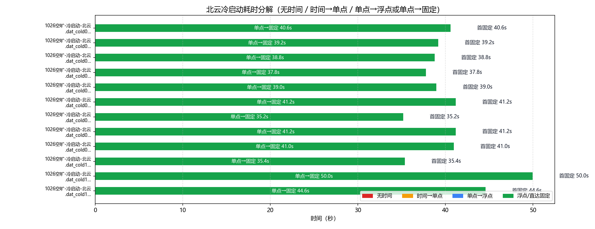
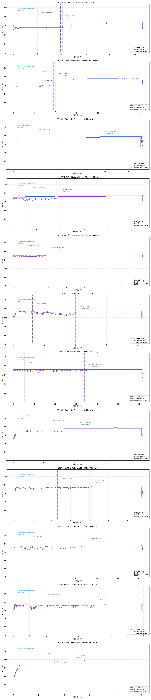

# 北云（UG016）GNSS 冷启动策略分析

- 数据源：`1026空旷-冷启动-北云.dat_cold01`、`1026空旷-冷启动-北云.dat_cold02`、`1026空旷-冷启动-北云.dat_cold03`、`1026空旷-冷启动-北云.dat_cold04`、`1026空旷-冷启动-北云.dat_cold05`、`1026空旷-冷启动-北云.dat_cold06`、`1026空旷-冷启动-北云.dat_cold07`、`1026空旷-冷启动-北云.dat_cold08`、`1026空旷-冷启动-北云.dat_cold09`、`1026空旷-冷启动-北云.dat_cold10`、`1026空旷-冷启动-北云.dat_cold11`、`1026空旷-冷启动-北云.dat_cold12`（定位流来源见下表）
- 口径依据：北云科技《UG016 数据通信接口协议》（文本转录：`by_manual\UG016.md`）
- 分析维度：时标状态 / 解算状态 / 定位类型 / 卫星数；本报告不含 INS

## 一、数据完整性与报文构成

| 文件 | 时长 | 定位报文 | 实测周期 | 时标分布(条) | 定位类型分布(条) | 间断/重定标 |
|---|---|---|---|---|---|---|
| `1026空旷-冷启动-北云.dat_cold01` | 107.0s | BESTGNSSPOSA 536条；0.2s/5.0Hz | `{'COARSE': 94, 'FINESTEERING': 442}` | `{'SINGLE': 203, 'NARROW_INT': 327, 'PSRDIFF': 6}` | 0 / 0 |
| `1026空旷-冷启动-北云.dat_cold02` | 122.6s | BESTGNSSPOSA 614条；0.2s/5.0Hz | `{'COARSE': 117, 'FINESTEERING': 497}` | `{'SINGLE': 196, 'NARROW_INT': 412, 'PSRDIFF': 6}` | 0 / 0 |
| `1026空旷-冷启动-北云.dat_cold03` | 56.6s | BESTGNSSPOSA 284条；0.2s/5.0Hz | `{'COARSE': 45, 'FINESTEERING': 239}` | `{'SINGLE': 194, 'NARROW_INT': 84, 'PSRDIFF': 6}` | 0 / 0 |
| `1026空旷-冷启动-北云.dat_cold04` | 109.4s | BESTGNSSPOSA 548条；0.2s/5.0Hz | `{'COARSE': 65, 'FINESTEERING': 483}` | `{'SINGLE': 189, 'NARROW_INT': 353, 'PSRDIFF': 6}` | 0 / 0 |
| `1026空旷-冷启动-北云.dat_cold05` | 144.2s | BESTGNSSPOSA 722条；0.2s/5.0Hz | `{'COARSE': 56, 'FINESTEERING': 666}` | `{'SINGLE': 195, 'NARROW_INT': 520, 'PSRDIFF': 7}` | 0 / 0 |
| `1026空旷-冷启动-北云.dat_cold06` | 83.4s | BESTGNSSPOSA 418条；0.2s/5.0Hz | `{'COARSE': 62, 'FINESTEERING': 356}` | `{'SINGLE': 206, 'NARROW_INT': 205, 'PSRDIFF': 7}` | 0 / 0 |
| `1026空旷-冷启动-北云.dat_cold07` | 61.8s | BESTGNSSPOSA 310条；0.2s/5.0Hz | `{'COARSE': 27, 'FINESTEERING': 283}` | `{'SINGLE': 176, 'NARROW_INT': 128, 'PSRDIFF': 6}` | 0 / 0 |
| `1026空旷-冷启动-北云.dat_cold08` | 83.8s | BESTGNSSPOSA 420条；0.2s/5.0Hz | `{'COARSE': 112, 'FINESTEERING': 308}` | `{'SINGLE': 206, 'NARROW_INT': 207, 'PSRDIFF': 7}` | 0 / 0 |
| `1026空旷-冷启动-北云.dat_cold09` | 68.0s | BESTGNSSPOSA 341条；0.2s/5.0Hz | `{'COARSE': 116, 'FINESTEERING': 225}` | `{'SINGLE': 205, 'NARROW_INT': 130, 'PSRDIFF': 6}` | 0 / 0 |
| `1026空旷-冷启动-北云.dat_cold10` | 62.0s | BESTGNSSPOSA 311条；0.2s/5.0Hz | `{'COARSE': 33, 'FINESTEERING': 278}` | `{'SINGLE': 177, 'NARROW_INT': 128, 'PSRDIFF': 6}` | 0 / 0 |
| `1026空旷-冷启动-北云.dat_cold11` | 79.6s | BESTGNSSPOSA 399条；0.2s/5.0Hz | `{'COARSE': 91, 'FINESTEERING': 308}` | `{'SINGLE': 250, 'NARROW_INT': 143, 'PSRDIFF': 6}` | 0 / 0 |
| `1026空旷-冷启动-北云.dat_cold12` | 101.6s | BESTGNSSPOSA 509条；0.2s/5.0Hz | `{'COARSE': 114, 'FINESTEERING': 395}` | `{'SINGLE': 223, 'NARROW_INT': 286}` | 0 / 0 |

> 口径（UG016）：报文按行做 CRC 校验（`#` 开头为 32 位 CRC，`$` 开头为 NMEA 异或）；`$KSXT` 为自定义 8 位 CRC32 私有报文，按 NMEA 异或校验判失败属正常、非故障。卫星维度口径：#SVs=跟踪卫星数、#solnSVs=参与解算卫星数、#solnMultiSVs=参与解算的多频卫星数。

### 报文完整性与周期（按报头时间戳逐帧判定）

| 文件 | 帧数 | 实测周期 | 标称频率 | CRC失败行 | 真实间断 | 周重定标 |
|---|---|---|---|---|---|---|
| `1026空旷-冷启动-北云.dat_cold01` | 536 | 0.2s | 5.0Hz | 0 | 0 | 0 |
| `1026空旷-冷启动-北云.dat_cold02` | 614 | 0.2s | 5.0Hz | 0 | 0 | 0 |
| `1026空旷-冷启动-北云.dat_cold03` | 284 | 0.2s | 5.0Hz | 0 | 0 | 0 |
| `1026空旷-冷启动-北云.dat_cold04` | 548 | 0.2s | 5.0Hz | 0 | 0 | 0 |
| `1026空旷-冷启动-北云.dat_cold05` | 722 | 0.2s | 5.0Hz | 0 | 0 | 0 |
| `1026空旷-冷启动-北云.dat_cold06` | 418 | 0.2s | 5.0Hz | 0 | 0 | 0 |
| `1026空旷-冷启动-北云.dat_cold07` | 310 | 0.2s | 5.0Hz | 0 | 0 | 0 |
| `1026空旷-冷启动-北云.dat_cold08` | 420 | 0.2s | 5.0Hz | 0 | 0 | 0 |
| `1026空旷-冷启动-北云.dat_cold09` | 341 | 0.2s | 5.0Hz | 0 | 0 | 0 |
| `1026空旷-冷启动-北云.dat_cold10` | 311 | 0.2s | 5.0Hz | 0 | 0 | 0 |
| `1026空旷-冷启动-北云.dat_cold11` | 399 | 0.2s | 5.0Hz | 0 | 0 | 0 |
| `1026空旷-冷启动-北云.dat_cold12` | 509 | 0.2s | 5.0Hz | 0 | 0 | 0 |

> 实测周期 = 全部相邻帧报头时间差的中位数（不假设）；真实间断 = 相邻帧时间差 > 2.5×实测周期（保留在时间轴中）；周重定标 = 相邻帧时间差 > 3600s（按时间连续处理）。

## 二、四个关键时刻（秒）

| 文件 | 获得卫星时间(脱离UNKNOWN) | COARSE→FINE | 差分改正可用 | 首单点 | 首浮点 | 首固定 | 无解/单点/浮点/固定 占比% | 跟踪星 min/均值/max |
|---|---|---|---|---|---|---|---|---|
| `1026空旷-冷启动-北云.dat_cold01` | **0.0s** | 0.0s → 18.8s | 39.0s | 0.0s | — | **40.6s** | 0/39.0/0/61.0 | 25/35.3/36 |
| `1026空旷-冷启动-北云.dat_cold02` | **0.0s** | 0.0s → 23.4s | 38.0s | 0.0s | — | **39.2s** | 0/32.9/0/67.1 | 31/36.5/38 |
| `1026空旷-冷启动-北云.dat_cold03` | **0.0s** | 0.0s → 9.0s | 37.8s | 0.0s | — | **38.8s** | 0/70.4/0/29.6 | 33/36.6/39 |
| `1026空旷-冷启动-北云.dat_cold04` | **0.0s** | 0.0s → 13.0s | 36.4s | 0.0s | — | **37.8s** | 0/35.6/0/64.4 | 34/36.8/38 |
| `1026空旷-冷启动-北云.dat_cold05` | **0.0s** | 0.0s → 11.2s | 37.8s | 0.0s | — | **39.0s** | 0/28.0/0/72.0 | 29/37.1/38 |
| `1026空旷-冷启动-北云.dat_cold06` | **0.0s** | 0.0s → 12.4s | 40.0s | 0.0s | — | **41.2s** | 0/51.0/0/49.0 | 31/36.9/37 |
| `1026空旷-冷启动-北云.dat_cold07` | **0.0s** | 0.0s → 5.4s | 34.0s | 0.0s | — | **35.2s** | 0/58.7/0/41.3 | 30/35.9/36 |
| `1026空旷-冷启动-北云.dat_cold08` | **0.0s** | 0.0s → 22.4s | 39.8s | 0.0s | — | **41.2s** | 0/50.7/0/49.3 | 27/37.0/39 |
| `1026空旷-冷启动-北云.dat_cold09` | **0.0s** | 0.0s → 23.2s | 39.6s | 0.0s | — | **41.0s** | 0/61.9/0/38.1 | 29/38.2/39 |
| `1026空旷-冷启动-北云.dat_cold10` | **0.0s** | 0.0s → 6.6s | 34.2s | 0.0s | — | **35.4s** | 0/58.8/0/41.2 | 33/39.4/40 |
| `1026空旷-冷启动-北云.dat_cold11` | **0.0s** | 0.0s → 18.2s | 48.8s | 0.0s | — | **50.0s** | 0/64.2/0/35.8 | 34/38.2/40 |
| `1026空旷-冷启动-北云.dat_cold12` | **0.0s** | 0.0s → 22.8s | 43.6s | 0.0s | — | **44.6s** | 0/43.8/0/56.2 | 17/37.8/39 |

## 三、冷启动耗时分解

### 表1：四阶段严格分解

| 文件 | 无时间 | 时间→单点 | 单点→浮点 | 浮点→固定 | 首固定 | 差分数据可用 |
|---|---|---|---|---|---|---|
| `1026空旷-冷启动-北云.dat_cold01` | 0.0s | 0.0s | — | — | **40.6s** | 39.0s |
| `1026空旷-冷启动-北云.dat_cold02` | 0.0s | 0.0s | — | — | **39.2s** | 38.0s |
| `1026空旷-冷启动-北云.dat_cold03` | 0.0s | 0.0s | — | — | **38.8s** | 37.8s |
| `1026空旷-冷启动-北云.dat_cold04` | 0.0s | 0.0s | — | — | **37.8s** | 36.4s |
| `1026空旷-冷启动-北云.dat_cold05` | 0.0s | 0.0s | — | — | **39.0s** | 37.8s |
| `1026空旷-冷启动-北云.dat_cold06` | 0.0s | 0.0s | — | — | **41.2s** | 40.0s |
| `1026空旷-冷启动-北云.dat_cold07` | 0.0s | 0.0s | — | — | **35.2s** | 34.0s |
| `1026空旷-冷启动-北云.dat_cold08` | 0.0s | 0.0s | — | — | **41.2s** | 39.8s |
| `1026空旷-冷启动-北云.dat_cold09` | 0.0s | 0.0s | — | — | **41.0s** | 39.6s |
| `1026空旷-冷启动-北云.dat_cold10` | 0.0s | 0.0s | — | — | **35.4s** | 34.2s |
| `1026空旷-冷启动-北云.dat_cold11` | 0.0s | 0.0s | — | — | **50.0s** | 48.8s |
| `1026空旷-冷启动-北云.dat_cold12` | 0.0s | 0.0s | — | — | **44.6s** | 43.6s |

### 表2：图示使用的路径汇总（支持无浮点直达固定）

| 文件 | 无时间 | 时间→单点 | 单点→浮点 | 浮点→固定 | 单点→固定 | 合计到首固定 |
|---|---|---|---|---|---|---|
| `1026空旷-冷启动-北云.dat_cold01` | 0.0s | 0.0s | — | — | 40.6s | 40.6s |
| `1026空旷-冷启动-北云.dat_cold02` | 0.0s | 0.0s | — | — | 39.2s | 39.2s |
| `1026空旷-冷启动-北云.dat_cold03` | 0.0s | 0.0s | — | — | 38.8s | 38.8s |
| `1026空旷-冷启动-北云.dat_cold04` | 0.0s | 0.0s | — | — | 37.8s | 37.8s |
| `1026空旷-冷启动-北云.dat_cold05` | 0.0s | 0.0s | — | — | 39.0s | 39.0s |
| `1026空旷-冷启动-北云.dat_cold06` | 0.0s | 0.0s | — | — | 41.2s | 41.2s |
| `1026空旷-冷启动-北云.dat_cold07` | 0.0s | 0.0s | — | — | 35.2s | 35.2s |
| `1026空旷-冷启动-北云.dat_cold08` | 0.0s | 0.0s | — | — | 41.2s | 41.2s |
| `1026空旷-冷启动-北云.dat_cold09` | 0.0s | 0.0s | — | — | 41.0s | 41.0s |
| `1026空旷-冷启动-北云.dat_cold10` | 0.0s | 0.0s | — | — | 35.4s | 35.4s |
| `1026空旷-冷启动-北云.dat_cold11` | 0.0s | 0.0s | — | — | 50.0s | 50.0s |
| `1026空旷-冷启动-北云.dat_cold12` | 0.0s | 0.0s | — | — | 44.6s | 44.6s |

## 四、定位类型分段统计

### `1026空旷-冷启动-北云.dat_cold01`

| 定位类型段 | 起–止(s) | 时长(s) | 条数 | 跟踪星 | 解算星 | 多频解算 |
|---|---|---|---|---|---|---|
| SINGLE | 0.0–40.4 | 40.6 | 203 | 34.4 | 27.9 | 27.9 |
| NARROW_INT | 40.6–105.8 | 65.4 | 327 | 35.9 | 33.0 | 33.0 |
| PSRDIFF | 106.0–107.0 | 1.2 | 6 | 31.2 | 28.3 | 28.3 |

### `1026空旷-冷启动-北云.dat_cold02`

| 定位类型段 | 起–止(s) | 时长(s) | 条数 | 跟踪星 | 解算星 | 多频解算 |
|---|---|---|---|---|---|---|
| SINGLE | 0.0–39.0 | 39.2 | 196 | 35.2 | 29.7 | 29.7 |
| NARROW_INT | 39.2–121.4 | 82.4 | 412 | 37.2 | 35.1 | 35.1 |
| PSRDIFF | 121.6–122.6 | 1.2 | 6 | 34.5 | 30.8 | 30.8 |

### `1026空旷-冷启动-北云.dat_cold03`

| 定位类型段 | 起–止(s) | 时长(s) | 条数 | 跟踪星 | 解算星 | 多频解算 |
|---|---|---|---|---|---|---|
| SINGLE | 0.0–38.6 | 38.8 | 194 | 35.6 | 34.2 | 34.2 |
| NARROW_INT | 38.8–55.4 | 16.8 | 84 | 39 | 36.1 | 36.1 |
| PSRDIFF | 55.6–56.6 | 1.2 | 6 | 35.8 | 29.8 | 29.8 |

### `1026空旷-冷启动-北云.dat_cold04`

| 定位类型段 | 起–止(s) | 时长(s) | 条数 | 跟踪星 | 解算星 | 多频解算 |
|---|---|---|---|---|---|---|
| SINGLE | 0.0–37.6 | 37.8 | 189 | 35.8 | 33.0 | 33.0 |
| NARROW_INT | 37.8–108.2 | 70.6 | 353 | 37.4 | 36.4 | 36.4 |
| PSRDIFF | 108.4–109.4 | 1.2 | 6 | 36.5 | 32 | 32 |

### `1026空旷-冷启动-北云.dat_cold05`

| 定位类型段 | 起–止(s) | 时长(s) | 条数 | 跟踪星 | 解算星 | 多频解算 |
|---|---|---|---|---|---|---|
| SINGLE | 0.0–38.8 | 39.0 | 195 | 36.6 | 34.6 | 34.6 |
| NARROW_INT | 39.0–142.8 | 104.0 | 520 | 37.3 | 36.9 | 36.9 |
| PSRDIFF | 143.0–144.2 | 1.4 | 7 | 34.6 | 32.1 | 32.1 |

### `1026空旷-冷启动-北云.dat_cold06`

| 定位类型段 | 起–止(s) | 时长(s) | 条数 | 跟踪星 | 解算星 | 多频解算 |
|---|---|---|---|---|---|---|
| SINGLE | 0.0–41.0 | 41.2 | 206 | 36.8 | 34.9 | 34.9 |
| NARROW_INT | 41.2–82.0 | 41.0 | 205 | 37 | 37 | 37 |
| PSRDIFF | 82.2–83.4 | 1.4 | 7 | 34.9 | 32.1 | 32.1 |

### `1026空旷-冷启动-北云.dat_cold07`

| 定位类型段 | 起–止(s) | 时长(s) | 条数 | 跟踪星 | 解算星 | 多频解算 |
|---|---|---|---|---|---|---|
| SINGLE | 0.0–35.0 | 35.2 | 176 | 36 | 34.7 | 34.7 |
| NARROW_INT | 35.2–60.6 | 25.6 | 128 | 36 | 36 | 36 |
| PSRDIFF | 60.8–61.8 | 1.2 | 6 | 33 | 27.5 | 27.5 |

### `1026空旷-冷启动-北云.dat_cold08`

| 定位类型段 | 起–止(s) | 时长(s) | 条数 | 跟踪星 | 解算星 | 多频解算 |
|---|---|---|---|---|---|---|
| SINGLE | 0.0–41.0 | 41.2 | 206 | 36.0 | 34.8 | 34.8 |
| NARROW_INT | 41.2–82.4 | 41.4 | 207 | 38.0 | 38.0 | 38.0 |
| PSRDIFF | 82.6–83.8 | 1.4 | 7 | 33.9 | 31.6 | 31.6 |

### `1026空旷-冷启动-北云.dat_cold09`

| 定位类型段 | 起–止(s) | 时长(s) | 条数 | 跟踪星 | 解算星 | 多频解算 |
|---|---|---|---|---|---|---|
| SINGLE | 0.0–40.8 | 41.0 | 205 | 37.9 | 36.5 | 36.5 |
| NARROW_INT | 41.0–66.8 | 26.0 | 130 | 38.9 | 38.9 | 38.9 |
| PSRDIFF | 67.0–68.0 | 1.2 | 6 | 34 | 31.7 | 31.7 |

### `1026空旷-冷启动-北云.dat_cold10`

| 定位类型段 | 起–止(s) | 时长(s) | 条数 | 跟踪星 | 解算星 | 多频解算 |
|---|---|---|---|---|---|---|
| SINGLE | 0.0–35.2 | 35.4 | 177 | 39.1 | 35.3 | 35.3 |
| NARROW_INT | 35.4–60.8 | 25.6 | 128 | 40 | 39.5 | 39.5 |
| PSRDIFF | 61.0–62.0 | 1.2 | 6 | 37 | 35.5 | 35.5 |

### `1026空旷-冷启动-北云.dat_cold11`

| 定位类型段 | 起–止(s) | 时长(s) | 条数 | 跟踪星 | 解算星 | 多频解算 |
|---|---|---|---|---|---|---|
| SINGLE | 0.0–49.8 | 50.0 | 250 | 37.9 | 35.0 | 35.0 |
| NARROW_INT | 50.0–78.4 | 28.6 | 143 | 38.8 | 38.8 | 38.8 |
| PSRDIFF | 78.6–79.6 | 1.2 | 6 | 37.7 | 33.5 | 33.5 |

### `1026空旷-冷启动-北云.dat_cold12`

| 定位类型段 | 起–止(s) | 时长(s) | 条数 | 跟踪星 | 解算星 | 多频解算 |
|---|---|---|---|---|---|---|
| SINGLE | 0.0–44.4 | 44.6 | 223 | 36.4 | 35.0 | 35.0 |
| NARROW_INT | 44.6–101.6 | 57.2 | 286 | 39.0 | 39.0 | 39.0 |

## 附录：口径与手册条款对应

| 报告字段 | 数据来源 | 手册条款 | 说明 |
|---|---|---|---|
| 获得卫星时间 | BESTGNSSPOSA 报头 Time Status 首次脱离 UNKNOWN | 报头字段 6 | UNKNOWN 表明尚未计算出准确的 GPS 时间 |
| COARSE→FINE | Time Status 首次 COARSE / FINESTEERING | 报头字段 6 | UNKNOWN / COARSE / FINESTEERING 三态 |
| 首单点 / 首浮点 / 首固定 | 位置类型 Pos Type 首次 SINGLE / NARROW_FLOAT / NARROW_INT | 表 4-2 | SINGLE=16 单点解；NARROW_FLOAT=34 窄带浮点解；NARROW_INT=50 窄带固定解 |
| 差分改正可用 | Stn ID 非空且 != "0" | 4.2.2 字段 12 | 差分站台 ID 号；单点定位时 ID 为 0；基站 ID 随数据动态变化 |
| 无解段解算状态 | Sol Type = INSUFFICIENT_OBS / VARIANCE | 表 4-1 | 观测量不足 / 方差超过限值；SOL_COMPUTED=完全解算；COLD_START=冷启动尚未完全解算 |
| 跟踪星 / 解算星 / 多频解算 | #SVs / #solnSVs / #solnMultiSVs | 4.2.2 字段 15/16/18 | 跟踪卫星数 / 解算卫星数 / 多频解算卫星数 |

> 时间轴为录制经过时间（t=0 为各日志首条记录）；若出现冷启动 GPS 周重定标（相邻两条报头时间差 >3600s），按时间连续处理（间隔按标称周期计）。