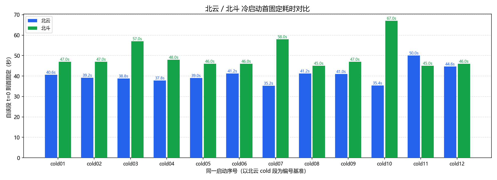

# 室外冷启动联合对比报告（北云 + 北斗）

- 北云数据源：`D:\software\gps分析程序\gps_test_coldstart\1026空旷-冷启动-北云\beiyun`，有效段数：12，定位流：BESTGNSSPOSA
- 北斗数据源：`D:\software\gps分析程序\gps_test_coldstart\1026空旷-冷启动-北云\beidou`，有效段数：12，定位流：BESTNAVA
- 配对口径：北云 cold 段为主切割/编号基准；北斗在时间窗口内匹配后仍使用自身 BESTNAVA 边界。共 12 对。
- 时间基准：各产品独立报告内该段自己的 t=0；本报告只比较同一启动序号的相对耗时。
- 注意：GNSS 状态推断段不等于已证明的物理断电/上电时刻；设备间启动是否同步需外部事件记录确认。

## 首固定时间对比

| 启动序号 | 北云首固定 | 北斗首固定 | 北斗-北云 |
|---:|---:|---:|---:|
| cold01 | 40.6s | 47.0s | 6.4s |
| cold02 | 39.2s | 47.0s | 7.8s |
| cold03 | 38.8s | 57.0s | 18.2s |
| cold04 | 37.8s | 48.0s | 10.2s |
| cold05 | 39.0s | 46.0s | 7.0s |
| cold06 | 41.2s | 46.0s | 4.8s |
| cold07 | 35.2s | 58.0s | 22.8s |
| cold08 | 41.2s | 45.0s | 3.8s |
| cold09 | 41.0s | 47.0s | 6.0s |
| cold10 | 35.4s | 67.0s | 31.6s |
| cold11 | 50.0s | 45.0s | -5.0s |
| cold12 | 44.6s | 46.0s | 1.4s |

**首固定统计（min / 均值 / max）：北云 35.2 / 40.3 / 50.0 (n=12)；北斗 45.0 / 49.9 / 67.0 (n=12)。**

## 关键里程碑明细

| 启动序号 | 北云获得时间 | 北斗获得时间 | 北云首单点 | 北斗首单点 | 北云首浮点 | 北斗首浮点 | 北云首固定 | 北斗首固定 |
|---:|---:|---:|---:|---:|---:|---:|---:|---:|
| cold01 | 0.0s | — | 0.0s | 0.0s | — | — | 40.6s | 47.0s |
| cold02 | 0.0s | — | 0.0s | 0.0s | — | — | 39.2s | 47.0s |
| cold03 | 0.0s | — | 0.0s | 0.0s | — | — | 38.8s | 57.0s |
| cold04 | 0.0s | — | 0.0s | 0.0s | — | — | 37.8s | 48.0s |
| cold05 | 0.0s | — | 0.0s | 0.0s | — | — | 39.0s | 46.0s |
| cold06 | 0.0s | — | 0.0s | 0.0s | — | — | 41.2s | 46.0s |
| cold07 | 0.0s | — | 0.0s | 0.0s | — | — | 35.2s | 58.0s |
| cold08 | 0.0s | — | 0.0s | 0.0s | — | — | 41.2s | 45.0s |
| cold09 | 0.0s | — | 0.0s | 0.0s | — | — | 41.0s | 47.0s |
| cold10 | 0.0s | — | 0.0s | 0.0s | — | — | 35.4s | 67.0s |
| cold11 | 0.0s | — | 0.0s | 0.0s | — | — | 50.0s | 45.0s |
| cold12 | 0.0s | — | 0.0s | 0.0s | — | — | 44.6s | 46.0s |

> 北斗 UM980 可由内部电池保持 GPS 时间，段首已持有效时标时“获得卫星时间”输出“—”。

## 冷启动路径汇总对比

| 启动序号 | 北云 无时间 | 北云 时间→单点 | 北云 单点→浮点 | 北云 浮点→固定 | 北云 单点→固定 | 北斗 无时间 | 北斗 时间→单点 | 北斗 单点→浮点 | 北斗 浮点→固定 | 北斗 单点→固定 |
|---:|---:|---:|---:|---:|---:|---:|---:|---:|---:|---:|
| cold01 | 0.0s | 0.0s | — | — | 40.6s | — | 0.0s | — | — | 47.0s |
| cold02 | 0.0s | 0.0s | — | — | 39.2s | — | 0.0s | — | — | 47.0s |
| cold03 | 0.0s | 0.0s | — | — | 38.8s | — | 0.0s | — | — | 57.0s |
| cold04 | 0.0s | 0.0s | — | — | 37.8s | — | 0.0s | — | — | 48.0s |
| cold05 | 0.0s | 0.0s | — | — | 39.0s | — | 0.0s | — | — | 46.0s |
| cold06 | 0.0s | 0.0s | — | — | 41.2s | — | 0.0s | — | — | 46.0s |
| cold07 | 0.0s | 0.0s | — | — | 35.2s | — | 0.0s | — | — | 58.0s |
| cold08 | 0.0s | 0.0s | — | — | 41.2s | — | 0.0s | — | — | 45.0s |
| cold09 | 0.0s | 0.0s | — | — | 41.0s | — | 0.0s | — | — | 47.0s |
| cold10 | 0.0s | 0.0s | — | — | 35.4s | — | 0.0s | — | — | 67.0s |
| cold11 | 0.0s | 0.0s | — | — | 50.0s | — | 0.0s | — | — | 45.0s |
| cold12 | 0.0s | 0.0s | — | — | 44.6s | — | 0.0s | — | — | 46.0s |

## 数据质量摘要

| 产品 | 定位流 | 有效段数 | 阶段顺序全部有效 | 校验失败报文 |
|---|---|---:|---|---:|
| 北云 | BESTGNSSPOSA | 12 | 是 | 0 |
| 北斗 | BESTNAVA | 12 | 是 | 24 |
