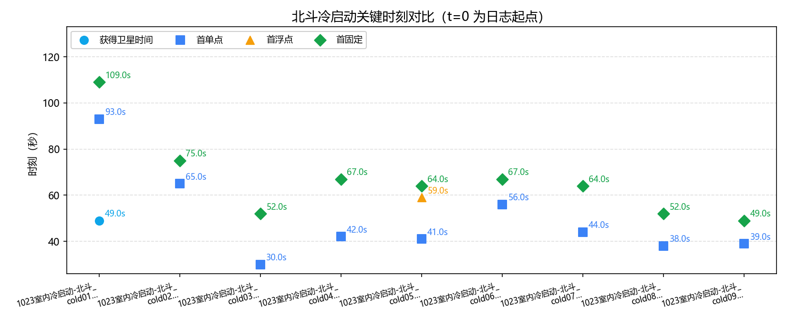
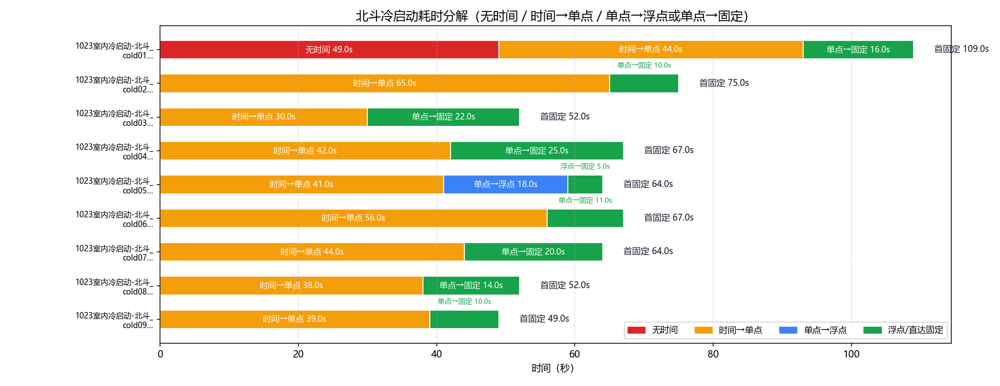
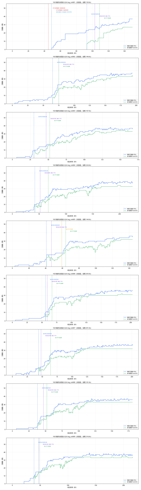

# 北斗（UM980）GNSS 冷启动策略分析

- 数据源：`1023室内冷启动-北斗.log_cold01`、`1023室内冷启动-北斗.log_cold02`、`1023室内冷启动-北斗.log_cold03`、`1023室内冷启动-北斗.log_cold04`、`1023室内冷启动-北斗.log_cold05`、`1023室内冷启动-北斗.log_cold06`、`1023室内冷启动-北斗.log_cold07`、`1023室内冷启动-北斗.log_cold08`、`1023室内冷启动-北斗.log_cold09`（混合二进制+ASCII 日志，#BESTNAVA）
- 口径依据：和芯星通《N4 Products Commands and Logs Reference Book R1.15》（`beidou_manual\Unicore Reference Commands Manual For N4 High Precision Products_V2_CH_R1.15.pdf`）
- 分析维度：时标状态 / 解算状态 / 定位类型 / 卫星数；本报告不含 INS（UM980 无 IMU）

## 一、数据完整性与报文构成

| 文件 | 时长 | 定位报文 | 实测周期 | 时标分布(条) | 定位类型分布(条) | 间断/重定标 |
|---|---|---|---|---|---|---|
| `1023室内冷启动-北斗.log_cold01` | 150.0s | BESTNAVA 151条；1.0s/1.0Hz | `{'UNKNOWN': 49, 'FINE': 102}` | `{'NONE': 93, 'SINGLE': 11, 'PSRDIFF': 5, 'NARROW_INT': 42}` | 0 / 2 |
| `1023室内冷启动-北斗.log_cold02` | 194.0s | BESTNAVA 195条；1.0s/1.0Hz | `{'FINE': 195}` | `{'NONE': 65, 'SINGLE': 10, 'NARROW_INT': 120}` | 0 / 0 |
| `1023室内冷启动-北斗.log_cold03` | 167.0s | BESTNAVA 168条；1.0s/1.0Hz | `{'FINE': 168}` | `{'NONE': 30, 'SINGLE': 17, 'PSRDIFF': 5, 'NARROW_INT': 116}` | 0 / 0 |
| `1023室内冷启动-北斗.log_cold04` | 224.0s | BESTNAVA 225条；1.0s/1.0Hz | `{'FINE': 225}` | `{'NONE': 42, 'SINGLE': 10, 'PSRDIFF': 15, 'NARROW_INT': 158}` | 0 / 0 |
| `1023室内冷启动-北斗.log_cold05` | 144.0s | BESTNAVA 145条；1.0s/1.0Hz | `{'FINE': 145}` | `{'NONE': 41, 'SINGLE': 6, 'PSRDIFF': 12, 'NARROW_FLOAT': 5, 'NARROW_INT': 81}` | 0 / 0 |
| `1023室内冷启动-北斗.log_cold06` | 203.0s | BESTNAVA 204条；1.0s/1.0Hz | `{'FINE': 204}` | `{'NONE': 56, 'SINGLE': 3, 'PSRDIFF': 8, 'NARROW_INT': 137}` | 0 / 0 |
| `1023室内冷启动-北斗.log_cold07` | 201.0s | BESTNAVA 202条；1.0s/1.0Hz | `{'FINE': 202}` | `{'NONE': 44, 'SINGLE': 5, 'PSRDIFF': 15, 'NARROW_INT': 138}` | 0 / 0 |
| `1023室内冷启动-北斗.log_cold08` | 181.0s | BESTNAVA 182条；1.0s/1.0Hz | `{'FINE': 182}` | `{'NONE': 38, 'SINGLE': 9, 'PSRDIFF': 5, 'NARROW_INT': 130}` | 0 / 0 |
| `1023室内冷启动-北斗.log_cold09` | 216.0s | BESTNAVA 217条；1.0s/1.0Hz | `{'FINE': 217}` | `{'NONE': 39, 'SINGLE': 8, 'PSRDIFF': 2, 'NARROW_INT': 168}` | 0 / 0 |

> 口径（N4 手册）：报文按行做 32 位 CRC 校验（`#` 开头为 32 位 CRC，`$` 开头为 NMEA 异或）；报头结构见表 7-51，BESTNAV 数据结构见表 7-70。卫星维度口径：#SVs=跟踪卫星数、#solnSVs=解算卫星数；表 7-70 无 #solnMultiSVs（字段 17-19 为 Reserved），多频解算维度不适用，输出“—”，不解析保留字段。

### 报文完整性与周期（按报头时间戳逐帧判定）

| 文件 | 帧数 | 实测周期 | 标称频率 | CRC失败行 | 真实间断 | 周重定标 |
|---|---|---|---|---|---|---|
| `1023室内冷启动-北斗.log_cold01` | 151 | 1.0s | 1.0Hz | 2 | 0 | 2 |
| `1023室内冷启动-北斗.log_cold02` | 195 | 1.0s | 1.0Hz | 2 | 0 | 0 |
| `1023室内冷启动-北斗.log_cold03` | 168 | 1.0s | 1.0Hz | 2 | 0 | 0 |
| `1023室内冷启动-北斗.log_cold04` | 225 | 1.0s | 1.0Hz | 2 | 0 | 0 |
| `1023室内冷启动-北斗.log_cold05` | 145 | 1.0s | 1.0Hz | 2 | 0 | 0 |
| `1023室内冷启动-北斗.log_cold06` | 204 | 1.0s | 1.0Hz | 2 | 0 | 0 |
| `1023室内冷启动-北斗.log_cold07` | 202 | 1.0s | 1.0Hz | 2 | 0 | 0 |
| `1023室内冷启动-北斗.log_cold08` | 182 | 1.0s | 1.0Hz | 2 | 0 | 0 |
| `1023室内冷启动-北斗.log_cold09` | 217 | 1.0s | 1.0Hz | 2 | 0 | 0 |

> 实测周期 = 全部相邻帧报头时间差的中位数（不假设）；真实间断 = 相邻帧时间差 > 2.5×实测周期（保留在时间轴中）；周重定标 = 相邻帧时间差 > 3600s（按时间连续处理）。

## 二、四个关键时刻（秒）

| 文件 | 获得卫星时间(脱离UNKNOWN) | 时标进入 FINE | 差分改正可用 | 首单点 | 首浮点 | 首固定 | 无解/单点/浮点/固定 占比% | 跟踪星 min/均值/max |
|---|---|---|---|---|---|---|---|---|
| `1023室内冷启动-北斗.log_cold01` | **49.0s** | 49.0s | 103.0s | 93.0s | — | **109.0s** | 61.6/10.6/0/27.8 | 0/15.8/37 |
| `1023室内冷启动-北斗.log_cold02` | **—** | — | 75.0s | 65.0s | — | **75.0s** | 33.3/5.1/0/61.5 | 0/21.6/37 |
| `1023室内冷启动-北斗.log_cold03` | **—** | — | 47.0s | 30.0s | — | **52.0s** | 17.9/13.1/0/69.0 | 0/24.1/38 |
| `1023室内冷启动-北斗.log_cold04` | **—** | — | 52.0s | 42.0s | — | **67.0s** | 18.7/11.1/0/70.2 | 0/25.4/39 |
| `1023室内冷启动-北斗.log_cold05` | **—** | — | 47.0s | 41.0s | 59.0s | **64.0s** | 28.3/12.4/3.4/55.9 | 0/20.6/36 |
| `1023室内冷启动-北斗.log_cold06` | **—** | — | 59.0s | 56.0s | — | **67.0s** | 27.5/5.4/0/67.2 | 0/22.5/36 |
| `1023室内冷启动-北斗.log_cold07` | **—** | — | 48.0s | 44.0s | — | **64.0s** | 21.8/9.9/0/68.3 | 0/24.3/37 |
| `1023室内冷启动-北斗.log_cold08` | **—** | — | 47.0s | 38.0s | — | **52.0s** | 20.9/7.7/0/71.4 | 0/24.4/37 |
| `1023室内冷启动-北斗.log_cold09` | **—** | — | 47.0s | 39.0s | — | **49.0s** | 18.0/4.6/0/77.4 | 0/27.0/39 |

> “—”规则：若该次启动段首已持有效时标（断电后 GPS 时间由 UM980 内部电池保持，Time Status 未丢失），“获得卫星时间 / 时标进入 FINE”输出“—”，不参与对比。N4 时标状态仅 UNKNOWN / FINE 两态（表 7-51）。

## 三、冷启动耗时分解

### 表1：四阶段严格分解

| 文件 | 无时间 | 时间→单点 | 单点→浮点 | 浮点→固定 | 首固定 | 差分数据可用 |
|---|---|---|---|---|---|---|
| `1023室内冷启动-北斗.log_cold01` | 49.0s | 44.0s | — | — | **109.0s** | 103.0s |
| `1023室内冷启动-北斗.log_cold02` | — | 65.0s | — | — | **75.0s** | 75.0s |
| `1023室内冷启动-北斗.log_cold03` | — | 30.0s | — | — | **52.0s** | 47.0s |
| `1023室内冷启动-北斗.log_cold04` | — | 42.0s | — | — | **67.0s** | 52.0s |
| `1023室内冷启动-北斗.log_cold05` | — | 41.0s | 18.0s | 5.0s | **64.0s** | 47.0s |
| `1023室内冷启动-北斗.log_cold06` | — | 56.0s | — | — | **67.0s** | 59.0s |
| `1023室内冷启动-北斗.log_cold07` | — | 44.0s | — | — | **64.0s** | 48.0s |
| `1023室内冷启动-北斗.log_cold08` | — | 38.0s | — | — | **52.0s** | 47.0s |
| `1023室内冷启动-北斗.log_cold09` | — | 39.0s | — | — | **49.0s** | 47.0s |

### 表2：图示使用的路径汇总（支持无浮点直达固定）

| 文件 | 无时间 | 时间→单点 | 单点→浮点 | 浮点→固定 | 单点→固定 | 合计到首固定 |
|---|---|---|---|---|---|---|
| `1023室内冷启动-北斗.log_cold01` | 49.0s | 44.0s | — | — | 16.0s | 109.0s |
| `1023室内冷启动-北斗.log_cold02` | — | 65.0s | — | — | 10.0s | 75.0s |
| `1023室内冷启动-北斗.log_cold03` | — | 30.0s | — | — | 22.0s | 52.0s |
| `1023室内冷启动-北斗.log_cold04` | — | 42.0s | — | — | 25.0s | 67.0s |
| `1023室内冷启动-北斗.log_cold05` | — | 41.0s | 18.0s | 5.0s | — | 64.0s |
| `1023室内冷启动-北斗.log_cold06` | — | 56.0s | — | — | 11.0s | 67.0s |
| `1023室内冷启动-北斗.log_cold07` | — | 44.0s | — | — | 20.0s | 64.0s |
| `1023室内冷启动-北斗.log_cold08` | — | 38.0s | — | — | 14.0s | 52.0s |
| `1023室内冷启动-北斗.log_cold09` | — | 39.0s | — | — | 10.0s | 49.0s |

## 四、定位类型分段统计

### `1023室内冷启动-北斗.log_cold01`

| 定位类型段 | 起–止(s) | 时长(s) | 条数 | 跟踪星 | 解算星 | 多频解算 |
|---|---|---|---|---|---|---|
| NONE | 0.0–92.0 | 93.0 | 93 | 7.2 | 0 | — |
| SINGLE | 93.0–102.0 | 10.0 | 10 | 23.8 | 9.5 | — |
| PSRDIFF | 103.0–105.0 | 3.0 | 3 | 27 | 10.3 | — |
| SINGLE | 106.0–106.0 | 1.0 | 1 | 26 | 10 | — |
| PSRDIFF | 107.0–108.0 | 2.0 | 2 | 25.5 | 14 | — |
| NARROW_INT | 109.0–150.0 | 42.0 | 42 | 31.4 | 23.1 | — |

### `1023室内冷启动-北斗.log_cold02`

| 定位类型段 | 起–止(s) | 时长(s) | 条数 | 跟踪星 | 解算星 | 多频解算 |
|---|---|---|---|---|---|---|
| NONE | 0.0–64.0 | 65.0 | 65 | 4.2 | 0 | — |
| SINGLE | 65.0–74.0 | 10.0 | 10 | 15.8 | 11.2 | — |
| NARROW_INT | 75.0–194.0 | 120.0 | 120 | 31.5 | 26.6 | — |

### `1023室内冷启动-北斗.log_cold03`

| 定位类型段 | 起–止(s) | 时长(s) | 条数 | 跟踪星 | 解算星 | 多频解算 |
|---|---|---|---|---|---|---|
| NONE | 0.0–29.0 | 30.0 | 30 | 1.7 | 0 | — |
| SINGLE | 30.0–46.0 | 17.0 | 17 | 12.6 | 8.4 | — |
| PSRDIFF | 47.0–51.0 | 5.0 | 5 | 16.6 | 14.2 | — |
| NARROW_INT | 52.0–167.0 | 116.0 | 116 | 32.0 | 27.7 | — |

### `1023室内冷启动-北斗.log_cold04`

| 定位类型段 | 起–止(s) | 时长(s) | 条数 | 跟踪星 | 解算星 | 多频解算 |
|---|---|---|---|---|---|---|
| NONE | 0.0–41.0 | 42.0 | 42 | 1.7 | 0 | — |
| SINGLE | 42.0–51.0 | 10.0 | 10 | 11 | 8.3 | — |
| PSRDIFF | 52.0–66.0 | 15.0 | 15 | 17.1 | 13.3 | — |
| NARROW_INT | 67.0–224.0 | 158.0 | 158 | 33.4 | 28.0 | — |

### `1023室内冷启动-北斗.log_cold05`

| 定位类型段 | 起–止(s) | 时长(s) | 条数 | 跟踪星 | 解算星 | 多频解算 |
|---|---|---|---|---|---|---|
| NONE | 0.0–40.0 | 41.0 | 41 | 2.8 | 0 | — |
| SINGLE | 41.0–46.0 | 6.0 | 6 | 14 | 10.7 | — |
| PSRDIFF | 47.0–58.0 | 12.0 | 12 | 15.2 | 9.6 | — |
| NARROW_FLOAT | 59.0–63.0 | 5.0 | 5 | 18.8 | 15.8 | — |
| NARROW_INT | 64.0–144.0 | 81.0 | 81 | 31.0 | 25.7 | — |

### `1023室内冷启动-北斗.log_cold06`

| 定位类型段 | 起–止(s) | 时长(s) | 条数 | 跟踪星 | 解算星 | 多频解算 |
|---|---|---|---|---|---|---|
| NONE | 0.0–55.0 | 56.0 | 56 | 2.4 | 0 | — |
| SINGLE | 56.0–58.0 | 3.0 | 3 | 10.7 | 6 | — |
| PSRDIFF | 59.0–66.0 | 8.0 | 8 | 15.1 | 10.4 | — |
| NARROW_INT | 67.0–203.0 | 137.0 | 137 | 31.5 | 27.1 | — |

### `1023室内冷启动-北斗.log_cold07`

| 定位类型段 | 起–止(s) | 时长(s) | 条数 | 跟踪星 | 解算星 | 多频解算 |
|---|---|---|---|---|---|---|
| NONE | 0.0–43.0 | 44.0 | 44 | 2.8 | 0 | — |
| SINGLE | 44.0–47.0 | 4.0 | 4 | 9.2 | 7 | — |
| PSRDIFF | 48.0–53.0 | 6.0 | 6 | 10.7 | 6.5 | — |
| SINGLE | 54.0–54.0 | 1.0 | 1 | 16 | 8 | — |
| PSRDIFF | 55.0–63.0 | 9.0 | 9 | 18.6 | 13.4 | — |
| NARROW_INT | 64.0–201.0 | 138.0 | 138 | 32.7 | 28.6 | — |

### `1023室内冷启动-北斗.log_cold08`

| 定位类型段 | 起–止(s) | 时长(s) | 条数 | 跟踪星 | 解算星 | 多频解算 |
|---|---|---|---|---|---|---|
| NONE | 0.0–37.0 | 38.0 | 38 | 1.2 | 0 | — |
| SINGLE | 38.0–46.0 | 9.0 | 9 | 12.6 | 8.7 | — |
| PSRDIFF | 47.0–51.0 | 5.0 | 5 | 16.2 | 13 | — |
| NARROW_INT | 52.0–181.0 | 130.0 | 130 | 32.3 | 28.4 | — |

### `1023室内冷启动-北斗.log_cold09`

| 定位类型段 | 起–止(s) | 时长(s) | 条数 | 跟踪星 | 解算星 | 多频解算 |
|---|---|---|---|---|---|---|
| NONE | 0.0–38.0 | 39.0 | 39 | 2.2 | 0 | — |
| SINGLE | 39.0–46.0 | 8.0 | 8 | 13.5 | 9.9 | — |
| PSRDIFF | 47.0–48.0 | 2.0 | 2 | 15 | 14.5 | — |
| NARROW_INT | 49.0–216.0 | 168.0 | 168 | 33.6 | 29.6 | — |

## 附录：口径与手册条款对应

| 报告字段 | 数据来源 | 手册条款 | 说明 |
|---|---|---|---|
| 获得卫星时间 | #BESTNAVA 报头 Time Status 首次脱离 UNKNOWN | 表 7-51 字段 5 | UNKNOWN 表明接收机尚未计算出准确的 GPS 时间；仅 UNKNOWN / FINE 两态；时标未丢失的段输出“—” |
| 时标进入 FINE | Time Status 首次 FINE | 表 7-51 字段 5 | 与“获得卫星时间”同刻（无 COARSE 态）；时标未丢失的段输出“—” |
| 首单点 / 首浮点 / 首固定 | 定位类型 Pos Type 首次 SINGLE 系 / NARROW_FLOAT 系 / NARROW_INT 系 | 表 0-5 | SINGLE=16 单点；PSRDIFF=17 伪距差分；NARROW_FLOAT=34 窄巷浮点解；NARROW_INT=50 窄巷固定解 |
| 差分改正可用 | Stn ID 非空且 != "0" | 表 7-70 字段 12 | 基站 ID，缺省值 0（实测如 "1793"）；单点定位时为 0 |
| 无解段解算状态 | Sol Status = INSUFFICIENT_OBS / NO_CONVERGENCE / COV_TRACE / VARIANCE | 表 0-6 | 观测数据不足 / 无法收敛 / 协方差迹超限 / 方差超限；SOL_COMPUTED=已解出 |
| 跟踪星 / 解算星 | #SVs / #solnSVs | 表 7-70 字段 15/16 | 跟踪卫星数 / 解算卫星数 |
| 多频解算 | 不适用（输出“—”） | 表 7-70 字段 17-19 | BESTNAV 无 #solnMultiSVs，17-19 为 Reserved，不解析保留字段 |
| 冷启动段判定 | 解状态≠SOL_COMPUTED + 定位类型 NONE/单点类 + 无基站 | 表 0-5/0-6/7-70 | UM980 断电后时标可由内部电池保持（FINE/真实周），时标不作启动必要条件（用户确认口径 2026-10-23） |

> 时间轴为录制经过时间（t=0 为各日志首条记录）；若出现冷启动 GPS 周重定标（相邻两条报头时间差 >3600s），按时间连续处理（间隔按标称周期计）。