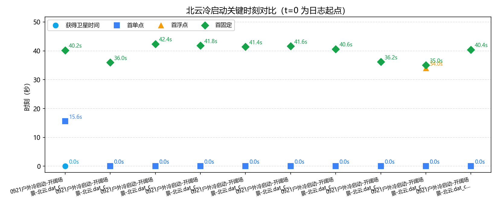
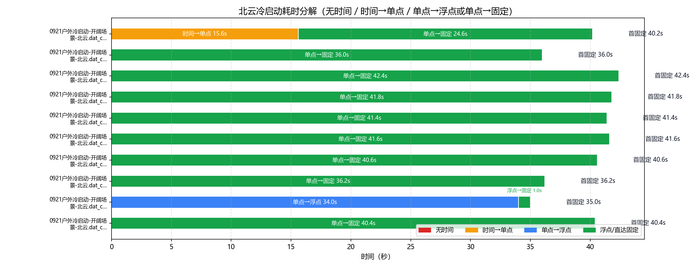
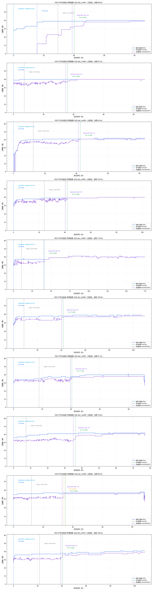

# 北云（UG016）GNSS 冷启动策略分析

- 数据源：`0921户外冷启动-开阔场景-北云.dat_cold01`、`0921户外冷启动-开阔场景-北云.dat_cold02`、`0921户外冷启动-开阔场景-北云.dat_cold03`、`0921户外冷启动-开阔场景-北云.dat_cold04`、`0921户外冷启动-开阔场景-北云.dat_cold05`、`0921户外冷启动-开阔场景-北云.dat_cold06`、`0921户外冷启动-开阔场景-北云.dat_cold07`、`0921户外冷启动-开阔场景-北云.dat_cold08`、`0921户外冷启动-开阔场景-北云.dat_cold09`、`0921户外冷启动-开阔场景-北云.dat_cold10`（定位流来源见下表）
- 口径依据：北云科技《UG016 数据通信接口协议》（文本转录：`by_manual\UG016.md`）
- 分析维度：时标状态 / 解算状态 / 定位类型 / 卫星数；本报告不含 INS

## 一、数据完整性与报文构成

| 文件 | 时长 | 定位报文 | 实测周期 | 时标分布(条) | 定位类型分布(条) | 间断/重定标 |
|---|---|---|---|---|---|---|
| `0921户外冷启动-开阔场景-北云.dat_cold01` | 86.8s | BESTGNSSPOSA 435条；0.2s/5.0Hz | `{'COARSE': 147, 'FINESTEERING': 288}` | `{'NONE': 78, 'SINGLE': 123, 'NARROW_INT': 234}` | 0 / 0 |
| `0921户外冷启动-开阔场景-北云.dat_cold02` | 87.4s | BESTGNSSPOSA 438条；0.2s/5.0Hz | `{'COARSE': 36, 'FINESTEERING': 402}` | `{'SINGLE': 180, 'NARROW_INT': 258}` | 0 / 0 |
| `0921户外冷启动-开阔场景-北云.dat_cold03` | 83.4s | BESTGNSSPOSA 418条；0.2s/5.0Hz | `{'COARSE': 63, 'FINESTEERING': 355}` | `{'SINGLE': 207, 'NONE': 5, 'NARROW_INT': 206}` | 0 / 0 |
| `0921户外冷启动-开阔场景-北云.dat_cold04` | 102.0s | BESTGNSSPOSA 511条；0.2s/5.0Hz | `{'COARSE': 120, 'FINESTEERING': 391}` | `{'SINGLE': 209, 'NARROW_INT': 302}` | 0 / 0 |
| `0921户外冷启动-开阔场景-北云.dat_cold05` | 174.6s | BESTGNSSPOSA 874条；0.2s/5.0Hz | `{'COARSE': 53, 'FINESTEERING': 821}` | `{'SINGLE': 207, 'NARROW_INT': 667}` | 0 / 0 |
| `0921户外冷启动-开阔场景-北云.dat_cold06` | 109.6s | BESTGNSSPOSA 549条；0.2s/5.0Hz | `{'COARSE': 44, 'FINESTEERING': 505}` | `{'SINGLE': 208, 'NARROW_INT': 341}` | 0 / 0 |
| `0921户外冷启动-开阔场景-北云.dat_cold07` | 91.2s | BESTGNSSPOSA 457条；0.2s/5.0Hz | `{'COARSE': 89, 'FINESTEERING': 368}` | `{'SINGLE': 203, 'NARROW_INT': 248, 'PSRDIFF': 6}` | 0 / 0 |
| `0921户外冷启动-开阔场景-北云.dat_cold08` | 76.8s | BESTGNSSPOSA 385条；0.2s/5.0Hz | `{'COARSE': 37, 'FINESTEERING': 348}` | `{'SINGLE': 181, 'NARROW_INT': 202, 'PSRDIFF': 2}` | 0 / 0 |
| `0921户外冷启动-开阔场景-北云.dat_cold09` | 88.4s | BESTGNSSPOSA 443条；0.2s/5.0Hz | `{'COARSE': 61, 'FINESTEERING': 382}` | `{'SINGLE': 170, 'NARROW_FLOAT': 5, 'NARROW_INT': 264, 'PSRDIFF': 4}` | 0 / 0 |
| `0921户外冷启动-开阔场景-北云.dat_cold10` | 108.4s | BESTGNSSPOSA 543条；0.2s/5.0Hz | `{'COARSE': 108, 'FINESTEERING': 435}` | `{'SINGLE': 202, 'NARROW_INT': 341}` | 0 / 0 |

> 口径（UG016）：报文按行做 CRC 校验（`#` 开头为 32 位 CRC，`$` 开头为 NMEA 异或）；`$KSXT` 为自定义 8 位 CRC32 私有报文，按 NMEA 异或校验判失败属正常、非故障。卫星维度口径：#SVs=跟踪卫星数、#solnSVs=参与解算卫星数、#solnMultiSVs=参与解算的多频卫星数。

### 报文完整性与周期（按报头时间戳逐帧判定）

| 文件 | 帧数 | 实测周期 | 标称频率 | CRC失败行 | 真实间断 | 周重定标 |
|---|---|---|---|---|---|---|
| `0921户外冷启动-开阔场景-北云.dat_cold01` | 435 | 0.2s | 5.0Hz | 0 | 0 | 0 |
| `0921户外冷启动-开阔场景-北云.dat_cold02` | 438 | 0.2s | 5.0Hz | 0 | 0 | 0 |
| `0921户外冷启动-开阔场景-北云.dat_cold03` | 418 | 0.2s | 5.0Hz | 0 | 0 | 0 |
| `0921户外冷启动-开阔场景-北云.dat_cold04` | 511 | 0.2s | 5.0Hz | 0 | 0 | 0 |
| `0921户外冷启动-开阔场景-北云.dat_cold05` | 874 | 0.2s | 5.0Hz | 0 | 0 | 0 |
| `0921户外冷启动-开阔场景-北云.dat_cold06` | 549 | 0.2s | 5.0Hz | 0 | 0 | 0 |
| `0921户外冷启动-开阔场景-北云.dat_cold07` | 457 | 0.2s | 5.0Hz | 0 | 0 | 0 |
| `0921户外冷启动-开阔场景-北云.dat_cold08` | 385 | 0.2s | 5.0Hz | 0 | 0 | 0 |
| `0921户外冷启动-开阔场景-北云.dat_cold09` | 443 | 0.2s | 5.0Hz | 0 | 0 | 0 |
| `0921户外冷启动-开阔场景-北云.dat_cold10` | 543 | 0.2s | 5.0Hz | 0 | 0 | 0 |

> 实测周期 = 全部相邻帧报头时间差的中位数（不假设）；真实间断 = 相邻帧时间差 > 2.5×实测周期（保留在时间轴中）；周重定标 = 相邻帧时间差 > 3600s（按时间连续处理）。

## 二、四个关键时刻（秒）

| 文件 | 获得卫星时间(脱离UNKNOWN) | COARSE→FINE | 差分改正可用 | 首单点 | 首浮点 | 首固定 | 无解/单点/浮点/固定 占比% | 跟踪星 min/均值/max |
|---|---|---|---|---|---|---|---|---|
| `0921户外冷启动-开阔场景-北云.dat_cold01` | **0.0s** | 0.0s → 29.4s | 38.8s | 15.6s | — | **40.2s** | 17.9/28.3/0/53.8 | 28/38.0/40 |
| `0921户外冷启动-开阔场景-北云.dat_cold02` | **0.0s** | 0.0s → 7.2s | 34.8s | 0.0s | — | **36.0s** | 0/41.1/0/58.9 | 39/39.9/40 |
| `0921户外冷启动-开阔场景-北云.dat_cold03` | **0.0s** | 0.0s → 12.6s | 41.2s | 0.0s | — | **42.4s** | 1.2/49.5/0/49.3 | 0/40.4/42 |
| `0921户外冷启动-开阔场景-北云.dat_cold04` | **0.0s** | 0.0s → 24.0s | 40.4s | 0.0s | — | **41.8s** | 0/40.9/0/59.1 | 31/39.0/40 |
| `0921户外冷启动-开阔场景-北云.dat_cold05` | **0.0s** | 0.0s → 10.6s | 40.2s | 0.0s | — | **41.4s** | 0/23.7/0/76.3 | 30/39.0/41 |
| `0921户外冷启动-开阔场景-北云.dat_cold06` | **0.0s** | 0.0s → 8.8s | 40.4s | 0.0s | — | **41.6s** | 0/37.9/0/62.1 | 28/38.0/39 |
| `0921户外冷启动-开阔场景-北云.dat_cold07` | **0.0s** | 0.0s → 17.8s | 39.6s | 0.0s | — | **40.6s** | 0/45.7/0/54.3 | 31/37.9/41 |
| `0921户外冷启动-开阔场景-北云.dat_cold08` | **0.0s** | 0.0s → 7.4s | 35.0s | 0.0s | — | **36.2s** | 0/47.5/0/52.5 | 36/40.7/42 |
| `0921户外冷启动-开阔场景-北云.dat_cold09` | **0.0s** | 0.0s → 12.2s | 32.8s | 0.0s | 34.0s | **35.0s** | 0/39.3/1.1/59.6 | 31/36.7/38 |
| `0921户外冷启动-开阔场景-北云.dat_cold10` | **0.0s** | 0.0s → 21.6s | 39.0s | 0.0s | — | **40.4s** | 0/37.2/0/62.8 | 32/38.3/41 |

## 三、冷启动耗时分解

### 表1：四阶段严格分解

| 文件 | 无时间 | 时间→单点 | 单点→浮点 | 浮点→固定 | 首固定 | 差分数据可用 |
|---|---|---|---|---|---|---|
| `0921户外冷启动-开阔场景-北云.dat_cold01` | 0.0s | 15.6s | — | — | **40.2s** | 38.8s |
| `0921户外冷启动-开阔场景-北云.dat_cold02` | 0.0s | 0.0s | — | — | **36.0s** | 34.8s |
| `0921户外冷启动-开阔场景-北云.dat_cold03` | 0.0s | 0.0s | — | — | **42.4s** | 41.2s |
| `0921户外冷启动-开阔场景-北云.dat_cold04` | 0.0s | 0.0s | — | — | **41.8s** | 40.4s |
| `0921户外冷启动-开阔场景-北云.dat_cold05` | 0.0s | 0.0s | — | — | **41.4s** | 40.2s |
| `0921户外冷启动-开阔场景-北云.dat_cold06` | 0.0s | 0.0s | — | — | **41.6s** | 40.4s |
| `0921户外冷启动-开阔场景-北云.dat_cold07` | 0.0s | 0.0s | — | — | **40.6s** | 39.6s |
| `0921户外冷启动-开阔场景-北云.dat_cold08` | 0.0s | 0.0s | — | — | **36.2s** | 35.0s |
| `0921户外冷启动-开阔场景-北云.dat_cold09` | 0.0s | 0.0s | 34.0s | 1.0s | **35.0s** | 32.8s |
| `0921户外冷启动-开阔场景-北云.dat_cold10` | 0.0s | 0.0s | — | — | **40.4s** | 39.0s |

### 表2：图示使用的路径汇总（支持无浮点直达固定）

| 文件 | 无时间 | 时间→单点 | 单点→浮点 | 浮点→固定 | 单点→固定 | 合计到首固定 |
|---|---|---|---|---|---|---|
| `0921户外冷启动-开阔场景-北云.dat_cold01` | 0.0s | 15.6s | — | — | 24.6s | 40.2s |
| `0921户外冷启动-开阔场景-北云.dat_cold02` | 0.0s | 0.0s | — | — | 36.0s | 36.0s |
| `0921户外冷启动-开阔场景-北云.dat_cold03` | 0.0s | 0.0s | — | — | 42.4s | 42.4s |
| `0921户外冷启动-开阔场景-北云.dat_cold04` | 0.0s | 0.0s | — | — | 41.8s | 41.8s |
| `0921户外冷启动-开阔场景-北云.dat_cold05` | 0.0s | 0.0s | — | — | 41.4s | 41.4s |
| `0921户外冷启动-开阔场景-北云.dat_cold06` | 0.0s | 0.0s | — | — | 41.6s | 41.6s |
| `0921户外冷启动-开阔场景-北云.dat_cold07` | 0.0s | 0.0s | — | — | 40.6s | 40.6s |
| `0921户外冷启动-开阔场景-北云.dat_cold08` | 0.0s | 0.0s | — | — | 36.2s | 36.2s |
| `0921户外冷启动-开阔场景-北云.dat_cold09` | 0.0s | 0.0s | 34.0s | 1.0s | — | 35.0s |
| `0921户外冷启动-开阔场景-北云.dat_cold10` | 0.0s | 0.0s | — | — | 40.4s | 40.4s |

## 四、定位类型分段统计

### `0921户外冷启动-开阔场景-北云.dat_cold01`

| 定位类型段 | 起–止(s) | 时长(s) | 条数 | 跟踪星 | 解算星 | 多频解算 |
|---|---|---|---|---|---|---|
| NONE | 0.0–15.4 | 15.6 | 78 | 31.4 | 0 | 0 |
| SINGLE | 15.6–40.0 | 24.6 | 123 | 38.8 | 22.6 | 22.6 |
| NARROW_INT | 40.2–86.8 | 46.8 | 234 | 39.8 | 37.6 | 37.6 |

### `0921户外冷启动-开阔场景-北云.dat_cold02`

| 定位类型段 | 起–止(s) | 时长(s) | 条数 | 跟踪星 | 解算星 | 多频解算 |
|---|---|---|---|---|---|---|
| SINGLE | 0.0–35.8 | 36.0 | 180 | 39.9 | 35.5 | 35.5 |
| NARROW_INT | 36.0–87.4 | 51.6 | 258 | 40.0 | 39.8 | 39.8 |

### `0921户外冷启动-开阔场景-北云.dat_cold03`

| 定位类型段 | 起–止(s) | 时长(s) | 条数 | 跟踪星 | 解算星 | 多频解算 |
|---|---|---|---|---|---|---|
| SINGLE | 0.0–0.2 | 0.4 | 2 | 22 | 21 | 21 |
| NONE | 0.4–1.2 | 1.0 | 5 | 18.6 | 0 | 0 |
| SINGLE | 1.4–42.2 | 41.0 | 205 | 39.9 | 36.3 | 36.3 |
| NARROW_INT | 42.4–83.4 | 41.2 | 206 | 41.6 | 40.8 | 40.8 |

### `0921户外冷启动-开阔场景-北云.dat_cold04`

| 定位类型段 | 起–止(s) | 时长(s) | 条数 | 跟踪星 | 解算星 | 多频解算 |
|---|---|---|---|---|---|---|
| SINGLE | 0.0–41.6 | 41.8 | 209 | 38.2 | 35.8 | 35.8 |
| NARROW_INT | 41.8–102.0 | 60.4 | 302 | 39.6 | 39.6 | 39.6 |

### `0921户外冷启动-开阔场景-北云.dat_cold05`

| 定位类型段 | 起–止(s) | 时长(s) | 条数 | 跟踪星 | 解算星 | 多频解算 |
|---|---|---|---|---|---|---|
| SINGLE | 0.0–41.2 | 41.4 | 207 | 36.8 | 32.9 | 32.9 |
| NARROW_INT | 41.4–174.6 | 133.4 | 667 | 39.7 | 39.7 | 39.7 |

### `0921户外冷启动-开阔场景-北云.dat_cold06`

| 定位类型段 | 起–止(s) | 时长(s) | 条数 | 跟踪星 | 解算星 | 多频解算 |
|---|---|---|---|---|---|---|
| SINGLE | 0.0–41.4 | 41.6 | 208 | 37.1 | 33.5 | 33.5 |
| NARROW_INT | 41.6–109.6 | 68.2 | 341 | 38.5 | 37.3 | 37.3 |

### `0921户外冷启动-开阔场景-北云.dat_cold07`

| 定位类型段 | 起–止(s) | 时长(s) | 条数 | 跟踪星 | 解算星 | 多频解算 |
|---|---|---|---|---|---|---|
| SINGLE | 0.0–40.4 | 40.6 | 203 | 35.7 | 33.3 | 33.3 |
| NARROW_INT | 40.6–90.0 | 49.6 | 248 | 39.7 | 37.7 | 37.7 |
| PSRDIFF | 90.2–91.2 | 1.2 | 6 | 37 | 32.8 | 32.8 |

### `0921户外冷启动-开阔场景-北云.dat_cold08`

| 定位类型段 | 起–止(s) | 时长(s) | 条数 | 跟踪星 | 解算星 | 多频解算 |
|---|---|---|---|---|---|---|
| SINGLE | 0.0–36.0 | 36.2 | 181 | 39.5 | 32.9 | 32.9 |
| NARROW_INT | 36.2–76.4 | 40.4 | 202 | 41.7 | 39.9 | 39.9 |
| PSRDIFF | 76.6–76.8 | 0.4 | 2 | 41.5 | 39.5 | 39.5 |

### `0921户外冷启动-开阔场景-北云.dat_cold09`

| 定位类型段 | 起–止(s) | 时长(s) | 条数 | 跟踪星 | 解算星 | 多频解算 |
|---|---|---|---|---|---|---|
| SINGLE | 0.0–33.8 | 34.0 | 170 | 36.3 | 31.4 | 31.4 |
| NARROW_FLOAT | 34.0–34.8 | 1.0 | 5 | 37 | 36 | 36 |
| NARROW_INT | 35.0–87.6 | 52.8 | 264 | 37.0 | 36.0 | 36.0 |
| PSRDIFF | 87.8–88.4 | 0.8 | 4 | 35.5 | 30.2 | 30.2 |

### `0921户外冷启动-开阔场景-北云.dat_cold10`

| 定位类型段 | 起–止(s) | 时长(s) | 条数 | 跟踪星 | 解算星 | 多频解算 |
|---|---|---|---|---|---|---|
| SINGLE | 0.0–40.2 | 40.4 | 202 | 36.6 | 31.0 | 31.0 |
| NARROW_INT | 40.4–108.4 | 68.2 | 341 | 39.3 | 37.1 | 37.1 |

## 附录：口径与手册条款对应

| 报告字段 | 数据来源 | 手册条款 | 说明 |
|---|---|---|---|
| 获得卫星时间 | BESTGNSSPOSA 报头 Time Status 首次脱离 UNKNOWN | 报头字段 6 | UNKNOWN 表明尚未计算出准确的 GPS 时间 |
| COARSE→FINE | Time Status 首次 COARSE / FINESTEERING | 报头字段 6 | UNKNOWN / COARSE / FINESTEERING 三态 |
| 首单点 / 首浮点 / 首固定 | 位置类型 Pos Type 首次 SINGLE / NARROW_FLOAT / NARROW_INT | 表 4-2 | SINGLE=16 单点解；NARROW_FLOAT=34 窄带浮点解；NARROW_INT=50 窄带固定解 |
| 差分改正可用 | Stn ID 非空且 != "0" | 4.2.2 字段 12 | 差分站台 ID 号；单点定位时 ID 为 0；基站 ID 随数据动态变化 |
| 无解段解算状态 | Sol Type = INSUFFICIENT_OBS / VARIANCE | 表 4-1 | 观测量不足 / 方差超过限值；SOL_COMPUTED=完全解算；COLD_START=冷启动尚未完全解算 |
| 跟踪星 / 解算星 / 多频解算 | #SVs / #solnSVs / #solnMultiSVs | 4.2.2 字段 15/16/18 | 跟踪卫星数 / 解算卫星数 / 多频解算卫星数 |

> 时间轴为录制经过时间（t=0 为各日志首条记录）；若出现冷启动 GPS 周重定标（相邻两条报头时间差 >3600s），按时间连续处理（间隔按标称周期计）。