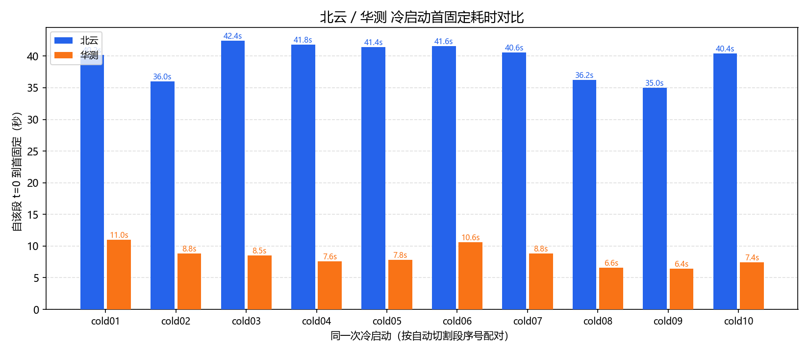

# 室外冷启动联合对比报告（北云 + 华测）

- 北云数据源：`D:\software\gps分析程序\gps_test_coldstart\reports\beiyun`，有效段数：10，定位流：BESTGNSSPOSA
- 华测数据源：`D:\software\gps分析程序\gps_test_coldstart\reports\huace`，有效段数：10，定位流：BESTPA
- 配对口径：按自动切割段序号 `coldNN` 一一对应，共 10 对。
- 时间基准：各产品独立报告内该段自己的 t=0；本报告只比较同一启动序号的相对耗时。
- 注意：GNSS 状态推断段不等于已证明的物理断电/上电时刻；设备间启动是否同步需外部事件记录确认。

## 首固定时间对比

| 启动序号 | 北云首固定 | 华测首固定 | 华测-北云 |
|---:|---:|---:|---:|
| cold01 | 40.2s | 11.0s | -29.2s |
| cold02 | 36.0s | 8.8s | -27.2s |
| cold03 | 42.4s | 8.5s | -33.9s |
| cold04 | 41.8s | 7.6s | -34.2s |
| cold05 | 41.4s | 7.8s | -33.6s |
| cold06 | 41.6s | 10.6s | -31.0s |
| cold07 | 40.6s | 8.8s | -31.8s |
| cold08 | 36.2s | 6.6s | -29.6s |
| cold09 | 35.0s | 6.4s | -28.6s |
| cold10 | 40.4s | 7.4s | -33.0s |

**首固定统计（min / 均值 / max）：北云 35.0 / 39.6 / 42.4 (n=10)；华测 6.4 / 8.3 / 11.0 (n=10)。**

## 获得卫星时间对比

华测口径：Time Status 首次脱离 UNKNOWN/APPROXIMATE；北云口径：首次脱离 UNKNOWN。

| 启动序号 | 北云获得时间 | 华测获得时间 | 华测-北云 |
|---:|---:|---:|---:|
| cold01 | 0.0s | 5.0s | 5.0s |
| cold02 | 0.0s | 3.3s | 3.3s |
| cold03 | 0.0s | 2.3s | 2.3s |
| cold04 | 0.0s | 3.9s | 3.9s |
| cold05 | 0.0s | 3.3s | 3.3s |
| cold06 | 0.0s | 2.2s | 2.2s |
| cold07 | 0.0s | 3.9s | 3.9s |
| cold08 | 0.0s | 3.6s | 3.6s |
| cold09 | 0.0s | 3.4s | 3.4s |
| cold10 | 0.0s | 3.1s | 3.1s |

## 首单点/首浮点对比

| 启动序号 | 北云首单点 | 华测首单点 | 北云首浮点 | 华测首浮点 |
|---:|---:|---:|---:|---:|
| cold01 | 15.6s | 8.5s | — | 9.3s |
| cold02 | 0.0s | 3.3s | — | — |
| cold03 | 0.0s | 1.5s | — | 8.0s |
| cold04 | 0.0s | 2.2s | — | 5.5s |
| cold05 | 0.0s | 2.4s | — | 6.5s |
| cold06 | 0.0s | 1.6s | — | — |
| cold07 | 0.0s | 3.1s | — | 6.6s |
| cold08 | 0.0s | 2.6s | — | 5.6s |
| cold09 | 0.0s | 2.4s | 34.0s | — |
| cold10 | 0.0s | 2.1s | — | — |

## 冷启动路径汇总对比

“单点→固定”表示该段没有出现浮点解，直接从单点类进入固定解。

| 启动序号 | 北云 无时间 | 北云 时间→单点 | 北云 单点→浮点 | 北云 浮点→固定 | 北云 单点→固定 | 华测 无时间 | 华测 时间→单点 | 华测 单点→浮点 | 华测 浮点→固定 | 华测 单点→固定 |
|---:|---:|---:|---:|---:|---:|---:|---:|---:|---:|---:|
| cold01 | 0.0s | 15.6s | — | — | 24.6s | 5.0s | 3.5s | 0.8s | 1.7s | — |
| cold02 | 0.0s | 0.0s | — | — | 36.0s | 3.3s | 0.0s | — | — | 5.5s |
| cold03 | 0.0s | 0.0s | — | — | 42.4s | 2.3s | 0.0s | 6.5s | 0.5s | — |
| cold04 | 0.0s | 0.0s | — | — | 41.8s | 3.9s | 0.0s | 3.3s | 2.1s | — |
| cold05 | 0.0s | 0.0s | — | — | 41.4s | 3.3s | 0.0s | 4.1s | 1.3s | — |
| cold06 | 0.0s | 0.0s | — | — | 41.6s | 2.2s | 0.0s | — | — | 9.0s |
| cold07 | 0.0s | 0.0s | — | — | 40.6s | 3.9s | 0.0s | 3.5s | 2.2s | — |
| cold08 | 0.0s | 0.0s | — | — | 36.2s | 3.6s | 0.0s | 3.0s | 1.0s | — |
| cold09 | 0.0s | 0.0s | 34.0s | 1.0s | — | 3.4s | 0.0s | — | — | 4.0s |
| cold10 | 0.0s | 0.0s | — | — | 40.4s | 3.1s | 0.0s | — | — | 5.3s |

## 数据质量摘要

| 产品 | 定位流 | 有效段数 | 阶段顺序全部有效 | 校验失败报文 |
|---|---|---:|---|---:|
| 北云 | BESTGNSSPOSA | 10 | 是 | 0 |
| 华测 | BESTPA | 10 | 是 | 40 |
