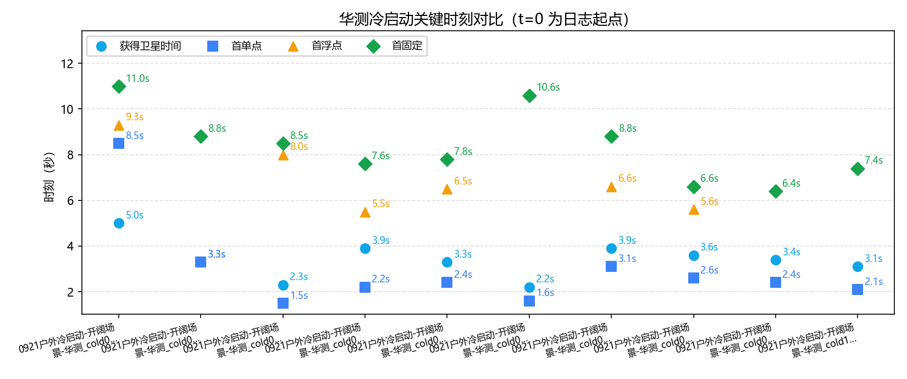
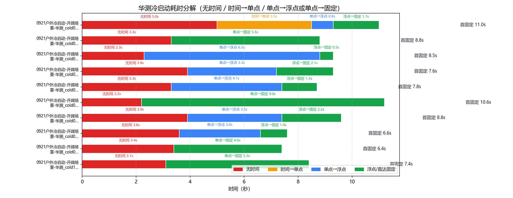
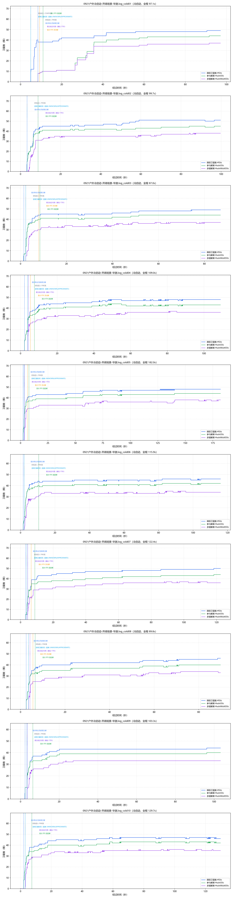

# 华测（HUACE M720）GNSS 冷启动策略分析

- 数据源：`0921户外冷启动-开阔场景-华测.log_cold01`、`0921户外冷启动-开阔场景-华测.log_cold02`、`0921户外冷启动-开阔场景-华测.log_cold03`、`0921户外冷启动-开阔场景-华测.log_cold04`、`0921户外冷启动-开阔场景-华测.log_cold05`、`0921户外冷启动-开阔场景-华测.log_cold06`、`0921户外冷启动-开阔场景-华测.log_cold07`、`0921户外冷启动-开阔场景-华测.log_cold08`、`0921户外冷启动-开阔场景-华测.log_cold09`、`0921户外冷启动-开阔场景-华测.log_cold10`（COM1 ASCII 日志，#BESTPOSA）
- 口径依据：华测《M7系列模组用户指令及协议手册 V2.7》（`huace_manual\M7系列模组用户指令及协议手册_V2.7.pdf`）
- 分析维度：时标状态 / 解算状态 / 定位类型 / 卫星数；本报告不含 INS

## 一、数据完整性与报文构成

| 文件 | 时长 | 定位报文 | 实测周期 | 时标分布(条) | 定位类型分布(条) | 间断/重定标 |
|---|---|---|---|---|---|---|
| `0921户外冷启动-开阔场景-华测.log_cold01` | 97.1s | BESTPA 954条 | 0.1s/10.0Hz | `{'APPROXIMATE': 32, 'COARSESTEERING': 35, 'FINESTEERING': 887}` | `{'NONE': 67, 'SINGLE': 8, 'NARROW_FLOAT': 17, 'NARROW_INT': 862}` | 1 / 0 |
| `0921户外冷启动-开阔场景-华测.log_cold02` | 99.7s | BESTPA 999条 | 0.1s/10.0Hz | `{'APPROXIMATE': 34, 'FINESTEERING': 965}` | `{'NONE': 34, 'SINGLE': 55, 'NARROW_INT': 910}` | 0 / 0 |
| `0921户外冷启动-开阔场景-华测.log_cold03` | 87.0s | BESTPA 870条 | 0.1s/10.0Hz | `{'APPROXIMATE': 23, 'FINESTEERING': 847}` | `{'NONE': 15, 'SINGLE': 64, 'NARROW_FLOAT': 6, 'NARROW_INT': 785}` | 0 / 0 |
| `0921户外冷启动-开阔场景-华测.log_cold04` | 109.0s | BESTPA 1092条 | 0.1s/10.0Hz | `{'APPROXIMATE': 40, 'FINESTEERING': 1052}` | `{'NONE': 23, 'SINGLE': 22, 'SPPDIFF': 11, 'NARROW_FLOAT': 21, 'NARROW_INT': 1015}` | 0 / 0 |
| `0921户外冷启动-开阔场景-华测.log_cold05` | 182.0s | BESTPA 1822条 | 0.1s/10.0Hz | `{'APPROXIMATE': 34, 'FINESTEERING': 1788}` | `{'NONE': 25, 'SINGLE': 12, 'SPPDIFF': 29, 'NARROW_FLOAT': 13, 'NARROW_INT': 1743}` | 0 / 0 |
| `0921户外冷启动-开阔场景-华测.log_cold06` | 115.9s | BESTPA 1159条 | 0.1s/10.0Hz | `{'APPROXIMATE': 21, 'FINESTEERING': 1138}` | `{'NONE': 15, 'SINGLE': 90, 'NARROW_INT': 1054}` | 0 / 0 |
| `0921户外冷启动-开阔场景-华测.log_cold07` | 122.4s | BESTPA 1225条 | 0.1s/10.0Hz | `{'APPROXIMATE': 39, 'FINESTEERING': 1186}` | `{'NONE': 32, 'SINGLE': 13, 'SPPDIFF': 21, 'NARROW_FLOAT': 22, 'NARROW_INT': 1137}` | 0 / 0 |
| `0921户外冷启动-开阔场景-华测.log_cold08` | 89.8s | BESTPA 900条 | 0.1s/10.0Hz | `{'APPROXIMATE': 37, 'FINESTEERING': 863}` | `{'NONE': 27, 'SINGLE': 17, 'SPPDIFF': 13, 'NARROW_FLOAT': 10, 'NARROW_INT': 833}` | 0 / 0 |
| `0921户外冷启动-开阔场景-华测.log_cold09` | 103.3s | BESTPA 1034条 | 0.1s/10.0Hz | `{'APPROXIMATE': 34, 'FINESTEERING': 1000}` | `{'NONE': 25, 'SINGLE': 10, 'SPPDIFF': 29, 'NARROW_INT': 970}` | 0 / 0 |
| `0921户外冷启动-开阔场景-华测.log_cold10` | 129.7s | BESTPA 1296条 | 0.1s/10.0Hz | `{'APPROXIMATE': 29, 'FINESTEERING': 1267}` | `{'NONE': 20, 'SINGLE': 52, 'NARROW_INT': 1224}` | 0 / 0 |

> 口径（华测 M7 手册）：报文按行做 CRC 校验（`#` 开头为 32 位 CRC，`$` 开头为 NMEA 异或）。卫星维度口径：#SVs=跟踪到的卫星数、#solnSVs=参与解算的卫星数、#solnMultiSVs=参与解算的多频信号卫星数（含义与单位同北云）。

### 报文完整性与周期（按报头时间戳逐帧判定）

| 文件 | 帧数 | 实测周期 | 标称频率 | CRC失败行 | 真实间断 | 周重定标 |
|---|---|---|---|---|---|---|
| `0921户外冷启动-开阔场景-华测.log_cold01` | 954 | 0.1s | 10.0Hz | 4 | 1 | 0 |
| `0921户外冷启动-开阔场景-华测.log_cold02` | 999 | 0.1s | 10.0Hz | 4 | 0 | 0 |
| `0921户外冷启动-开阔场景-华测.log_cold03` | 870 | 0.1s | 10.0Hz | 4 | 0 | 0 |
| `0921户外冷启动-开阔场景-华测.log_cold04` | 1092 | 0.1s | 10.0Hz | 4 | 0 | 0 |
| `0921户外冷启动-开阔场景-华测.log_cold05` | 1822 | 0.1s | 10.0Hz | 4 | 0 | 0 |
| `0921户外冷启动-开阔场景-华测.log_cold06` | 1159 | 0.1s | 10.0Hz | 4 | 0 | 0 |
| `0921户外冷启动-开阔场景-华测.log_cold07` | 1225 | 0.1s | 10.0Hz | 4 | 0 | 0 |
| `0921户外冷启动-开阔场景-华测.log_cold08` | 900 | 0.1s | 10.0Hz | 4 | 0 | 0 |
| `0921户外冷启动-开阔场景-华测.log_cold09` | 1034 | 0.1s | 10.0Hz | 4 | 0 | 0 |
| `0921户外冷启动-开阔场景-华测.log_cold10` | 1296 | 0.1s | 10.0Hz | 4 | 0 | 0 |

> 实测周期 = 全部相邻帧报头时间差的中位数（不假设）；真实间断 = 相邻帧时间差 > 2.5×实测周期（保留在时间轴中）；周重定标 = 相邻帧时间差 > 3600s（按时间连续处理）。

## 二、四个关键时刻（秒）

| 文件 | 获得卫星时间(脱离UNKNOWN) | COARSE→FINE | 差分改正可用 | 首单点 | 首浮点 | 首固定 | 无解/单点/浮点/固定 占比% | 跟踪星 min/均值/max |
|---|---|---|---|---|---|---|---|---|
| `0921户外冷启动-开阔场景-华测.log_cold01` | **5.0s** | 5.0s → 8.5s | 9.3s | 8.5s | 9.3s | **11.0s** | 7.0/0.8/1.8/90.4 | 0/43.1/49 |
| `0921户外冷启动-开阔场景-华测.log_cold02` | **3.3s** | — → 3.3s | 8.8s | 3.3s | — | **8.8s** | 3.4/5.5/0/91.1 | 0/45.6/51 |
| `0921户外冷启动-开阔场景-华测.log_cold03` | **2.3s** | — → 2.3s | 8.0s | 1.5s | 8.0s | **8.5s** | 1.7/7.4/0.7/90.2 | 0/44.9/49 |
| `0921户外冷启动-开阔场景-华测.log_cold04` | **3.9s** | — → 3.9s | 4.4s | 2.2s | 5.5s | **7.6s** | 2.1/3.0/1.9/92.9 | 0/44.5/48 |
| `0921户外冷启动-开阔场景-华测.log_cold05` | **3.3s** | — → 3.3s | 3.6s | 2.4s | 6.5s | **7.8s** | 1.4/2.3/0.7/95.7 | 0/45.0/48 |
| `0921户外冷启动-开阔场景-华测.log_cold06` | **2.2s** | — → 2.2s | 10.6s | 1.6s | — | **10.6s** | 1.3/7.8/0/90.9 | 0/43.7/46 |
| `0921户外冷启动-开阔场景-华测.log_cold07` | **3.9s** | — → 3.9s | 4.5s | 3.1s | 6.6s | **8.8s** | 2.6/2.8/1.8/92.8 | 0/45.1/50 |
| `0921户外冷启动-开阔场景-华测.log_cold08` | **3.6s** | — → 3.6s | 4.3s | 2.6s | 5.6s | **6.6s** | 3.0/3.3/1.1/92.6 | 0/40.6/46 |
| `0921户外冷启动-开阔场景-华测.log_cold09` | **3.4s** | — → 3.4s | 3.5s | 2.4s | — | **6.4s** | 2.4/3.8/0/93.8 | 0/40.8/44 |
| `0921户外冷启动-开阔场景-华测.log_cold10` | **3.1s** | — → 3.1s | 7.4s | 2.1s | — | **7.4s** | 1.5/4.0/0/94.4 | 0/44.3/47 |

## 三、冷启动耗时分解

### 表1：四阶段严格分解

| 文件 | 无时间 | 时间→单点 | 单点→浮点 | 浮点→固定 | 首固定 | 差分数据可用 |
|---|---|---|---|---|---|---|
| `0921户外冷启动-开阔场景-华测.log_cold01` | 5.0s | 3.5s | 0.8s | 1.7s | **11.0s** | 9.3s |
| `0921户外冷启动-开阔场景-华测.log_cold02` | 3.3s | 0.0s | — | — | **8.8s** | 8.8s |
| `0921户外冷启动-开阔场景-华测.log_cold03` | 2.3s | 0.0s | 6.5s | 0.5s | **8.5s** | 8.0s |
| `0921户外冷启动-开阔场景-华测.log_cold04` | 3.9s | 0.0s | 3.3s | 2.1s | **7.6s** | 4.4s |
| `0921户外冷启动-开阔场景-华测.log_cold05` | 3.3s | 0.0s | 4.1s | 1.3s | **7.8s** | 3.6s |
| `0921户外冷启动-开阔场景-华测.log_cold06` | 2.2s | 0.0s | — | — | **10.6s** | 10.6s |
| `0921户外冷启动-开阔场景-华测.log_cold07` | 3.9s | 0.0s | 3.5s | 2.2s | **8.8s** | 4.5s |
| `0921户外冷启动-开阔场景-华测.log_cold08` | 3.6s | 0.0s | 3.0s | 1.0s | **6.6s** | 4.3s |
| `0921户外冷启动-开阔场景-华测.log_cold09` | 3.4s | 0.0s | — | — | **6.4s** | 3.5s |
| `0921户外冷启动-开阔场景-华测.log_cold10` | 3.1s | 0.0s | — | — | **7.4s** | 7.4s |

### 表2：图示使用的路径汇总（支持无浮点直达固定）

| 文件 | 无时间 | 时间→单点 | 单点→浮点 | 浮点→固定 | 单点→固定 | 合计到首固定 |
|---|---|---|---|---|---|---|
| `0921户外冷启动-开阔场景-华测.log_cold01` | 5.0s | 3.5s | 0.8s | 1.7s | — | 11.0s |
| `0921户外冷启动-开阔场景-华测.log_cold02` | 3.3s | 0.0s | — | — | 5.5s | 8.8s |
| `0921户外冷启动-开阔场景-华测.log_cold03` | 2.3s | 0.0s | 6.5s | 0.5s | — | 9.3s |
| `0921户外冷启动-开阔场景-华测.log_cold04` | 3.9s | 0.0s | 3.3s | 2.1s | — | 9.299999999999999s |
| `0921户外冷启动-开阔场景-华测.log_cold05` | 3.3s | 0.0s | 4.1s | 1.3s | — | 8.7s |
| `0921户外冷启动-开阔场景-华测.log_cold06` | 2.2s | 0.0s | — | — | 9.0s | 11.2s |
| `0921户外冷启动-开阔场景-华测.log_cold07` | 3.9s | 0.0s | 3.5s | 2.2s | — | 9.600000000000001s |
| `0921户外冷启动-开阔场景-华测.log_cold08` | 3.6s | 0.0s | 3.0s | 1.0s | — | 7.6s |
| `0921户外冷启动-开阔场景-华测.log_cold09` | 3.4s | 0.0s | — | — | 4.0s | 7.4s |
| `0921户外冷启动-开阔场景-华测.log_cold10` | 3.1s | 0.0s | — | — | 5.3s | 8.4s |

## 四、定位类型分段统计

### `0921户外冷启动-开阔场景-华测.log_cold01`

| 定位类型段 | 起–止(s) | 时长(s) | 条数 | 跟踪星 | 解算星 | 多频解算 |
|---|---|---|---|---|---|---|
| NONE | 0.0–8.4 | 6.7 | 67 | 12.4 | 0 | 0 |
| SINGLE | 8.5–9.2 | 0.8 | 8 | 38 | 8 | 8 |
| NARROW_FLOAT | 9.3–10.9 | 1.7 | 17 | 38 | 9.1 | 9.1 |
| NARROW_INT | 11.0–97.1 | 86.2 | 862 | 45.6 | 34.5 | 29.5 |

### `0921户外冷启动-开阔场景-华测.log_cold02`

| 定位类型段 | 起–止(s) | 时长(s) | 条数 | 跟踪星 | 解算星 | 多频解算 |
|---|---|---|---|---|---|---|
| NONE | 0.0–3.2 | 3.4 | 34 | 0 | 0 | 0 |
| SINGLE | 3.3–8.7 | 5.5 | 55 | 29.5 | 27.6 | 16.2 |
| NARROW_INT | 8.8–99.7 | 91.0 | 910 | 48.3 | 42.6 | 35.7 |

### `0921户外冷启动-开阔场景-华测.log_cold03`

| 定位类型段 | 起–止(s) | 时长(s) | 条数 | 跟踪星 | 解算星 | 多频解算 |
|---|---|---|---|---|---|---|
| NONE | 0.0–1.4 | 1.5 | 15 | 0.3 | 0 | 0 |
| SINGLE | 1.5–7.8 | 6.4 | 64 | 33.5 | 31.6 | 20.0 |
| NARROW_FLOAT | 8.0–8.5 | 0.6 | 6 | 44 | 40 | 30 |
| NARROW_INT | 8.5–87.0 | 78.5 | 785 | 46.7 | 42.5 | 35.0 |

### `0921户外冷启动-开阔场景-华测.log_cold04`

| 定位类型段 | 起–止(s) | 时长(s) | 条数 | 跟踪星 | 解算星 | 多频解算 |
|---|---|---|---|---|---|---|
| NONE | 0.0–2.1 | 2.3 | 23 | 0 | 0 | 0 |
| SINGLE | 2.2–4.3 | 2.2 | 22 | 17.4 | 17.4 | 3.2 |
| SPPDIFF | 4.4–5.4 | 1.1 | 11 | 33.1 | 32.1 | 23.2 |
| NARROW_FLOAT | 5.5–7.5 | 2.1 | 21 | 37.5 | 33.5 | 26.5 |
| NARROW_INT | 7.6–109.0 | 101.5 | 1015 | 46.4 | 41.9 | 34.4 |

### `0921户外冷启动-开阔场景-华测.log_cold05`

| 定位类型段 | 起–止(s) | 时长(s) | 条数 | 跟踪星 | 解算星 | 多频解算 |
|---|---|---|---|---|---|---|
| NONE | 0.0–2.3 | 2.5 | 25 | 0 | 0 | 0 |
| SINGLE | 2.4–3.5 | 1.2 | 12 | 12.5 | 12.5 | 0.4 |
| SPPDIFF | 3.6–6.4 | 2.9 | 29 | 33.7 | 32.7 | 21.2 |
| NARROW_FLOAT | 6.5–7.7 | 1.3 | 13 | 40.6 | 36.6 | 30 |
| NARROW_INT | 7.8–182.0 | 174.3 | 1743 | 46.1 | 42.0 | 35.3 |

### `0921户外冷启动-开阔场景-华测.log_cold06`

| 定位类型段 | 起–止(s) | 时长(s) | 条数 | 跟踪星 | 解算星 | 多频解算 |
|---|---|---|---|---|---|---|
| NONE | 0.0–1.4 | 1.5 | 15 | 0 | 0 | 0 |
| SINGLE | 1.6–10.5 | 9.0 | 90 | 36.1 | 33.6 | 23.3 |
| NARROW_INT | 10.6–115.9 | 105.4 | 1054 | 45.0 | 41.0 | 33.5 |

### `0921户外冷启动-开阔场景-华测.log_cold07`

| 定位类型段 | 起–止(s) | 时长(s) | 条数 | 跟踪星 | 解算星 | 多频解算 |
|---|---|---|---|---|---|---|
| NONE | 0.0–3.0 | 3.2 | 32 | 0 | 0 | 0 |
| SINGLE | 3.1–4.4 | 1.3 | 13 | 9.7 | 9.7 | 2.4 |
| SPPDIFF | 4.5–6.5 | 2.1 | 21 | 28.5 | 27.6 | 17.9 |
| NARROW_FLOAT | 6.6–8.7 | 2.2 | 22 | 39 | 35 | 25.7 |
| NARROW_INT | 8.8–122.4 | 113.7 | 1137 | 47.2 | 40.9 | 34.6 |

### `0921户外冷启动-开阔场景-华测.log_cold08`

| 定位类型段 | 起–止(s) | 时长(s) | 条数 | 跟踪星 | 解算星 | 多频解算 |
|---|---|---|---|---|---|---|
| NONE | 0.0–2.5 | 2.7 | 27 | 0 | 0 | 0 |
| SINGLE | 2.6–4.2 | 1.7 | 17 | 17.4 | 17.4 | 5.2 |
| SPPDIFF | 4.3–5.5 | 1.3 | 13 | 33.1 | 31.6 | 22.2 |
| NARROW_FLOAT | 5.6–6.5 | 1.0 | 10 | 35.7 | 32.1 | 25 |
| NARROW_INT | 6.6–89.8 | 83.3 | 833 | 42.6 | 37.6 | 31.1 |

### `0921户外冷启动-开阔场景-华测.log_cold09`

| 定位类型段 | 起–止(s) | 时长(s) | 条数 | 跟踪星 | 解算星 | 多频解算 |
|---|---|---|---|---|---|---|
| NONE | 0.0–2.3 | 2.5 | 25 | 0 | 0 | 0 |
| SINGLE | 2.4–3.4 | 1.0 | 10 | 10.7 | 10.7 | 0.9 |
| SPPDIFF | 3.5–6.3 | 2.9 | 29 | 29.8 | 28.8 | 18.6 |
| NARROW_INT | 6.4–103.3 | 97.0 | 970 | 42.5 | 38.5 | 32.2 |

### `0921户外冷启动-开阔场景-华测.log_cold10`

| 定位类型段 | 起–止(s) | 时长(s) | 条数 | 跟踪星 | 解算星 | 多频解算 |
|---|---|---|---|---|---|---|
| NONE | 0.0–1.9 | 2.0 | 20 | 0 | 0 | 0 |
| SINGLE | 2.1–7.3 | 5.2 | 52 | 28.7 | 27.4 | 18.5 |
| NARROW_INT | 7.4–129.7 | 122.4 | 1224 | 45.6 | 41.4 | 34.2 |

## 附录：口径与手册条款对应

| 报告字段 | 数据来源 | 手册条款 | 说明 |
|---|---|---|---|
| 获得卫星时间 | #BESTPOSA 报头 Time Status 首次脱离 UNKNOWN | 表3-19 | UNKNOWN=0 时间有效性未知；数据中出现的 APPROXIMATE/COARSESTEERING 均属"已脱离 UNKNOWN" |
| COARSE→FINE | Time Status 首次进入 COARSE 系（COARSE/COARSESTEERING）/ FINE 系（FINE/FINESTEERING） | 表3-19 | COARSESTEERING=4 粗调调优中；FINESTEERING=9 已正确配置且调优中 |
| 首单点 / 首浮点 / 首固定 | 定位类型 Pos Type 首次 SINGLE / NARROW_FLOAT / NARROW_INT | 表3-40 | SINGLE=1 单点定位；NARROW_FLOAT=5 窄巷浮点解；NARROW_INT=4 窄巷固定解 |
| 差分改正可用 | Stn ID 非空且 != "0" | 3.2.14 字段24 | 基准站 ID（实测为十进制字符串，如 "1793"）；单点定位时为空串 |
| 无解段解算状态 | Sol Type = INSUFFICIENT_OBS / VARIANCE / NO_CONVERGENCE | 表3-39 | 观测数据不足 / 方差超过限制 / 无法收敛；SOL_COMPUTED=已解出 |
| 跟踪星 / 解算星 / 多频解算 | #SVs / #solnSVs / #solnMultiSVs | 3.2.14 字段15/16/17 | 跟踪到的卫星数 / 参与解算的卫星数 / 参与解算的多频信号卫星数（含义与单位同北云） |

> 时间轴为录制经过时间（t=0 为各日志首条记录）；若出现冷启动 GPS 周重定标（相邻两条报头时间差 >3600s），按时间连续处理（间隔按标称周期计）。