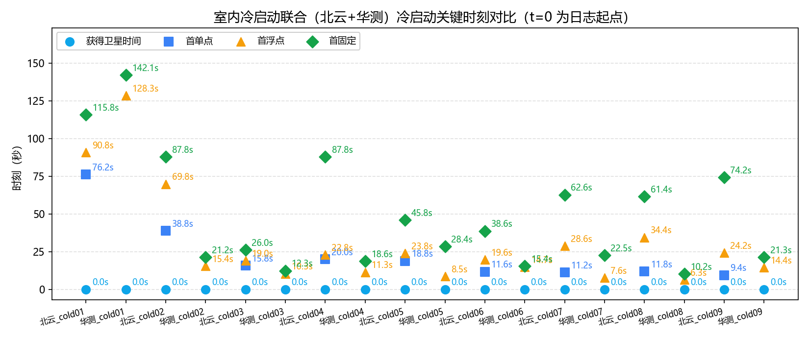
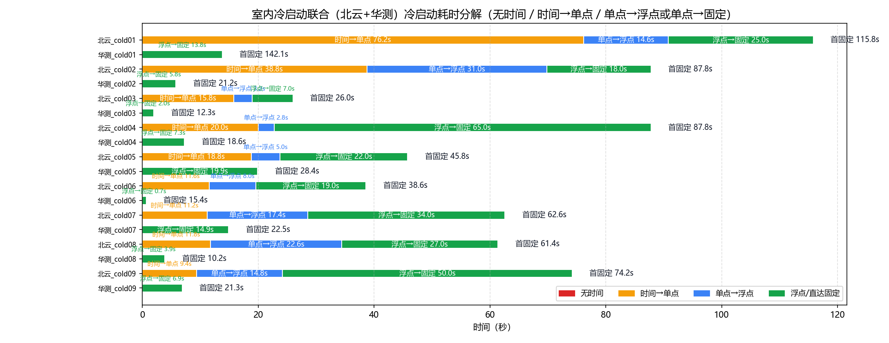

# 室内冷启动联合分析（北云 UG016 + 华测 M720）

- 数据源：`北云_cold01`、`华测_cold01`、`北云_cold02`、`华测_cold02`、`北云_cold03`、`华测_cold03`、`北云_cold04`、`华测_cold04`、`北云_cold05`、`华测_cold05`、`北云_cold06`、`华测_cold06`、`北云_cold07`、`华测_cold07`、`北云_cold08`、`华测_cold08`、`北云_cold09`、`华测_cold09`（定位流来源见下表）
- 口径依据：北云科技《UG016 数据通信接口协议》（文本转录：`by_manual\UG016.md`）
- 分析维度：时标状态 / 解算状态 / 定位类型 / 卫星数；本报告不含 INS

## 一、数据完整性与报文构成

| 文件 | 时长 | 定位报文 | 实测周期 | 时标分布(条) | 定位类型分布(条) | 间断/重定标 |
|---|---|---|---|---|---|---|
| `北云_cold01` | 149.8s | BESTGNSSPOSA 750条；0.2s/5.0Hz | `{'COARSE': 450, 'FINESTEERING': 280, 'FREEWHEELING': 20}` | `{'NONE': 405, 'SINGLE': 75, 'NARROW_FLOAT': 125, 'NARROW_INT': 137, 'PSRDIFF': 8}` | 0 / 1 |
| `华测_cold01` | 244.7s | RTKPA 2448条；0.1s/10.0Hz | `{'COARSESTEERING': 1242, 'FINESTEERING': 1206}` | `{'NONE': 1354, 'NARROW_FLOAT': 67, 'NARROW_INT': 1027}` | 0 / 0 |
| `北云_cold02` | 111.6s | BESTGNSSPOSA 559条；0.2s/5.0Hz | `{'COARSE': 250, 'FINESTEERING': 305, 'FREEWHEELING': 4}` | `{'NONE': 200, 'SINGLE': 155, 'NARROW_FLOAT': 90, 'NARROW_INT': 103, 'PSRDIFF': 11}` | 0 / 0 |
| `华测_cold02` | 122.9s | RTKPA 1230条；0.1s/10.0Hz | `{'COARSESTEERING': 121, 'FINESTEERING': 1109}` | `{'NONE': 161, 'NARROW_FLOAT': 52, 'NARROW_INT': 1017}` | 0 / 0 |
| `北云_cold03` | 97.2s | BESTGNSSPOSA 487条；0.2s/5.0Hz | `{'COARSE': 136, 'FINESTEERING': 351}` | `{'NONE': 79, 'SINGLE': 16, 'NARROW_FLOAT': 35, 'NARROW_INT': 357}` | 0 / 0 |
| `华测_cold03` | 97.2s | RTKPA 973条；0.1s/10.0Hz | `{'FINESTEERING': 972, 'COARSESTEERING': 1}` | `{'NONE': 103, 'NARROW_FLOAT': 20, 'NARROW_INT': 850}` | 0 / 0 |
| `北云_cold04` | 94.6s | BESTGNSSPOSA 474条；0.2s/5.0Hz | `{'COARSE': 170, 'FINESTEERING': 304}` | `{'NONE': 100, 'SINGLE': 14, 'NARROW_FLOAT': 324, 'PSRDIFF': 1, 'NARROW_INT': 35}` | 0 / 0 |
| `华测_cold04` | 98.8s | RTKPA 989条；0.1s/10.0Hz | `{'COARSESTEERING': 43, 'FINESTEERING': 946}` | `{'NONE': 142, 'NARROW_FLOAT': 44, 'NARROW_INT': 803}` | 0 / 0 |
| `北云_cold05` | 103.8s | BESTGNSSPOSA 520条；0.2s/5.0Hz | `{'COARSE': 160, 'FINESTEERING': 360}` | `{'NONE': 94, 'SINGLE': 25, 'NARROW_FLOAT': 110, 'NARROW_INT': 291}` | 0 / 0 |
| `华测_cold05` | 109.7s | RTKPA 1098条；0.1s/10.0Hz | `{'FINESTEERING': 1093, 'COARSESTEERING': 5}` | `{'NONE': 98, 'NARROW_FLOAT': 186, 'NARROW_INT': 814}` | 0 / 0 |
| `北云_cold06` | 94.6s | BESTGNSSPOSA 474条；0.2s/5.0Hz | `{'COARSE': 149, 'FINESTEERING': 325}` | `{'NONE': 58, 'SINGLE': 40, 'NARROW_FLOAT': 95, 'NARROW_INT': 281}` | 0 / 0 |
| `华测_cold06` | 98.9s | RTKPA 990条；0.1s/10.0Hz | `{'COARSESTEERING': 80, 'FINESTEERING': 910}` | `{'NONE': 148, 'NARROW_FLOAT': 8, 'NARROW_INT': 834}` | 0 / 0 |
| `北云_cold07` | 99.4s | BESTGNSSPOSA 498条；0.2s/5.0Hz | `{'COARSE': 149, 'FINESTEERING': 349}` | `{'NONE': 56, 'SINGLE': 87, 'NARROW_FLOAT': 170, 'NARROW_INT': 185}` | 0 / 1 |
| `华测_cold07` | 100.3s | RTKPA 1004条；0.1s/10.0Hz | `{'COARSESTEERING': 12, 'FINESTEERING': 992}` | `{'NONE': 116, 'NARROW_FLOAT': 110, 'NARROW_INT': 778}` | 0 / 0 |
| `北云_cold08` | 93.8s | BESTGNSSPOSA 470条；0.2s/5.0Hz | `{'COARSE': 178, 'FINESTEERING': 292}` | `{'NONE': 59, 'SINGLE': 113, 'NARROW_FLOAT': 135, 'NARROW_INT': 163}` | 0 / 0 |
| `华测_cold08` | 95.7s | RTKPA 958条；0.1s/10.0Hz | `{'COARSESTEERING': 16, 'FINESTEERING': 942}` | `{'NONE': 73, 'NARROW_FLOAT': 29, 'NARROW_INT': 856}` | 0 / 0 |
| `北云_cold09` | 99.6s | BESTGNSSPOSA 499条；0.2s/5.0Hz | `{'COARSE': 127, 'FINESTEERING': 372}` | `{'NONE': 47, 'SINGLE': 74, 'NARROW_FLOAT': 250, 'NARROW_INT': 128}` | 0 / 0 |
| `华测_cold09` | 106.7s | RTKPA 1068条；0.1s/10.0Hz | `{'COARSESTEERING': 60, 'FINESTEERING': 1008}` | `{'NONE': 160, 'NARROW_FLOAT': 53, 'NARROW_INT': 855}` | 0 / 0 |

> 口径（UG016）：报文按行做 CRC 校验（`#` 开头为 32 位 CRC，`$` 开头为 NMEA 异或）；`$KSXT` 为自定义 8 位 CRC32 私有报文，按 NMEA 异或校验判失败属正常、非故障。卫星维度口径：#SVs=跟踪卫星数、#solnSVs=参与解算卫星数、#solnMultiSVs=参与解算的多频卫星数。

### 报文完整性与周期（按报头时间戳逐帧判定）

| 文件 | 帧数 | 实测周期 | 标称频率 | CRC失败行 | 真实间断 | 周重定标 |
|---|---|---|---|---|---|---|
| `北云_cold01` | 750 | 0.2s | 5.0Hz | 0 | 0 | 1 |
| `华测_cold01` | 2448 | 0.1s | 10.0Hz | 0 | 0 | 0 |
| `北云_cold02` | 559 | 0.2s | 5.0Hz | 0 | 0 | 0 |
| `华测_cold02` | 1230 | 0.1s | 10.0Hz | 0 | 0 | 0 |
| `北云_cold03` | 487 | 0.2s | 5.0Hz | 0 | 0 | 0 |
| `华测_cold03` | 973 | 0.1s | 10.0Hz | 0 | 0 | 0 |
| `北云_cold04` | 474 | 0.2s | 5.0Hz | 0 | 0 | 0 |
| `华测_cold04` | 989 | 0.1s | 10.0Hz | 0 | 0 | 0 |
| `北云_cold05` | 520 | 0.2s | 5.0Hz | 0 | 0 | 0 |
| `华测_cold05` | 1098 | 0.1s | 10.0Hz | 0 | 0 | 0 |
| `北云_cold06` | 474 | 0.2s | 5.0Hz | 0 | 0 | 0 |
| `华测_cold06` | 990 | 0.1s | 10.0Hz | 0 | 0 | 0 |
| `北云_cold07` | 498 | 0.2s | 5.0Hz | 0 | 0 | 1 |
| `华测_cold07` | 1004 | 0.1s | 10.0Hz | 0 | 0 | 0 |
| `北云_cold08` | 470 | 0.2s | 5.0Hz | 0 | 0 | 0 |
| `华测_cold08` | 958 | 0.1s | 10.0Hz | 0 | 0 | 0 |
| `北云_cold09` | 499 | 0.2s | 5.0Hz | 0 | 0 | 0 |
| `华测_cold09` | 1068 | 0.1s | 10.0Hz | 0 | 0 | 0 |

> 实测周期 = 全部相邻帧报头时间差的中位数（不假设）；真实间断 = 相邻帧时间差 > 2.5×实测周期（保留在时间轴中）；周重定标 = 相邻帧时间差 > 3600s（按时间连续处理）。

## 二、四个关键时刻（秒）

| 文件 | 获得卫星时间(脱离UNKNOWN) | COARSE→FINE | 差分改正可用 | 首单点 | 首浮点 | 首固定 | 无解/单点/浮点/固定 占比% | 跟踪星 min/均值/max |
|---|---|---|---|---|---|---|---|---|
| `北云_cold01` | **0.0s** | 0.0s → 90.0s | 77.6s | 76.2s | 90.8s | **115.8s** | 54.0/11.1/16.7/18.3 | 0/22.8/38 |
| `华测_cold01` | **0.0s** | 0.0s → 120.1s | 128.3s | — | 128.3s | **142.1s** | 55.3/0/2.7/42.0 | 3/18.8/44 |
| `北云_cold02` | **0.0s** | 0.0s → 50.0s | 49.4s | 38.8s | 69.8s | **87.8s** | 35.8/29.7/16.1/18.4 | 0/26.2/34 |
| `华测_cold02` | **0.0s** | 0.0s → 12.1s | 15.4s | — | 15.4s | **21.2s** | 13.1/0/4.2/82.7 | 3/30.4/43 |
| `北云_cold03` | **0.0s** | 0.0s → 27.2s | 17.8s | 15.8s | 19.0s | **26.0s** | 16.2/3.3/7.2/73.3 | 4/23.0/33 |
| `华测_cold03` | **0.0s** | 0.4s → 0.0s | 10.3s | — | 10.3s | **12.3s** | 10.6/0/2.1/87.4 | 10/30.8/40 |
| `北云_cold04` | **0.0s** | 0.0s → 34.0s | 21.6s | 20.0s | 22.8s | **87.8s** | 21.1/3.2/68.4/7.4 | 0/23.5/34 |
| `华测_cold04` | **0.0s** | 0.0s → 4.3s | 11.3s | — | 11.3s | **18.6s** | 14.4/0/4.4/81.2 | 2/29.9/41 |
| `北云_cold05` | **0.0s** | 0.0s → 32.0s | 22.4s | 18.8s | 23.8s | **45.8s** | 18.1/4.8/21.2/56.0 | 0/24.2/36 |
| `华测_cold05` | **0.0s** | 0.1s → 0.0s | 8.5s | — | 8.5s | **28.4s** | 8.9/0/16.9/74.1 | 8/31.4/43 |
| `北云_cold06` | **0.0s** | 0.0s → 29.8s | 18.4s | 11.6s | 19.6s | **38.6s** | 12.2/8.4/20.0/59.3 | 0/24.9/33 |
| `华测_cold06` | **0.0s** | 0.0s → 8.0s | 14.7s | — | 14.7s | **15.4s** | 14.9/0/0.8/84.2 | 2/30.7/43 |
| `北云_cold07` | **0.0s** | 0.0s → 29.8s | 17.6s | 11.2s | 28.6s | **62.6s** | 11.2/17.5/34.1/37.1 | 2/23.0/34 |
| `华测_cold07` | **0.0s** | 0.0s → 0.1s | 7.6s | — | 7.6s | **22.5s** | 11.6/0/11.0/77.5 | 3/31.5/44 |
| `北云_cold08` | **0.0s** | 0.0s → 35.6s | 33.0s | 11.8s | 34.4s | **61.4s** | 12.6/24.0/28.7/34.7 | 0/24.9/36 |
| `华测_cold08` | **0.0s** | 0.0s → 1.6s | 6.3s | — | 6.3s | **10.2s** | 7.6/0/3.0/89.4 | 6/32.7/43 |
| `北云_cold09` | **0.0s** | 0.0s → 25.4s | 10.8s | 9.4s | 24.2s | **74.2s** | 9.4/14.8/50.1/25.7 | 0/24.8/36 |
| `华测_cold09` | **0.0s** | 0.0s → 6.0s | 14.4s | — | 14.4s | **21.3s** | 15.0/0/5.0/80.1 | 3/31.2/42 |

## 三、冷启动耗时分解

### 表1：四阶段严格分解

| 文件 | 无时间 | 时间→单点 | 单点→浮点 | 浮点→固定 | 首固定 | 差分数据可用 |
|---|---|---|---|---|---|---|
| `北云_cold01` | 0.0s | 76.2s | 14.6s | 25.0s | **115.8s** | 77.6s |
| `华测_cold01` | 0.0s | — | — | 13.8s | **142.1s** | 128.3s |
| `北云_cold02` | 0.0s | 38.8s | 31.0s | 18.0s | **87.8s** | 49.4s |
| `华测_cold02` | 0.0s | — | — | 5.8s | **21.2s** | 15.4s |
| `北云_cold03` | 0.0s | 15.8s | 3.2s | 7.0s | **26.0s** | 17.8s |
| `华测_cold03` | 0.0s | — | — | 2.0s | **12.3s** | 10.3s |
| `北云_cold04` | 0.0s | 20.0s | 2.8s | 65.0s | **87.8s** | 21.6s |
| `华测_cold04` | 0.0s | — | — | 7.3s | **18.6s** | 11.3s |
| `北云_cold05` | 0.0s | 18.8s | 5.0s | 22.0s | **45.8s** | 22.4s |
| `华测_cold05` | 0.0s | — | — | 19.9s | **28.4s** | 8.5s |
| `北云_cold06` | 0.0s | 11.6s | 8.0s | 19.0s | **38.6s** | 18.4s |
| `华测_cold06` | 0.0s | — | — | 0.7s | **15.4s** | 14.7s |
| `北云_cold07` | 0.0s | 11.2s | 17.4s | 34.0s | **62.6s** | 17.6s |
| `华测_cold07` | 0.0s | — | — | 14.9s | **22.5s** | 7.6s |
| `北云_cold08` | 0.0s | 11.8s | 22.6s | 27.0s | **61.4s** | 33.0s |
| `华测_cold08` | 0.0s | — | — | 3.9s | **10.2s** | 6.3s |
| `北云_cold09` | 0.0s | 9.4s | 14.8s | 50.0s | **74.2s** | 10.8s |
| `华测_cold09` | 0.0s | — | — | 6.9s | **21.3s** | 14.4s |

### 表2：图示使用的路径汇总（支持无浮点直达固定）

| 文件 | 无时间 | 时间→单点 | 单点→浮点 | 浮点→固定 | 单点→固定 | 合计到首固定 |
|---|---|---|---|---|---|---|
| `北云_cold01` | 0.0s | 76.2s | 14.6s | 25.0s | — | 115.8s |
| `华测_cold01` | 0.0s | — | — | 13.8s | — | 13.8s |
| `北云_cold02` | 0.0s | 38.8s | 31.0s | 18.0s | — | 87.8s |
| `华测_cold02` | 0.0s | — | — | 5.8s | — | 5.8s |
| `北云_cold03` | 0.0s | 15.8s | 3.2s | 7.0s | — | 26.0s |
| `华测_cold03` | 0.0s | — | — | 2.0s | — | 2.0s |
| `北云_cold04` | 0.0s | 20.0s | 2.8s | 65.0s | — | 87.8s |
| `华测_cold04` | 0.0s | — | — | 7.3s | — | 7.3s |
| `北云_cold05` | 0.0s | 18.8s | 5.0s | 22.0s | — | 45.8s |
| `华测_cold05` | 0.0s | — | — | 19.9s | — | 19.9s |
| `北云_cold06` | 0.0s | 11.6s | 8.0s | 19.0s | — | 38.6s |
| `华测_cold06` | 0.0s | — | — | 0.7s | — | 0.7s |
| `北云_cold07` | 0.0s | 11.2s | 17.4s | 34.0s | — | 62.599999999999994s |
| `华测_cold07` | 0.0s | — | — | 14.9s | — | 14.9s |
| `北云_cold08` | 0.0s | 11.8s | 22.6s | 27.0s | — | 61.400000000000006s |
| `华测_cold08` | 0.0s | — | — | 3.9s | — | 3.9s |
| `北云_cold09` | 0.0s | 9.4s | 14.8s | 50.0s | — | 74.2s |
| `华测_cold09` | 0.0s | — | — | 6.9s | — | 6.9s |

## 四、定位类型分段统计

### `北云_cold01`

| 定位类型段 | 起–止(s) | 时长(s) | 条数 | 跟踪星 | 解算星 | 多频解算 |
|---|---|---|---|---|---|---|
| NONE | 0.0–76.0 | 76.2 | 381 | 14.6 | 0 | 0 |
| SINGLE | 76.2–90.6 | 14.6 | 73 | 27.4 | 10.5 | 10.5 |
| NARROW_FLOAT | 90.8–115.6 | 25.0 | 125 | 33.4 | 13.6 | 13.6 |
| NARROW_INT | 115.8–143.0 | 27.4 | 137 | 36.4 | 21.7 | 21.7 |
| PSRDIFF | 143.2–144.6 | 1.6 | 8 | 30.8 | 17.9 | 17.9 |
| SINGLE | 144.8–145.0 | 0.4 | 2 | 20 | 8.5 | 8.5 |
| NONE | 145.2–149.8 | 4.8 | 24 | 4.6 | 0 | 0 |

### `华测_cold01`

| 定位类型段 | 起–止(s) | 时长(s) | 条数 | 跟踪星 | 解算星 | 多频解算 |
|---|---|---|---|---|---|---|
| NONE | 0.0–128.2 | 128.3 | 1283 | 4.7 | 0 | 0 |
| NARROW_FLOAT | 128.3–128.4 | 0.2 | 2 | 16 | 14 | 12 |
| NONE | 128.5–128.5 | 0.1 | 1 | 16 | 0 | 0 |
| NARROW_FLOAT | 128.6–131.6 | 3.1 | 31 | 16 | 14 | 12.4 |
| NONE | 131.7–131.8 | 0.2 | 2 | 16 | 0 | 0 |
| NARROW_FLOAT | 131.9–131.9 | 0.1 | 1 | 17 | 15 | 13 |
| NONE | 132.0–132.1 | 0.2 | 2 | 17 | 0 | 0 |
| NARROW_FLOAT | 132.2–132.4 | 0.3 | 3 | 17 | 15 | 12.7 |
| NONE | 132.5–134.1 | 1.7 | 17 | 16.5 | 0 | 0 |
| NARROW_FLOAT | 134.2–134.3 | 0.2 | 2 | 16.5 | 15.5 | 14 |
| NONE | 134.4–136.0 | 1.7 | 17 | 17.1 | 0 | 0 |
| NARROW_FLOAT | 136.1–136.1 | 0.1 | 1 | 19 | 17 | 14 |
| NONE | 136.2–136.8 | 0.7 | 7 | 19 | 0 | 0 |
| NARROW_FLOAT | 136.9–136.9 | 0.1 | 1 | 19 | 17 | 14 |
| NONE | 137.0–138.6 | 1.7 | 17 | 19.1 | 0 | 0 |
| NARROW_FLOAT | 138.7–138.7 | 0.1 | 1 | 19 | 17 | 14 |
| NONE | 138.8–138.9 | 0.2 | 2 | 19 | 0 | 0 |
| NARROW_FLOAT | 139.0–139.8 | 0.9 | 9 | 19 | 17 | 15 |
| NONE | 139.9–139.9 | 0.1 | 1 | 19 | 0 | 0 |
| NARROW_FLOAT | 140.0–140.3 | 0.4 | 4 | 19.5 | 17.5 | 15.5 |
| NONE | 140.4–140.5 | 0.2 | 2 | 20 | 0 | 0 |
| NARROW_FLOAT | 140.6–140.8 | 0.3 | 3 | 20 | 18 | 16 |
| NONE | 140.9–140.9 | 0.1 | 1 | 20 | 0 | 0 |
| NARROW_FLOAT | 141.0–141.0 | 0.1 | 1 | 20 | 18 | 16 |
| NONE | 141.1–141.2 | 0.2 | 2 | 20 | 0 | 0 |
| NARROW_FLOAT | 141.3–142.0 | 0.8 | 8 | 20 | 18 | 16 |
| NARROW_INT | 142.1–244.7 | 102.7 | 1027 | 36.5 | 30.8 | 25.3 |

### `北云_cold02`

| 定位类型段 | 起–止(s) | 时长(s) | 条数 | 跟踪星 | 解算星 | 多频解算 |
|---|---|---|---|---|---|---|
| NONE | 0.0–38.6 | 38.8 | 194 | 18.9 | 0 | 0 |
| SINGLE | 38.8–69.6 | 31.0 | 155 | 27.7 | 11.9 | 11.9 |
| NARROW_FLOAT | 69.8–87.6 | 18.0 | 90 | 31.9 | 15.8 | 15.8 |
| NARROW_INT | 87.8–108.2 | 20.6 | 103 | 33.4 | 20.8 | 20.8 |
| PSRDIFF | 108.4–110.4 | 2.2 | 11 | 27.3 | 15.5 | 15.5 |
| NONE | 110.6–111.6 | 1.2 | 6 | 8.2 | 0 | 0 |

### `华测_cold02`

| 定位类型段 | 起–止(s) | 时长(s) | 条数 | 跟踪星 | 解算星 | 多频解算 |
|---|---|---|---|---|---|---|
| NONE | 0.0–15.3 | 15.4 | 154 | 6.2 | 0 | 0 |
| NARROW_FLOAT | 15.4–15.8 | 0.5 | 5 | 15.2 | 12.2 | 11 |
| NONE | 15.9–15.9 | 0.1 | 1 | 16 | 0 | 0 |
| NARROW_FLOAT | 16.0–16.3 | 0.4 | 4 | 17.5 | 14.5 | 12 |
| NONE | 16.4–16.6 | 0.3 | 3 | 18 | 0 | 0 |
| NARROW_FLOAT | 16.7–16.7 | 0.1 | 1 | 18 | 15 | 12 |
| NONE | 16.8–16.8 | 0.1 | 1 | 18 | 0 | 0 |
| NARROW_FLOAT | 16.9–17.0 | 0.2 | 2 | 18 | 15 | 12 |
| NONE | 17.1–17.2 | 0.2 | 2 | 18.5 | 0 | 0 |
| NARROW_FLOAT | 17.3–21.1 | 3.9 | 39 | 20.4 | 17.4 | 12.9 |
| NARROW_INT | 21.2–67.2 | 46.1 | 461 | 28.7 | 23.6 | 18.4 |
| NARROW_FLOAT | 67.3–67.3 | 0.1 | 1 | 34 | 27 | 21 |
| NARROW_INT | 67.4–122.9 | 55.6 | 556 | 39.7 | 32.1 | 25.9 |

### `北云_cold03`

| 定位类型段 | 起–止(s) | 时长(s) | 条数 | 跟踪星 | 解算星 | 多频解算 |
|---|---|---|---|---|---|---|
| NONE | 0.0–15.6 | 15.8 | 79 | 10.8 | 0 | 0 |
| SINGLE | 15.8–18.8 | 3.2 | 16 | 18.2 | 11.6 | 11.6 |
| NARROW_FLOAT | 19.0–25.8 | 7.0 | 35 | 20 | 14 | 14 |
| NARROW_INT | 26.0–97.2 | 71.4 | 357 | 26.3 | 16.4 | 16.4 |

### `华测_cold03`

| 定位类型段 | 起–止(s) | 时长(s) | 条数 | 跟踪星 | 解算星 | 多频解算 |
|---|---|---|---|---|---|---|
| NONE | 0.0–10.2 | 10.3 | 103 | 16.5 | 0 | 0 |
| NARROW_FLOAT | 10.3–12.2 | 2.0 | 20 | 21 | 17 | 12 |
| NARROW_INT | 12.3–97.2 | 85.0 | 850 | 32.8 | 26.8 | 21.3 |

### `北云_cold04`

| 定位类型段 | 起–止(s) | 时长(s) | 条数 | 跟踪星 | 解算星 | 多频解算 |
|---|---|---|---|---|---|---|
| NONE | 0.0–19.8 | 20.0 | 100 | 12.6 | 0 | 0 |
| SINGLE | 20.0–22.6 | 2.8 | 14 | 19.9 | 11.8 | 11.8 |
| NARROW_FLOAT | 22.8–34.2 | 11.6 | 58 | 21.1 | 14.1 | 14.1 |
| PSRDIFF | 34.4–34.4 | 0.2 | 1 | 22 | 14 | 14 |
| NARROW_FLOAT | 34.6–87.6 | 53.2 | 266 | 26.9 | 15.7 | 15.7 |
| NARROW_INT | 87.8–94.6 | 7.0 | 35 | 33.7 | 19.5 | 19.5 |

### `华测_cold04`

| 定位类型段 | 起–止(s) | 时长(s) | 条数 | 跟踪星 | 解算星 | 多频解算 |
|---|---|---|---|---|---|---|
| NONE | 0.0–11.2 | 11.3 | 113 | 12.0 | 0 | 0 |
| NARROW_FLOAT | 11.3–11.3 | 0.1 | 1 | 18 | 15 | 12 |
| NONE | 11.4–11.4 | 0.1 | 1 | 19 | 0 | 0 |
| NARROW_FLOAT | 11.5–11.5 | 0.1 | 1 | 19 | 16 | 11 |
| NONE | 11.6–11.6 | 0.1 | 1 | 18 | 0 | 0 |
| NARROW_FLOAT | 11.7–11.7 | 0.1 | 1 | 19 | 16 | 12 |
| NONE | 11.8–12.1 | 0.4 | 4 | 18.8 | 0 | 0 |
| NARROW_FLOAT | 12.2–12.4 | 0.3 | 3 | 18.7 | 15.7 | 11 |
| NONE | 12.5–14.3 | 1.9 | 19 | 19 | 0 | 0 |
| NARROW_FLOAT | 14.4–14.5 | 0.2 | 2 | 19 | 16 | 11 |
| NONE | 14.6–14.6 | 0.1 | 1 | 19 | 0 | 0 |
| NARROW_FLOAT | 14.7–15.1 | 0.5 | 5 | 19 | 16 | 11 |
| NONE | 15.2–15.2 | 0.1 | 1 | 19 | 0 | 0 |
| NARROW_FLOAT | 15.3–16.2 | 1.0 | 10 | 19.2 | 16 | 11 |
| NONE | 16.3–16.3 | 0.1 | 1 | 20 | 0 | 0 |
| NARROW_FLOAT | 16.4–17.5 | 1.2 | 12 | 20.4 | 16.4 | 11 |
| NONE | 17.6–17.6 | 0.1 | 1 | 21 | 0 | 0 |
| NARROW_FLOAT | 17.7–18.5 | 0.9 | 9 | 21 | 17 | 11 |
| NARROW_INT | 18.6–98.8 | 80.3 | 803 | 33.4 | 26.7 | 20.5 |

### `北云_cold05`

| 定位类型段 | 起–止(s) | 时长(s) | 条数 | 跟踪星 | 解算星 | 多频解算 |
|---|---|---|---|---|---|---|
| NONE | 0.0–18.6 | 18.8 | 94 | 10.8 | 0 | 0 |
| SINGLE | 18.8–23.6 | 5.0 | 25 | 17.2 | 10.3 | 10.3 |
| NARROW_FLOAT | 23.8–45.6 | 22.0 | 110 | 21.3 | 15.7 | 15.7 |
| NARROW_INT | 45.8–103.8 | 58.2 | 291 | 30.2 | 19.1 | 19.1 |

### `华测_cold05`

| 定位类型段 | 起–止(s) | 时长(s) | 条数 | 跟踪星 | 解算星 | 多频解算 |
|---|---|---|---|---|---|---|
| NONE | 0.0–8.4 | 8.5 | 85 | 14.9 | 0 | 0 |
| NARROW_FLOAT | 8.5–8.5 | 0.1 | 1 | 17 | 13 | 10 |
| NONE | 8.6–8.7 | 0.2 | 2 | 17.5 | 0 | 0 |
| NARROW_FLOAT | 8.8–8.8 | 0.1 | 1 | 17 | 13 | 10 |
| NONE | 8.9–8.9 | 0.1 | 1 | 17 | 0 | 0 |
| NARROW_FLOAT | 9.0–9.5 | 0.6 | 6 | 17.8 | 13.8 | 10 |
| NONE | 9.6–9.6 | 0.1 | 1 | 18 | 0 | 0 |
| NARROW_FLOAT | 9.7–10.3 | 0.7 | 7 | 17.7 | 13.7 | 10 |
| NONE | 10.4–10.4 | 0.1 | 1 | 17 | 0 | 0 |
| NARROW_FLOAT | 10.5–10.6 | 0.2 | 2 | 17.5 | 13.5 | 10 |
| NONE | 10.7–10.7 | 0.1 | 1 | 17 | 0 | 0 |
| NARROW_FLOAT | 10.8–11.7 | 1.0 | 10 | 17 | 13 | 10 |
| NONE | 11.8–11.8 | 0.1 | 1 | 17 | 0 | 0 |
| NARROW_FLOAT | 11.9–12.5 | 0.7 | 7 | 17 | 13 | 10 |
| NONE | 12.6–12.6 | 0.1 | 1 | 17 | 0 | 0 |
| NARROW_FLOAT | 12.7–13.0 | 0.4 | 4 | 17.2 | 13.2 | 10.2 |
| NONE | 13.1–13.1 | 0.1 | 1 | 18 | 0 | 0 |
| NARROW_FLOAT | 13.2–17.8 | 4.7 | 47 | 18.4 | 14.4 | 11.1 |
| NONE | 17.9–17.9 | 0.1 | 1 | 19 | 0 | 0 |
| NARROW_FLOAT | 18.0–22.2 | 4.3 | 43 | 20.9 | 16.1 | 11.4 |
| NONE | 22.3–22.3 | 0.1 | 1 | 23 | 0 | 0 |
| NARROW_FLOAT | 22.4–26.5 | 4.2 | 42 | 24 | 18 | 13.9 |
| NONE | 26.6–26.6 | 0.1 | 1 | 24 | 0 | 0 |
| NARROW_FLOAT | 26.7–28.0 | 1.4 | 14 | 26.3 | 20.3 | 15.9 |
| NONE | 28.1–28.1 | 0.1 | 1 | 27 | 0 | 0 |
| NARROW_FLOAT | 28.2–28.3 | 0.2 | 2 | 27 | 21 | 17 |
| NARROW_INT | 28.4–109.7 | 81.4 | 814 | 35.7 | 29.2 | 23.2 |

### `北云_cold06`

| 定位类型段 | 起–止(s) | 时长(s) | 条数 | 跟踪星 | 解算星 | 多频解算 |
|---|---|---|---|---|---|---|
| NONE | 0.0–11.4 | 11.6 | 58 | 8.1 | 0 | 0 |
| SINGLE | 11.6–19.4 | 8.0 | 40 | 18.1 | 11.7 | 11.7 |
| NARROW_FLOAT | 19.6–38.4 | 19.0 | 95 | 23.6 | 17.7 | 17.7 |
| NARROW_INT | 38.6–94.6 | 56.2 | 281 | 29.8 | 18.8 | 18.8 |

### `华测_cold06`

| 定位类型段 | 起–止(s) | 时长(s) | 条数 | 跟踪星 | 解算星 | 多频解算 |
|---|---|---|---|---|---|---|
| NONE | 0.0–14.6 | 14.7 | 147 | 9.4 | 0 | 0 |
| NARROW_FLOAT | 14.7–15.3 | 0.7 | 7 | 18.4 | 14.9 | 11 |
| NARROW_INT | 15.4–15.5 | 0.2 | 2 | 19 | 15 | 11 |
| NONE | 15.6–15.6 | 0.1 | 1 | 19 | 0 | 0 |
| NARROW_INT | 15.7–35.8 | 20.2 | 202 | 24.7 | 19.4 | 14.2 |
| NARROW_FLOAT | 35.9–35.9 | 0.1 | 1 | 27 | 22 | 17 |
| NARROW_INT | 36.0–98.9 | 63.0 | 630 | 37.8 | 30.6 | 24.4 |

### `北云_cold07`

| 定位类型段 | 起–止(s) | 时长(s) | 条数 | 跟踪星 | 解算星 | 多频解算 |
|---|---|---|---|---|---|---|
| NONE | 0.0–11.0 | 11.2 | 56 | 6.6 | 0 | 0 |
| SINGLE | 11.2–28.4 | 17.4 | 87 | 17.6 | 11.1 | 11.1 |
| NARROW_FLOAT | 28.6–62.4 | 34.0 | 170 | 22.4 | 17.6 | 17.6 |
| NARROW_INT | 62.6–99.4 | 37.0 | 185 | 31.2 | 18.1 | 18.1 |

### `华测_cold07`

| 定位类型段 | 起–止(s) | 时长(s) | 条数 | 跟踪星 | 解算星 | 多频解算 |
|---|---|---|---|---|---|---|
| NONE | 0.0–7.5 | 7.6 | 76 | 14.3 | 0 | 0 |
| NARROW_FLOAT | 7.6–8.4 | 0.9 | 9 | 18 | 14 | 11 |
| NONE | 8.5–8.6 | 0.2 | 2 | 18 | 0 | 0 |
| NARROW_FLOAT | 8.7–8.8 | 0.2 | 2 | 18 | 14 | 11 |
| NONE | 8.9–9.0 | 0.2 | 2 | 18 | 0 | 0 |
| NARROW_FLOAT | 9.1–9.3 | 0.3 | 3 | 18 | 14 | 11 |
| NONE | 9.4–9.8 | 0.5 | 5 | 18 | 0 | 0 |
| NARROW_FLOAT | 9.9–9.9 | 0.1 | 1 | 19 | 15 | 11 |
| NONE | 10.0–10.0 | 0.1 | 1 | 19 | 0 | 0 |
| NARROW_FLOAT | 10.1–10.5 | 0.5 | 5 | 18.8 | 14.8 | 10.6 |
| NONE | 10.6–11.4 | 0.9 | 9 | 19.7 | 0 | 0 |
| NARROW_FLOAT | 11.5–11.5 | 0.1 | 1 | 20 | 16 | 10 |
| NONE | 11.6–11.6 | 0.1 | 1 | 20 | 0 | 0 |
| NARROW_FLOAT | 11.7–11.7 | 0.1 | 1 | 20 | 16 | 11 |
| NONE | 11.8–12.0 | 0.3 | 3 | 20 | 0 | 0 |
| NARROW_FLOAT | 12.1–12.1 | 0.1 | 1 | 20 | 16 | 11 |
| NONE | 12.2–12.2 | 0.1 | 1 | 20 | 0 | 0 |
| NARROW_FLOAT | 12.3–12.3 | 0.1 | 1 | 20 | 16 | 11 |
| NONE | 12.4–12.4 | 0.1 | 1 | 20 | 0 | 0 |
| NARROW_FLOAT | 12.5–12.5 | 0.1 | 1 | 20 | 16 | 11 |
| NONE | 12.6–12.6 | 0.1 | 1 | 20 | 0 | 0 |
| NARROW_FLOAT | 12.7–12.7 | 0.1 | 1 | 20 | 16 | 12 |
| NONE | 12.8–12.9 | 0.2 | 2 | 20.5 | 0 | 0 |
| NARROW_FLOAT | 13.0–13.0 | 0.1 | 1 | 21 | 17 | 12 |
| NONE | 13.1–14.0 | 1.0 | 10 | 20 | 0 | 0 |
| NARROW_FLOAT | 14.1–16.9 | 2.9 | 29 | 21.4 | 17.4 | 13.0 |
| NONE | 17.0–17.0 | 0.1 | 1 | 22 | 0 | 0 |
| NARROW_FLOAT | 17.1–17.4 | 0.4 | 4 | 22 | 18 | 13 |
| NONE | 17.5–17.5 | 0.1 | 1 | 23 | 0 | 0 |
| NARROW_FLOAT | 17.6–22.4 | 4.9 | 49 | 23.5 | 19.5 | 13 |
| NARROW_INT | 22.5–65.7 | 43.3 | 433 | 30.8 | 25.8 | 18.6 |
| NARROW_FLOAT | 65.8–65.8 | 0.1 | 1 | 35 | 31 | 22 |
| NARROW_INT | 65.9–100.3 | 34.5 | 345 | 40.5 | 34.3 | 26.5 |

### `北云_cold08`

| 定位类型段 | 起–止(s) | 时长(s) | 条数 | 跟踪星 | 解算星 | 多频解算 |
|---|---|---|---|---|---|---|
| NONE | 0.0–11.6 | 11.8 | 59 | 8.2 | 0 | 0 |
| SINGLE | 11.8–34.2 | 22.6 | 113 | 19.8 | 13.5 | 13.5 |
| NARROW_FLOAT | 34.4–61.2 | 27.0 | 135 | 25.4 | 18 | 18 |
| NARROW_INT | 61.4–93.8 | 32.6 | 163 | 34.0 | 20.2 | 20.2 |

### `华测_cold08`

| 定位类型段 | 起–止(s) | 时长(s) | 条数 | 跟踪星 | 解算星 | 多频解算 |
|---|---|---|---|---|---|---|
| NONE | 0.0–6.2 | 6.3 | 63 | 12.8 | 0 | 0 |
| NARROW_FLOAT | 6.3–6.3 | 0.1 | 1 | 17 | 15 | 10 |
| NONE | 6.4–6.5 | 0.2 | 2 | 17 | 0 | 0 |
| NARROW_FLOAT | 6.6–6.6 | 0.1 | 1 | 17 | 15 | 10 |
| NONE | 6.7–6.7 | 0.1 | 1 | 17 | 0 | 0 |
| NARROW_FLOAT | 6.8–6.8 | 0.1 | 1 | 17 | 15 | 10 |
| NONE | 6.9–7.3 | 0.5 | 5 | 17 | 0 | 0 |
| NARROW_FLOAT | 7.4–9.3 | 2.0 | 20 | 19.4 | 16.6 | 10.9 |
| NONE | 9.4–9.4 | 0.1 | 1 | 20 | 0 | 0 |
| NARROW_FLOAT | 9.5–9.8 | 0.4 | 4 | 20 | 17 | 11.8 |
| NONE | 9.9–9.9 | 0.1 | 1 | 20 | 0 | 0 |
| NARROW_FLOAT | 10.0–10.1 | 0.2 | 2 | 20 | 17 | 12 |
| NARROW_INT | 10.2–95.7 | 85.6 | 856 | 34.8 | 29.5 | 22.2 |

### `北云_cold09`

| 定位类型段 | 起–止(s) | 时长(s) | 条数 | 跟踪星 | 解算星 | 多频解算 |
|---|---|---|---|---|---|---|
| NONE | 0.0–9.2 | 9.4 | 47 | 7.7 | 0 | 0 |
| SINGLE | 9.4–24.0 | 14.8 | 74 | 17.3 | 12.4 | 12.4 |
| NARROW_FLOAT | 24.2–74.0 | 50.0 | 250 | 25.3 | 17.9 | 17.9 |
| NARROW_INT | 74.2–99.6 | 25.6 | 128 | 34.3 | 19.0 | 19.0 |

### `华测_cold09`

| 定位类型段 | 起–止(s) | 时长(s) | 条数 | 跟踪星 | 解算星 | 多频解算 |
|---|---|---|---|---|---|---|
| NONE | 0.0–14.3 | 14.4 | 144 | 10.5 | 0 | 0 |
| NARROW_FLOAT | 14.4–15.2 | 0.9 | 9 | 18.4 | 16.4 | 10.8 |
| NONE | 15.3–16.7 | 1.5 | 15 | 20.1 | 0 | 0 |
| NARROW_FLOAT | 16.8–17.5 | 0.8 | 8 | 21 | 18 | 13 |
| NONE | 17.6–17.6 | 0.1 | 1 | 21 | 0 | 0 |
| NARROW_FLOAT | 17.7–21.2 | 3.6 | 36 | 22.1 | 19.1 | 13.6 |
| NARROW_INT | 21.3–106.7 | 85.5 | 855 | 35.5 | 30.8 | 23.7 |

## 附录：口径与手册条款对应

| 报告字段 | 数据来源 | 手册条款 | 说明 |
|---|---|---|---|
| 获得卫星时间 | BESTGNSSPOSA 报头 Time Status 首次脱离 UNKNOWN | 报头字段 6 | UNKNOWN 表明尚未计算出准确的 GPS 时间 |
| COARSE→FINE | Time Status 首次 COARSE / FINESTEERING | 报头字段 6 | UNKNOWN / COARSE / FINESTEERING 三态 |
| 首单点 / 首浮点 / 首固定 | 位置类型 Pos Type 首次 SINGLE / NARROW_FLOAT / NARROW_INT | 表 4-2 | SINGLE=16 单点解；NARROW_FLOAT=34 窄带浮点解；NARROW_INT=50 窄带固定解 |
| 差分改正可用 | Stn ID 非空且 != "0" | 4.2.2 字段 12 | 差分站台 ID 号；单点定位时 ID 为 0；基站 ID 随数据动态变化 |
| 无解段解算状态 | Sol Type = INSUFFICIENT_OBS / VARIANCE | 表 4-1 | 观测量不足 / 方差超过限值；SOL_COMPUTED=完全解算；COLD_START=冷启动尚未完全解算 |
| 跟踪星 / 解算星 / 多频解算 | #SVs / #solnSVs / #solnMultiSVs | 4.2.2 字段 15/16/18 | 跟踪卫星数 / 解算卫星数 / 多频解算卫星数 |

> 时间轴为录制经过时间（t=0 为各日志首条记录）；若出现冷启动 GPS 周重定标（相邻两条报头时间差 >3600s），按时间连续处理（间隔按标称周期计）。
> 说明：“获得卫星时间”为“—”表示该产品该次启动时标未丢失（如北斗 UM980 断电后由内部电池保持 GPS 时间），不参与对比；“多频解算”为“—”表示该产品报文无 #solnMultiSVs 字段（如北斗 BESTNAV 表 7-70）。